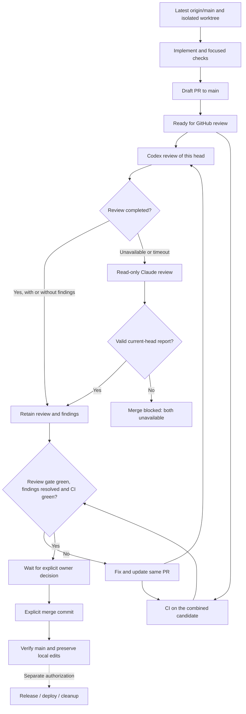

# Integration rules: preserve approved work through pull requests

This is the operational source for integration. `AGENTS.md` owns architecture and
product contracts; `REVIEW.md` owns review criteria; `docs/testing.md` owns check
commands. Historical plans and an incoming worktree's older instructions do not
replace the current policy. The former direct-push exception is superseded.

## Authorization and the current automation

Commit, branch push, PR creation, merge, release, deployment and cleanup are
separate actions. Use existing explicit authorization without asking again;
never infer authorization for the next action from the preceding one.
«كومت ودمج» authorizes committing the requested work and integrating that scope;
GitHub publication still needs push authorization. If publication is not authorized,
prepare and verify a local candidate and report the pending delivery step.
Do not silently fall back to a local `main` merge as a second delivery route.

Create authorized PRs as **drafts**. Keep them draft while scope, local checks or
prepublication inspection are incomplete. Mark ready to request GitHub review;
ready never means permission to merge. The CI
workflow has no merge job and repository auto-merge stays disabled. Only an
explicit owner instruction for the reviewed scope permits the coordinator to
merge; existing explicit approval remains valid without asking again. New scope
needs its own decision. Never enable auto-merge, use an administrative bypass or
weaken checks to get a candidate through.

The required `ci-result` check must come from GitHub Actions and the PR must be
up to date with `main`. Every selected stage must actually succeed; only
unselected stages may be skipped. Missing jobs, failure and cancellation block
integration. Review findings must be resolved. A recorded review can be an
agent's review: the repository currently has one writer, so it does not require
a formal approval from a nonexistent second account. Owner authorization is a
workflow rule, not an automated check of the conversation.

## Two review providers, one decision

The `pr-review` workflow starts when a same-repository owner/approved-bot PR becomes ready,
is reopened or receives commits. Codex is primary; Claude Code is a bounded
fallback if Codex does not complete within five minutes or the request fails.
An actual review with findings is complete and never triggers a softer reviewer.
The controller supplies the complete diff as data; Claude has no tools or
filesystem access and returns a structured report. A separate
non-model job publishes it on GitHub. Current-head reviews are required; an old
head, an incomplete report or two unavailable services cannot yield a green
`code-review`. P0/P1 fallback findings and explicit Codex change requests fail it.
Other review findings remain for resolution and the owner's decision.

Prerequisites: Codex code review enabled for this repository and a valid Claude
subscription token in the existing main-only `agent` environment. No paid API
fallback is configured. The workflow uses trusted base code, never PR checkout
or PR commands with secrets. Both providers can be temporarily unavailable;
report that state and keep the merge blocked.

## Six integration steps

1. **Record the live baseline.** Read the canonical checkout's current policy
   and compare it with the latest committed remote policy. Inspect both
   worktrees' dirty paths and owners. Fetch `origin` without resetting a checkout
   or pruning refs; record local `main`, remote `main`, incoming branch/head,
   PR state and active claims. Remote `main` is the delivery baseline; local
   `main` can be stale. Resolve policy conflicts with the current owner decision.
2. **Prepare one candidate.** Work in an isolated, claimed worktree. Bring the
   latest remote `main` into the candidate without rebasing another owner's
   branch. An independent task uses its own PR. A coupled batch uses
   `codex/tools-integrate-<slug>`, merging only its agreed branches with merge
   commits and one PR to `main`. Preserve incoming commits and approved behavior;
   do not replace entire files, use blanket `ours`/`theirs`, reset `main` to an
   incoming tree or treat ancestry as proof behavior survives. Regenerate API
   artifacts once on the integration branch when its routes/contracts change.
3. **Review the complete delta.** Compare the candidate with the recorded
   remote baseline, including deletions, shared UI, navigation, permissions,
   contracts, migrations and regression tests. Review the actual diff following
   `REVIEW.md`; addon/contract changes need Odoo-aware review. Keep compatible
   prior decisions. If the request conflicts with one, preserve it and ask for
   that specific decision; general merge authorization does not reverse it.
4. **Verify the combined result.** Run focused checks, `npm test`, Git and
   architecture policies against the recorded baseline, and the affected
   layers' checks from `docs/testing.md`. Odoo checks use isolated scratch
   databases, never `odoo19`. Record commands, commit, environment, pass/fail and
   gaps in the PR. Retain baseline regression requirements. Diagnose failures;
   a reproduced baseline failure is still disclosed, not silently waived.
   After local preparation, mark the PR ready to request GitHub review. Require
   successful `ci-result`, current-head `code-review` and every selected stage on the current PR
   candidate; inspect skipped stages and scope. A prior green head, local test
   run or merge conflict check alone does not establish readiness.
5. **Authorize and merge the reviewed candidate.** Wait for current-head GitHub review and CI after marking ready.
   Ready does not authorize merge. With
   the owner's explicit merge authorization, reread remote `main`, PR head,
   draft state and check runs immediately before merging.
   If the base or head moved, update the candidate and repeat affected checks
   and review. Use a merge commit to retain branch ancestry. For a manual merge,
   use `gh pr merge <number> --merge --match-head-commit <reviewed-head-sha>`;
   this pins the head only, so the base must also be rechecked. Do not bypass a
   failing check, overwrite another writer or push local `main` over GitHub.
6. **Verify and synchronize.** Confirm the PR is merged and record its actual
   merge SHA and post-merge CI result. Fetch and compare local/remote `main`.
   Fast-forward local `main` only when behind without divergence and clean,
   or after proving every dirty/untracked path is disjoint from the incoming
   changes (including directory collisions), saving a byte-level snapshot of
   those paths, and verifying it unchanged afterward. If that cannot be proved,
   leave the checkout intact and report it. Never auto-stash,
   reset, force-push or discard edits to synchronize. Release and deployment
   need their own authorization and evidence. Cleanup is a separate action:
   ancestry alone does not preserve uncommitted, untracked or ignored files,
   scratch data or runtime state. Inspect ownership, preservation and process
   use, then use the authorized `tools/wt.py gc` path.

## PR handoff

Use the repository PR template. Name one bounded outcome, included branches and
prerequisites; record baseline/head, verification evidence, review findings and
unverified areas. Dependent branches declare the prerequisite and stay draft
until tested against the intended combined result. When the parent merges,
update and retest the child against current `main`; do not deliver inherited
changes twice. A clean merge simulation proves textual compatibility only.

## Enforced GitHub rules and their limit

The target `protect-main` configuration requires a PR, `ci-result` and
`code-review` from GitHub Actions on an up-to-date branch, resolved review threads
and merge commits. It blocks deletion
and non-fast-forward updates and has no bypass actors. Repository auto-merge is
disabled and the `ci` workflow carries read-only permissions, with no merge job.
Verify those live settings before delivery; this document cannot enforce itself.

There is no formal second-account approval requirement while the owner is the
only writer. The review and owner's merge decision are recorded in the PR.
An administrator can still edit repository settings; removing the ruleset's
bypass does not remove that administrative ability. CI success is verification
of the checked candidate, not release, deployment or cleanup authorization.

### First activation

The new `pull_request_target` review workflow runs only after it exists on trusted
`main`. Bootstrap this policy PR with a recorded GitHub review and current CI,
then an explicit owner merge decision. Add the required `code-review` context
immediately after that normal PR merge, before any subsequent delivery; requiring
it before its producer exists would deadlock the bootstrap. Do not use an admin
bypass, direct push, untrusted PR checkout or weakened environment to bootstrap.
Verify both providers live before claiming the failover is operational.

## Delivery flow

