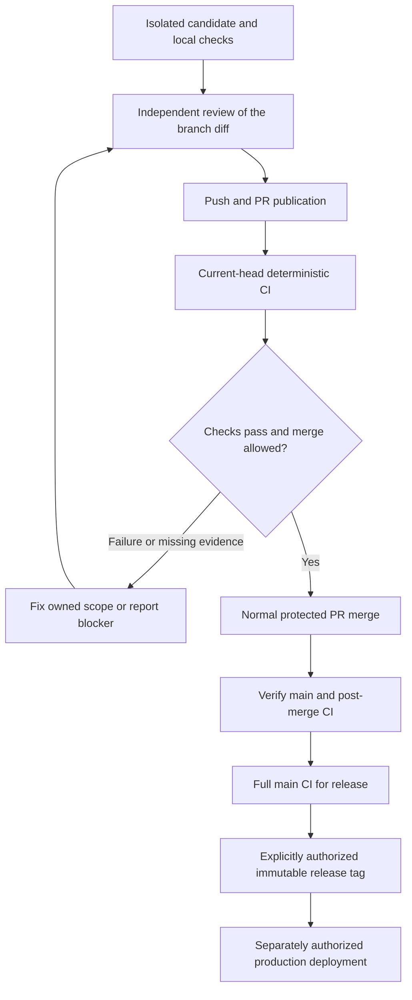

# Integration rules: preserve approved work through pull requests

This is the operational source for integration. `AGENTS.md` owns architecture and
product contracts; `REVIEW.md` owns review criteria; `docs/testing.md` owns check
commands. Historical plans and an incoming worktree's older instructions do not
replace the current policy. The former direct-push exception is superseded.

## Authorization and deterministic CI

The owner's 2026-10-24 reset keeps normal deterministic CI and removes the
model-driven review, repair, merge and release controllers. The required
status-check policy is **`ci-result` only**, on the current PR head. Review of the
actual diff still follows `REVIEW.md`; any selected available agent or a human
may perform it, without an exclusive model requirement or paid API fallback.

Keep a PR draft while local preparation is incomplete. Marking ready requests
CI and review; it does not by itself authorize publication, merging or release.
A local commit is covered by the standing authorization below; publication, merging,
release, deployment and the other excluded operations need the owner's explicit words for
their scope. Prior approved product, access and data decisions remain binding. New
changes require updated evidence and any authorization their scope needs.

The `ci` workflow reports checks; it does not repair code, merge PRs, create tags or deploy. The `publish` workflow runs only on `main` and release tags and calls the staging hook on release tags as described in the flow below.
Task authorization, remote publication, merge, release, production deployment
and cleanup remain distinct operations. Local consolidation authority does not
authorize a remote push or production deployment. Missing services, stale checks and failed
checks never justify bypassing branch protection.

### Standing authorization (owner decision 2026-11-11)

The owner authorizes every agent (Claude and Codex), in every session, to do the following
without asking each time, provided the evidence rules of this file hold:

- commit the task's work locally on its task branch;
- resolve a review thread after verifying the fix in the code;
- after a merge, return the lane with `python3 -B tools/wt.py done`, or remove a temporary
  lane with `python3 -B tools/wt.py lane remove <name>`, once the content is preserved and no
  process uses the worktree (step 6).

Publication and merging need the owner's explicit words in the current conversation, each
for its own step: pushing a branch, opening a pull request, moving it from draft to ready,
merging it, and enabling auto-merge. No new pull request is opened unless the owner asks
for one. The owner keywords below are explicit words for the steps they name. Words given
for one branch, one PR or one conversation do not carry to the next. The 2026-11-08
authorization, which also covered push, PR, ready and merge, is superseded.

Also excluded, and needing the owner's explicit words each time: a `release/19.0.X.Y.Z`
tag («انشر على الاستيج»), deploying to production («انشر على الإنتاج»), deploying to any other server by hand, force-push or history rewrite, a direct push to `main`,
bypassing branch protection or a failing check, and merging unrelated worktrees.
Changes to external source versions still follow [UPDATE_POLICY.md](../UPDATE_POLICY.md).
Missing, stale or failing checks never widen this authorization.

Fix-alone scope: within its task an agent fixes or deletes errors, stale text and
dead code without asking. A change in behavior the user can see, or reversing a
recorded owner decision, goes to the owner as options with a recommended default.

Owner keywords:

- «كومت ودمج» means: commit the requested work and prepare its integration against
  the latest remote `main`, preserving previously approved behavior and adding the
  requested changes, then follow the six steps. It does not authorize undoing an
  earlier decision, merging unrelated worktrees or deleting recovery material.
- «انشر» means: commit, run the checks, get the independent review and fix its findings,
  push the task branch, open the PR, mark it ready,
  merge it after current-head `ci-result` is green, and return the lane (`wt done`, or `wt lane remove` for a temporary lane). It never means a direct push to `main`,
  a release tag, or a deployment to staging or production. Nothing follows `main` by itself: a merge
  updates no environment (see [the flow](#from-task-branch-to-each-environment-owner-decision-2026-11-21)).
- «دمج» or «ادمج» means: merge the work the owner is pointing at into `main` through its PR,
  following the six steps. These are also the words that allow enabling auto-merge on that PR.
  When that work has no PR yet, the word covers pushing its branch, after the independent
  review, and opening the PR. It never means a direct push to `main`, a release tag, or a deployment to staging or production (a merge updates no environment, as under «انشر»).
- «انشر على الاستيج» means: create and push the tag `release/19.0.X.Y.Z` on a `main` commit that passed the release checks below, so that the staging environment updates through its hook. It
  needs that commit to be on `main` already; with the work still on a branch, «انشر» comes first. It never
  means production.
- «انشر على الإنتاج» means: release to production the tag that staging already served and passed, by starting
  the production job from Openship. If `main` is ahead of the staged tag, the answer says so; it does not
  stage silently. «انشر» alone never reaches staging or production.

### Review-approval constraint on `protect-main` (recorded 2026-10-24)

The active `protect-main` ruleset requires `ci-result` on the current head, blocks
force-pushes and deletions, and requires every review conversation resolved, but
sets `required_approving_review_count` to `0`. The repository has a single human
account, and GitHub does not let an author approve their own pull request, so any
higher count or `require_last_push_approval` would block every merge, including
the owner's own. The owner therefore keeps the count at `0` and accepts that a
PR author can merge their own PR once current-head `ci-result` is green.

This is a recorded gap, not an approval of self-merge quality. Raising the count
becomes possible as soon as a second collaborator exists; until then, the
independent review below is a rule of this file and does not gate the merge
mechanically. Do not describe the repository as review-protected while the
count stays at `0`.

### Independent review before every push (owner decision 2026-11-21)

Every push of a task branch, and so every publication, is preceded by an independent
review of that branch. It applies to ordinary and [sensitive](#sensitive-change-and-batching-single-definitions) changes alike.

- When: after the local commit and the applicable local checks, before the push.
- Who: an independent reviewer as [REVIEW.md](../../REVIEW.md#review-evidence-and-authorization)
  defines it. Each tool picks its reviewer under its own routing; the step and the
  reviewer's independence are mandatory, a model or provider is not.
- What: the whole branch diff against current `origin/main`. The reviewer opens the code
  the diff touches and follows `REVIEW.md`.
- Evidence: the reviewer checks each finding in the code before reporting it, with
  `file:line` and the input or state that breaks it. A guess is not a finding.
- Outcome: confirmed findings are fixed, or explicitly accepted by the owner, before the
  push. After a fix, repeat the affected checks and review the fix and the behavior it
  affects before pushing; name the reviewed head in the PR.

This is review, not authorization. It does not grant push, PR, ready, merge or release,
which still need the owner's explicit words as stated above.

## Sensitive change and batching (single definitions)

These two definitions are the only ones; other files link here and do not restate them.

**Sensitive change** (owner list, 2026-11-21): a change to money, authorization (authentication included), schema
or migrations, security, tenant isolation, or the CI rules that decide what must pass, or a change coupled across
layers. A sensitive change gets its own task branch and its own PR, so it does not hold other work back, and its
pre-push review also focuses on those boundaries (see "Keep the PR loop short").

**Batching.** Small tasks that share a scope (one session or one area) are commits on one task branch and go in
one PR: it stays draft until the batch is complete, then goes ready once (one CI run, one review). A change that
needs an owner decision, or a sensitive change, is not part of that batch. The branch
`<prefix>/tools-integrate-<slug>` is only for integrating branches that are already separate, coupled and must
land together: it merges only those agreed branches with merge commits and goes in one PR to `main`.

## Six integration steps

1. **Record the live baseline.** Read the canonical checkout's current policy
   and compare it with the latest committed remote policy. Inspect both
   worktrees' dirty paths and owners. Fetch `origin` without resetting a checkout
   or pruning refs; record local `main`, remote `main`, incoming branch/head,
   PR state and lane holders. Remote `main` is the publication baseline; local
   `main` can be stale. Resolve policy conflicts with the current owner decision.
2. **Prepare one candidate.** Work in a lane taken with `wt take` ([parallel-work.md](../parallel-work.md#lane-pool)). Bring the
   latest remote `main` into the candidate without rebasing another owner's
   branch. Batching and sensitive changes follow the
   [single definitions](#sensitive-change-and-batching-single-definitions): small tasks are commits on one task
   branch and one PR; a sensitive change gets its own PR; `<prefix>/tools-integrate-<slug>` integrates separate
   coupled branches only, with merge
   commits and one PR to `main`. Preserve incoming commits and approved behavior;
   do not replace entire files, use blanket `ours`/`theirs`, reset `main` to an
   incoming tree or treat ancestry as proof behavior survives. Generated API files
   follow the rule in [parallel-work.md](../parallel-work.md#generated-api-files): the branch that changes a route
   regenerates and commits both, and PR CI checks them. Two PRs that both regenerate can merge textually clean and
   leave `main` stale; the next PR then regenerates them (the check names the fix), so nothing stays broken.
3. **Review the complete delta.** Compare the candidate with the recorded
   remote baseline, including deletions, shared UI, navigation, permissions,
   contracts, migrations and regression tests. Review the actual diff following
   `REVIEW.md`; addon/contract changes need Odoo-aware review. Before every push
   this is the [independent review](#independent-review-before-every-push-owner-decision-2026-11-21). Keep compatible
   prior decisions. If the request conflicts with one, preserve it and ask for
   that specific decision; general merge authorization does not reverse it.
4. **Verify the combined result.** Run the Git and architecture policies against
   the recorded baseline and follow the [local verification policy](../testing.md#fast-local-loop)
   for any additional local checks. Record commands, commit, environment, results,
   and coverage left to CI in the PR. Retain baseline regression requirements.
   Disclose any reproduced baseline failure. After local preparation and
   publication, mark the PR ready.
   Require successful current-head `ci-result` and every selected stage; inspect
   skipped stages and scope. An old green head, local checks or a conflict check
   alone does not establish readiness for protected remote integration.
5. **Merge the candidate.** Recheck the current base/head, current-head
   CI, resolved review findings and conversations, and that the owner's explicit
   words in the current conversation cover this merge.
   Fix failures in the owned scope and repeat affected checks after a change.
   When the head moves, update its evidence before merging. A moved base alone
   is not a reason to merge `main` into a branch: that cancels and restarts its
   CI. Bring `main` in only when GitHub reports a conflict or the branch needs a
   change that just merged. Use the normal protected PR merge; do not force-push, bypass
   protection, relax a test or assume a green check grants permission. Quota or
   service exhaustion is a blocker to report, never a reason for a paid fallback.
6. **Verify and synchronize.** Confirm the PR is merged and record its actual
   merge SHA and post-merge CI result. Fetch and compare local/remote `main`.
   Fast-forward local `main` only when behind without divergence and clean,
   or after proving every dirty/untracked path is disjoint from the incoming
   changes (including directory collisions), saving a byte-level snapshot of
   those paths, and verifying it unchanged afterward. If that cannot be proved,
   leave the checkout intact and report it. Never auto-stash, reset, force-push
   or discard edits to synchronize. Release and deployment need their own
   authorization and evidence. Cleanup is a separate action: ancestry alone
   does not preserve uncommitted, untracked or ignored files, scratch data or
   runtime state. Inspect ownership, preservation and process use, then return the
   lane with `tools/wt.py done`, or use `tools/wt.py lane remove` for a temporary lane.

## From task branch to each environment (owner decision 2026-11-21)

GitHub is the only system for source, CI, image build and release; no other git host or registry is part of
the path. The keyword ladder is the owner's decision of 2026-11-18 and 2026-11-20; this section records the one flow that reaches
the two server environments, staging and production.

Owner decision 2026-11-21: the development server environment is
cancelled. LiwanOS has two server environments, staging and production. «انشر» ends at `main` and nothing follows `main` by itself.
«انشر على الاستيج» and «انشر على الإنتاج» are unchanged. The development env template, bring-up section A and the development channel of the
release command are remnants that a later task removes; they are not a working environment. The workflow `.github/workflows/publish.yml`,
the release command and the server setup are described in `deploy/release/README.md`,
[environment-bringup.md](../operations/environment-bringup.md) and
[tooling-server.md](../operations/tooling-server.md).

| Step | Who says it | Who acts | What happens |
| --- | --- | --- | --- |
| 1. Lane and branch | none | the agent | `npm run wt -- take <branch> --owner <who>` starts the branch from current `origin/main`. |
| 2. Local commit | none (standing authorization) | the agent | Commit on the task branch with the applicable local checks. |
| 3. Independent review | none | an independent reviewer | The [review before every push](#independent-review-before-every-push-owner-decision-2026-11-21); confirmed findings are fixed first. |
| 4. «انشر» | the owner | the agent | Push, PR, current-head `ci-result`, merge, lane return (steps 5 and 6 above). |
| 5. Push to `main` | nobody | `.github/workflows/publish.yml` | A push to `main` builds the nine images for amd64 only (runner `ubuntu-24.04`) and pushes them with an amd64 release document `ghcr.io/tariiq222/liwan-release:<commit>`. No hook is called and no server is updated. |
| 6. «انشر على الاستيج» | the owner | the coordinator | After checking that the `main` publish run for the commit has finished and its `main` CI is green, the coordinator creates and pushes `release/19.0.X.Y.Z` on it. arm64 is built only on a tag. On the tag push the workflow checks that the commit is on `main`, builds the arm64 images for it on `ubuntu-24.04-arm` (about 17 to 18 minutes for the nine images, measured), reuses the amd64 digests already published for that commit (it builds them only if missing), republishes the release document covering both architectures and calls the staging hook. Staging therefore waits for that build; Oracle `liwanos-staging` (arm64) then serves the tag. A tag that fails on staging is never promoted; the fix takes the next number. |
| 7. «انشر على الإنتاج» | the owner, after testing staging | the owner starts the job from Openship; the coordinator prepares and verifies | The job `liwan-production-release` has no hook and no credential on GitHub. It is started with an explicit tag (`release.py run --environment production --tag release/19.0.X.Y.Z`) and never picks the highest tag by itself (owner decision 2026-11-21). It takes only a tag that staging served and passed. Oracle `liwanos-prod` (arm64) serves it. The automatic proof that staging served that tag is not built: the owner and the coordinator confirm it before «انشر على الإنتاج» (an enforced gate is not built). Owner decision in principle, 2026-11-21, on who starts the production and rollback jobs: «نستخدم الايجنت الموجود في اوبن شيب ونضع اليه سليمه له مع ربطه معنا هنا». It is not built: the Openship assistant is still disabled on the tooling server and no agent exists. The hosts `liwanos-prod` and `liwanos-staging` were registered in Openship on 2026-11-21 (SSH from the tooling server only). Until that mechanism is designed and approved, the owner starts the production job from Openship himself. |

Rules of the flow:

- Every server runs the same release command, `deploy/release/release.py run --environment <env>`. It trusts
  GitHub and verifies exactly this: the commit is on GitHub `main` or is a `release/*` tag whose commit is on
  `main`; the release document's commit matches; the document covers the server's platform; and every digest
  points into `ghcr.io/tariiq222`. Servers pull from private GHCR with a read-only credential; nothing on GitHub
  or on a runner holds a production credential.
- Residual risk, stated plainly: the release document is not signed. Anyone with write access to the repository
  (a pushed branch or a `release/**` tag carrying a changed workflow) could publish a document for a `main`
  commit; fork pull requests cannot. The mitigation is owner-side and not done: a GitHub tag ruleset protecting
  `release/**`, and write access to the repository kept to the owner (row A0.2 of environment-bringup.md).
  Attestation may be revisited later.
- Publish runs for one commit are serialized (the concurrency group is keyed on the commit). So there is one release
  tag per commit, and the tag is pushed only after the `main` publish run for that commit has finished. A `main` run never downgrades a document that already covers
  both architectures.
- A pull request never triggers the publish workflow, so pull-request code never reaches the registry or a hook.
- Packages in GHCR stay private always, also while the repository is public. The mechanism: the publish workflow
  refuses to push unless each of the ten packages already exists and is private; it never creates one (owner-side
  pre-creation: row A0.1 of environment-bringup.md). The repository is public for now
  and turns private on the owner's word; the build then moves to a self-hosted runner and servers also need a
  read token for the source (checked on 2026-11-21 in `docs/operations/environment-bringup.md`).
- Each owner word covers its own step only: «انشر» alone ends at `main`; staging and production
  each need their own words.

## Local-only integration

An explicit request to consolidate into local `main` may authorize local commits
and merges without authorizing publication. Preserve all source work and dirty
paths, prepare the combined result in an isolated candidate, and run the
applicable combined checks and review before updating local `main`. Record that
there is no remote PR/CI evidence for this local-only action. The protected PR
procedure above remains required for subsequent remote publication.

## Keep the PR loop short

Enable auto-merge (`gh pr merge <n> --auto --merge`) only when the owner says «دمج» or «ادمج» for
that PR, or names auto-merge. GitHub then merges the PR the moment the current-head `ci-result` is
green, without waiting for an agent to come back. Under «انشر» alone the agent waits for the green
check and merges the PR itself. Auto-merge never bypasses protection: it waits
for the required check and for resolved conversations. Disable it (`gh pr merge <n> --disable-auto`)
before pushing further changes to that PR. Do not enable it on a PR that needs an owner
decision or a separate authorization, or on a [sensitive change](#sensitive-change-and-batching-single-definitions): those merge only after the
boundary-focused review described below. Inspect the selected and skipped stages before
enabling it. Step 6 (verify and synchronize) still runs after the merge.

Keep the PR in draft while its diff, applicable local checks and review notes are
being prepared. Mark it ready once the candidate is stable, and batch related
review fixes before pushing again. If a selected check fails, read that job
first and reproduce the failure locally when needed to diagnose or verify the fix.

For a [sensitive change](#sensitive-change-and-batching-single-definitions), the pre-push review also focuses on
those boundaries. Include evidence for the relevant refusal or failure paths and name
the exact head reviewed. For coupled PRs, review the combined candidate and
verify it under step 4. GitHub requires the green check and resolved threads;
it does not enforce an independent approval on this repository.

## PR handoff

Use the repository PR template. Name one bounded outcome, included branches and
prerequisites; record baseline/head, verification evidence, review findings and
unverified areas. Dependent branches declare the prerequisite and stay draft
until tested against the intended combined result. When the parent merges,
update and retest the child against current `main`; do not deliver inherited
changes twice. A clean merge simulation proves textual compatibility only.

## GitHub protection policy and live settings

Publish through a PR with current-head `ci-result` from GitHub Actions,
resolved conversations and normal merge commits. The branch need not be up to
date with `main` (owner decision 2026-10-27: the strict policy restarted CI on
every concurrent merge); `ci` on `main` after each merge catches a semantic
conflict between two green PRs. Do not merge `main` into a running or green PR
only because `main` moved (step 5). Merge PRs that turn green together where
possible. No protection
bypass, force updates or branch deletion is permitted. A mandatory second-account
or model-provider approval is not part of the owner's reset.

Inspect actual rulesets and required checks before remote delivery. A source
change does not modify GitHub settings or prove the live rules match this policy.
Report mismatches and obtain any required settings authorization; do not add a
required context whose producer no longer exists or bypass a stale gate.

## Release numbers

Publishing a `release/19.0.X.Y.Z` tag requires explicit owner authorization and
all thirteen `ci` stage groups, every matrix job and `ci-result`, green in a full
run on that exact `main` commit, with no skipped groups. Inspect the existing
immutable tags before choosing the next final numeric component. Scoped PR CI
does not prove a full release run. The tag is created only on a commit whose `main` publish run has finished
([flow](#from-task-branch-to-each-environment-owner-decision-2026-11-21), step 6). Release tags do not alter addon schema
versions or authorize production deployment; those retain their own checks and
authorization.

## Delivery flow

