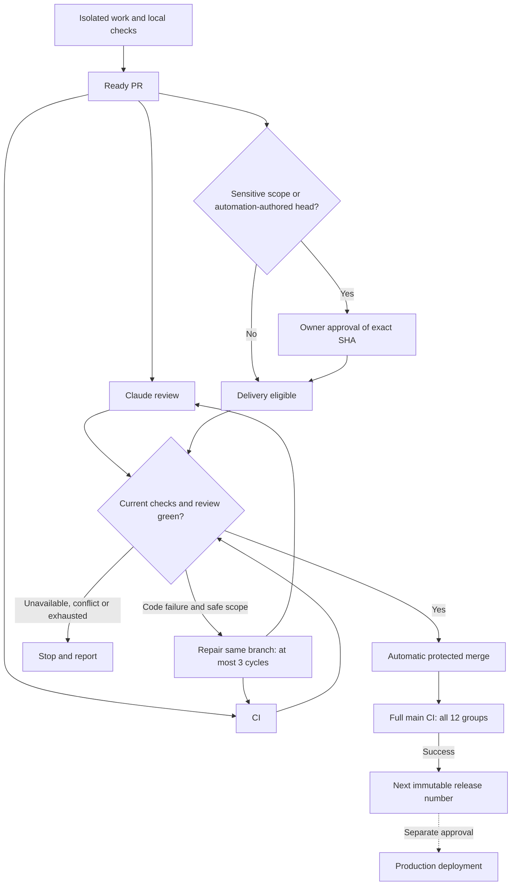

# Integration rules: preserve approved work through pull requests

This is the operational source for integration. `AGENTS.md` owns architecture and
product contracts; `REVIEW.md` owns review criteria; `docs/testing.md` owns check
commands. Historical plans and an incoming worktree's older instructions do not
replace the current policy. The former direct-push exception is superseded.

## Authorization and the current automation

The owner approved automatic delivery on 2026-10-22: ready, bounded PRs can merge
when `ci-result`, `code-review` and `delivery-policy` succeed for the current head.
Drafts remain preparation; ready requests review and evaluation against this policy.
The deterministic `pr-delivery` controller merges normally through GitHub; it never
pushes main or bypasses protection. Native repository auto-merge obeys the same gates.

Low-risk eligibility is deliberately conservative in `tools/pr_delivery.py`:
selected frontend component/page, Storybook/shared UI and non-policy documentation
paths, with sensitive path/content exclusions, no deletions/renames and complete
file evidence. Any uncertain or broader change needs an owner-authored exact comment:
`/webvue approve <40-character-current-head-sha>`. Permission/security/data migrations,
dependency/build/CI/controller/policy changes and breaking API work need that explicit
approval. Approval never waives review, checks, thread resolution or current-base
requirements. New commits invalidate it. Do not have automation impersonate the owner.

Task authorization, publication, production deployment and cleanup remain distinct.
The standing delivery policy covers reserved safe repair commits, normal merges and the version tags described
below. It does not authorize production deployment, destructive cleanup or changing
its own gates through an automatic repair.

## One reviewer, one decision

The `pr-review` workflow starts when a same-repository owner/approved-bot PR on a
`claude/` branch becomes ready, is reopened or receives commits; drafts and other
heads are skipped. Claude Code reviews it. The controller supplies the complete diff
as data; Claude has no tools or filesystem access and returns a structured report.
A separate non-model job publishes it on GitHub. Current-head reviews are required;
an old head, an incomplete report or an unavailable service cannot yield a green
`code-review`. P0/P1/P2 findings fail it; unresolved conversations remain binding
at merge. A head written by Claude, GitHub Actions or an unattributed author is
reviewed the same way but merges only with the owner's exact-head approval.

Prerequisites: a valid Claude subscription token in the separate main-only `review`
environment. Repair uses its own `agent` environment; do not populate it when
configuring review. No paid API fallback is configured. The workflow uses trusted
base code, never PR checkout or PR commands with secrets. The service can be
temporarily unavailable; report that state and keep the merge blocked.

## Six integration steps

1. **Record the live baseline.** Read the canonical checkout's current policy
   and compare it with the latest committed remote policy. Inspect both
   worktrees' dirty paths and owners. Fetch `origin` without resetting a checkout
   or pruning refs; record local `main`, remote `main`, incoming branch/head,
   PR state and active claims. Remote `main` is the delivery baseline; local
   `main` can be stale. Resolve policy conflicts with the current owner decision.
2. **Prepare one candidate.** Work in an isolated, claimed worktree. Bring the
   latest remote `main` into the candidate without rebasing another owner's
   branch. An independent task uses its own PR. A coupled batch uses
   `claude/tools-integrate-<slug>`, merging only its agreed branches with merge
   commits and one PR to `main`. Preserve incoming commits and approved behavior;
   do not replace entire files, use blanket `ours`/`theirs`, reset `main` to an
   incoming tree or treat ancestry as proof behavior survives. Regenerate API
   artifacts once on the integration branch when its routes/contracts change.
3. **Review the complete delta.** Compare the candidate with the recorded
   remote baseline, including deletions, shared UI, navigation, permissions,
   contracts, migrations and regression tests. Review the actual diff following
   `REVIEW.md`; addon/contract changes need Odoo-aware review. Keep compatible
   prior decisions. If the request conflicts with one, preserve it and ask for
   that specific decision; general merge authorization does not reverse it.
4. **Verify the combined result.** Run focused checks, `npm test`, Git and
   architecture policies against the recorded baseline, and the affected
   layers' checks from `docs/testing.md`. Odoo checks use isolated scratch
   databases, never `odoo19`. Record commands, commit, environment, pass/fail and
   gaps in the PR. Retain baseline regression requirements. Diagnose failures;
   a reproduced baseline failure is still disclosed, not silently waived.
   After local preparation, mark the PR ready to request GitHub review. Require
   successful `ci-result`, current-head `code-review` and every selected stage on the current PR
   candidate; inspect skipped stages and scope. A prior green head, local test
   run or merge conflict check alone does not establish readiness.
5. **Evaluate and merge the reviewed candidate.** `pr-delivery` rereads the current
   head, latest CI run, current-head review status, complete file inventory and
   sensitive approval. CI/review failures can request at most three durable repair
   cycles across the PR, one per head. Pending, cancelled, unavailable services or
   an already-attempted head do not start another repair. Sensitive scope and tests are never
   rewritten autonomously. A repaired head is automation-authored, so it merges only
   with the owner's exact-head approval; review threads stay manual. Claude receives bounded evidence as text with zero tools,
   hooks/settings disabled and a read-only token, then returns structured replacement
   content. A separate model-free publisher validates original modified regular files,
   size/scope, reserved attempt and unchanged head before a non-force API update.
   It explicitly dispatches full CI and trusted-main review for the new head because
   GitHub token mutations do not reliably trigger those events. Failed generation
   consumes its reservation and stops; no quota retry or budget reset. At three
   unsuccessful cycles, stop and report owner action needed. Successful current gates
   merge with exact head through the normal merge API. Conflicts or a behind branch
   wait for integration; do not rewrite history or weaken protection to proceed.
6. **Verify and synchronize.** Confirm the PR is merged and record its actual
   merge SHA and post-merge CI result. Fetch and compare local/remote `main`.
   Fast-forward local `main` only when behind without divergence and clean,
   or after proving every dirty/untracked path is disjoint from the incoming
   changes (including directory collisions), saving a byte-level snapshot of
   those paths, and verifying it unchanged afterward. If that cannot be proved,
   leave the checkout intact and report it. Never auto-stash,
   reset, force-push or discard edits to synchronize. Release and deployment
   need their own authorization and evidence. Cleanup is a separate action:
   ancestry alone does not preserve uncommitted, untracked or ignored files,
   scratch data or runtime state. Inspect ownership, preservation and process
   use, then use the authorized `tools/wt.py gc` path.

## PR handoff

Use the repository PR template. Name one bounded outcome, included branches and
prerequisites; record baseline/head, verification evidence, review findings and
unverified areas. Dependent branches declare the prerequisite and stay draft
until tested against the intended combined result. When the parent merges,
update and retest the child against current `main`; do not deliver inherited
changes twice. A clean merge simulation proves textual compatibility only.

## Enforced GitHub rules and activation

`protect-main` requires a PR, `ci-result`, `code-review` and `delivery-policy` from
GitHub Actions, an up-to-date branch, resolved conversations and merge commits.
No bypass actors, force updates or branch deletion. No formal second-account
approval is required while only the owner has write access. The exact-head owner
comment provides the sensitive-scope decision. Recheck actual settings before delivery.

The owner explicitly authorized activation of PR32, including its sensitive governance
scope. Bootstrap it with current CI and a recorded independent review, through a normal
explicit merge. Add the new required contexts once their trusted-main producers exist,
before enabling native auto-merge or allowing subsequent delivery. Do not require a
context before its producer exists, bypass protection or expose credentials to PR code.
Verify providers live; a configured secret is not proof of working authentication.

## Release numbers

`release-version` runs after successful CI on main. It verifies the CI workflow identity,
repository, event, exact main SHA and all twelve stage groups, including every matrix
job and `ci-result`, with no skipped stages. It then creates the next immutable
`release/19.0.X.Y.Z` tag by incrementing the final numeric component. Repeated events
reuse the same commit's existing tag. From `19.0.1.0.1`, next is `19.0.1.0.2`.
Scoped PR CI cannot create a release number; bot merges explicitly request full main CI.
Versioning never deploys production or changes addon schema versions automatically.

## Delivery flow

