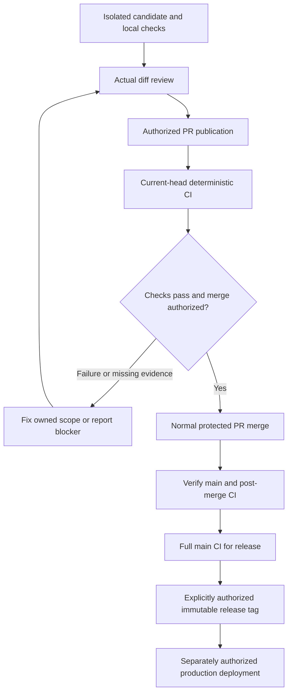

# Integration rules: preserve approved work through pull requests

This is the operational source for integration. `AGENTS.md` owns architecture and
product contracts; `REVIEW.md` owns review criteria; `docs/testing.md` owns check
commands. Historical plans and an incoming worktree's older instructions do not
replace the current policy. The former direct-push exception is superseded.

## Authorization and deterministic CI

The owner's 2026-10-24 reset keeps normal deterministic CI and removes the
model-driven review, repair, merge and release controllers. The required
status-check policy is **`ci-result` only**, on the current PR head. Review of the
actual diff still follows `REVIEW.md`; any selected available agent or a human
may perform it, without an exclusive model requirement or paid API fallback.

Keep a PR draft while local preparation is incomplete. Marking ready requests
CI and review; it does not authorize publication, merging or release. Those
operations require the owner's explicit authorization for their scope. Prior
approved product, access and data decisions remain binding. New changes require
updated evidence and any authorization their scope needs.

CI reports checks; it does not repair code, merge PRs, create tags or deploy.
Task authorization, remote publication, merge, release, production deployment
and cleanup remain distinct. Local consolidation authority does not authorize a
remote push or production deployment. Missing services, stale checks and failed
checks never justify bypassing branch protection.

## Six integration steps

1. **Record the live baseline.** Read the canonical checkout's current policy
   and compare it with the latest committed remote policy. Inspect both
   worktrees' dirty paths and owners. Fetch `origin` without resetting a checkout
   or pruning refs; record local `main`, remote `main`, incoming branch/head,
   PR state and active claims. Remote `main` is the publication baseline; local
   `main` can be stale. Resolve policy conflicts with the current owner decision.
2. **Prepare one candidate.** Work in an isolated, claimed worktree. Bring the
   latest remote `main` into the candidate without rebasing another owner's
   branch. An independent task uses its own PR. A coupled batch uses
   `<prefix>/tools-integrate-<slug>`, merging only its agreed branches with merge
   commits and one PR to `main`. Preserve incoming commits and approved behavior;
   do not replace entire files, use blanket `ours`/`theirs`, reset `main` to an
   incoming tree or treat ancestry as proof behavior survives. Regenerate API
   artifacts once on the integration branch when its routes/contracts change.
3. **Review the complete delta.** Compare the candidate with the recorded
   remote baseline, including deletions, shared UI, navigation, permissions,
   contracts, migrations and regression tests. Review the actual diff following
   `REVIEW.md`; addon/contract changes need Odoo-aware review. Keep compatible
   prior decisions. If the request conflicts with one, preserve it and ask for
   that specific decision; general merge authorization does not reverse it.
4. **Verify the combined result.** Run focused checks, `npm test`, Git and
   architecture policies against the recorded baseline, and the affected
   layers' checks from `docs/testing.md`. Odoo checks use isolated scratch
   databases, never development databases. Record commands, commit, environment,
   pass/fail and gaps in the PR. Retain baseline regression requirements.
   Diagnose failures; a reproduced baseline failure is disclosed, not silently
   waived. After local preparation and authorized publication, mark the PR ready.
   Require successful current-head `ci-result` and every selected stage; inspect
   skipped stages and scope. An old green head, local checks or a conflict check
   alone does not establish readiness for protected remote integration.
5. **Merge the authorized candidate.** Recheck the current base/head, current-head
   CI, resolved review findings and conversations, and the owner's authorization.
   Fix failures in the owned scope and repeat affected checks after a change.
   When the head or base moves, update the candidate and its evidence before
   merging. Use the normal protected PR merge; do not force-push, bypass
   protection, relax a test or assume a green check grants permission. Quota or
   service exhaustion is a blocker to report, never a reason for a paid fallback.
6. **Verify and synchronize.** Confirm the PR is merged and record its actual
   merge SHA and post-merge CI result. Fetch and compare local/remote `main`.
   Fast-forward local `main` only when behind without divergence and clean,
   or after proving every dirty/untracked path is disjoint from the incoming
   changes (including directory collisions), saving a byte-level snapshot of
   those paths, and verifying it unchanged afterward. If that cannot be proved,
   leave the checkout intact and report it. Never auto-stash, reset, force-push
   or discard edits to synchronize. Release and deployment need their own
   authorization and evidence. Cleanup is a separate action: ancestry alone
   does not preserve uncommitted, untracked or ignored files, scratch data or
   runtime state. Inspect ownership, preservation and process use, then use the
   authorized `tools/wt.py gc` path.

## Local-only integration

An explicit request to consolidate into local `main` may authorize local commits
and merges without authorizing publication. Preserve all source work and dirty
paths, prepare the combined result in an isolated candidate, and run the
applicable combined checks and review before updating local `main`. Record that
there is no remote PR/CI evidence for this local-only action. The protected PR
procedure above remains required for subsequent remote publication.

## PR handoff

Use the repository PR template. Name one bounded outcome, included branches and
prerequisites; record baseline/head, verification evidence, review findings and
unverified areas. Dependent branches declare the prerequisite and stay draft
until tested against the intended combined result. When the parent merges,
update and retest the child against current `main`; do not deliver inherited
changes twice. A clean merge simulation proves textual compatibility only.

## GitHub protection policy and live settings

Publish through a PR with current-head `ci-result` from GitHub Actions, an
up-to-date branch, resolved conversations and normal merge commits. No protection
bypass, force updates or branch deletion is permitted. A mandatory second-account
or model-provider approval is not part of the owner's reset.

Inspect actual rulesets and required checks before remote delivery. A source
change does not modify GitHub settings or prove the live rules match this policy.
Report mismatches and obtain any required settings authorization; do not add a
required context whose producer no longer exists or bypass a stale gate.

## Release numbers

Publishing a `release/19.0.X.Y.Z` tag requires explicit owner authorization and
all twelve `ci` stage groups, every matrix job and `ci-result`, green in a full
run on that exact `main` commit, with no skipped groups. Inspect the existing
immutable tags before choosing the next final numeric component. Scoped PR CI
does not prove a full release run. Release tags do not alter addon schema
versions or authorize production deployment; those retain their own checks and
authorization.

## Delivery flow

