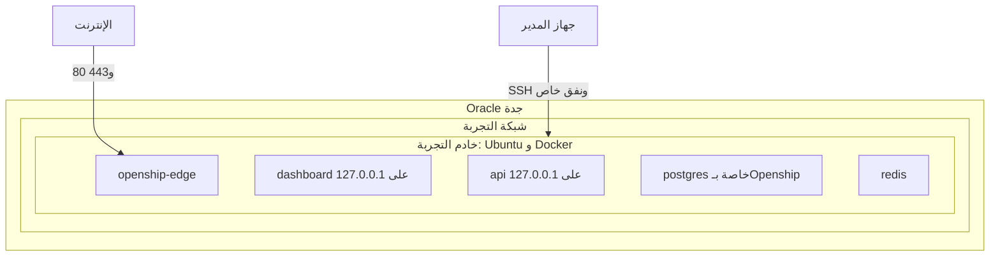
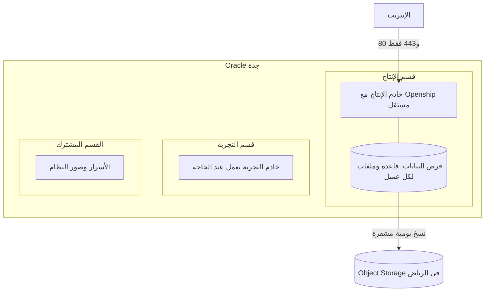

# تقرير DevOps: البنية التحتية على Oracle Cloud

**التاريخ:** 2026-10-30. **الحالة:** بيئة تجربة تعمل في جدة وعليها Openship، ولم يُنشر النظام عليها بعد، ولا توجد بيئة إنتاج.

الخلاصة: اخترنا Oracle Cloud في السعودية، وأنشأنا خادم تجربة بمعالج Arm، وثبتنا عليه Openship مستقلًا عن أي خادم خارج المملكة. التكلفة المتوقعة لأول العملاء نحو 45$ شهريًا بعد الجزء المجاني، و82$ بدونه. أقرب موعد مؤثر هو نهاية الفترة التجريبية في 2026-11-19.

تشير `<prefix>` إلى البادئة المعتمدة لأسماء الموارد. لا يذكر هذا الملف العناوين أو المعرفات أو بيانات الحساب لأن المستودع عام، وتبقى هذه التفاصيل في الإعداد الخاص خارج Git.

علامات الحالة: `[اختبار]` ثبت بفحص مباشر، `[كود]` ثبت من ملف في المستودع، `[استنتاج]` يحتاج تحققًا، `[مقترح]` لم يُنفذ، `[لم يُفحص]` لم نتحقق منه.

## ما تم تنفيذه

| البند | النتيجة | الحالة | الدليل |
|---|---|---|---|
| الحساب | Free Trial بدأ 2026-10-21، المنطقة الرئيسية جدة `me-jeddah-1` | `[اختبار]` | صفحات الحساب في وحدة التحكم |
| الرصيد | 250 يورو، والاستهلاك كان 0 يورو قبل إنشاء الخادم | `[اختبار]` | صفحة Subscription |
| تاريخ التجديد | `Nov 19, 2026 UTC`، ولا توجد صفحة تصفه صراحة بأنه نهاية التجربة | `[استنتاج]` | جدول Subscriptions |
| القسم | `<prefix>-staging` داخل الروت | `[اختبار]` | صفحة Compartments |
| الشبكة | `<prefix>-staging-vcn` بنطاق `10.0.0.0/16` وشبكتين فرعيتين، عامة وخاصة | `[اختبار]` | معالج VCN |
| الخادم | `VM.Standard.A1.Flex`، 4 أنوية، 24 GB رام، قرص 200 GB | `[اختبار]` | صفحة الخادم و`nproc` و`free` و`df` |
| نظام التشغيل | Ubuntu 24.04.5 LTS على `aarch64` | `[اختبار]` | `/etc/os-release` و`uname -m` |
| الجدار الناري | 80 و443 مفتوحان، و22 مقصور على عنوان إداري واحد | `[اختبار]` | قواعد Oracle و`iptables` |
| Docker | مثبت ومفعّل عند الإقلاع | `[اختبار]` | `systemctl is-enabled docker` |
| Openship | v0.9.5 بوضع Compose، 5 حاويات تعمل بسياسة `unless-stopped` | `[اختبار]` | `docker ps` و`docker inspect` |
| لوحة Openship | تعمل عبر نفق SSH فقط، و3001 و4000 و5432 مغلقة من الخارج | `[اختبار]` | فحص المنافذ من خارج الخادم |
| حساب المدير | أُنشئ حساب واحد، وتم الدخول به، والخادم يظهر Online | `[اختبار]` | قاعدة Openship وصفحة Servers |

استهلاك Openship قبل نشر أي نظام نحو 1.3 GB رام و7 GB قرص `[اختبار]`.

## فحص توافق Arm

| الفحص | النتيجة | الحالة |
|---|---|---|
| مكتبات Python المثبتة | 61 من 69 لها حزمة Arm جاهزة أو عامة، و8 تُبنى أو تُثبت من المصدر | `[اختبار]` |
| بناء صورة Odoo لـ`linux/arm64` | نجح، بحجم 4.79 GB، واستغرق نحو 21 دقيقة وجهاز المطور مشغول | `[اختبار]` |
| استيراد 16 مكتبة أساسية | نجح، ومنها `psycopg2` و`ldap` و`sass` | `[اختبار]` |
| `wkhtmltopdf` و`odoo-bin --version` | عملا داخل الصورة | `[اختبار]` |
| الخطوط العربية | موجودة في الصورة، ولم تُجرَّب طباعة فعلية | `[اختبار]` |
| مكتبات 280 وحدة | ناقص منها مكتبات تخص 6 وحدات OCA غير مستخدمة في `odoo-addons` و`deploy` و`tools` | `[اختبار]` |
| تثبيت وحدات النظام على قاعدة بيانات | لم يُنفذ | `[لم يُفحص]` |
| صور Nuxt والحارس والذكاء الاصطناعي على Arm | لم تُبن | `[لم يُفحص]` |

حُذفت صورة الفحص بعد انتهائه، فلا تعتمد البيئة عليها.

## القرارات المعتمدة

| القرار | السبب |
|---|---|
| Oracle Cloud في جدة كمنطقة أساسية، والرياض للنسخ الاحتياطية | شرط بقاء الخوادم والبيانات داخل السعودية، والجزء المجاني يعمل في المنطقة الرئيسية فقط |
| خادم A1 بـ4 أنوية و24 GB بدون العودة إلى الحجم المجاني | حجم مناسب لتجربة النظام كاملًا |
| إدارة الخوادم عبر Openship | قرار المالك |
| Openship مثبت على خادم جدة، بدون ربطه بخادم ألمانيا | تبقى الأسرار والمفاتيح والسجلات داخل المملكة، وتبقى المشاريع الحالية منفصلة |
| بادئة موحدة للموارد الجديدة | قرار المالك، واسم الحساب نفسه لا يتغير |
| قرص واحد بـ200 GB في بيئة التجربة بدل 50 و150 | Docker يعمل عليه مباشرة، والأداء يتحسن مع الحجم: 12,000 IOPS بدل 3,000 |

## البنية الحالية

| القيد الحالي | الأثر |
|---|---|
| خادم واحد ومنطقة توافر واحدة | تعطله يوقف البيئة كلها، وهذا مقبول للتجربة |
| عنوان الإنترنت مؤقت | قد يتغير إذا حُذف الخادم أو أعيد إنشاؤه، ويجب تثبيته قبل ربط نطاق |
| منفذ 22 مقصور على عنوان إداري | تغير عنوان جهاز المدير يتطلب تحديث القاعدة في Oracle |
| لا توجد نسخ احتياطية | مقبول ما دامت البيانات وهمية |

## التكلفة المتوقعة

الأسعار من واجهة Oracle العامة بالدولار في 2026-10-30، على أساس 744 ساعة شهريًا، قبل الضريبة. عملة الحساب تظهر باليورو، فقد تختلف الفاتورة. التحويل بسعر 3.75 ريال للدولار.

| البند | السعر |
|---|---|
| A1، النواة في الساعة | 0.01$ |
| A1، الذاكرة لكل GB في الساعة | 0.0015$ |
| E5، النواة والذاكرة في الساعة | 0.03$ و0.002$ |
| القرص المتوازن لكل GB شهريًا | 0.0425$ |
| Object Storage لكل GB شهريًا | 0.0255$ بعد أول 10 GB |
| الخروج للإنترنت من الشرق الأوسط | أول 10 TB مجانية، ثم 0.05$ لكل GB |

الجزء المجاني 1,500 ساعة نواة و9,000 ساعة GB شهريًا حسب وثائق Oracle، مع 200 GB أقراص، في المنطقة الرئيسية فقط. واجهة الأسعار ما زالت تعرض 3,000 و18,000، فاعتمدنا الرقم الأقل.

| السيناريو | بدون الجزء المجاني | بعد الجزء المجاني |
|---|---|---|
| التجربة حتى 2026-11-19 | 57$ من الرصيد | لا يوجد دفع |
| أول العملاء: خادم 4/24، أقراص 350 GB، نسخ 200 GB في جدة ومثلها في الرياض | 82$ (نحو 308 ر.س) | 45$ (نحو 170 ر.س) |
| الإنتاج مع تشغيل التجربة 40 ساعة شهريًا وبقاء قرصها 200 GB | 93$ | 56$ |
| الإنتاج والتجربة يعملان طوال الشهر | 147$ | 109$ |
| نحو 30 عميلًا: 12 نواة و72 GB إجمالًا | 200$ | 175$ (نحو 650 ر.س) |

أرقام 30 عميلًا تخطيطية `[استنتاج]`، وسعة الخادم لم تُقس. تطابق الأرقام تقريبًا افتراضات [دراسة 2027](../finance/2027-launch-year-financial-study.md)، لكن الدراسة تفترض الرياض كمنطقة أساسية وتحتاج تعديلًا إلى جدة.

لا تشمل الأرقام: الضريبة، والنطاق، والبريد، وخادم GPU، وأي منطقة أو خدمة مدفوعة إضافية. تكلفة بوابات الشبكة لم تُراجع بندًا بندًا `[لم يُفحص]`.

## المتبقي

### قبل نهاية التجربة

| العمل | المسؤول | الموعد |
|---|---|---|
| تأكيد عملة الفوترة واسم صاحب الحساب | المالك | قبل الترقية |
| ترقية الحساب إلى Pay As You Go | المالك | قبل 2026-11-15 |
| إنشاء تنبيهات ميزانية عند 50% و80% و100% | DevOps | بعد الترقية مباشرة |
| تغيير كلمة مرور مدير Openship | المالك | قبل فتح اللوحة للإنترنت |
| فحص التحقق الثنائي في Oracle | DevOps والمالك | قبل الترقية |
| فحص التحكم بالخادم في Openship | DevOps | عند أول نشر |
| تجربة إعادة تشغيل الخادم | DevOps | قبل نشر النظام |

الموارد المدفوعة من الرصيد تستعيدها Oracle وتحذفها إذا لم يُرق الحساب، وخوادم A1 فوق نواتين و12 GB تتعطل ثم تُحذف بعد 30 يومًا حسب وثائق Oracle.

### تجهيز النشر على التجربة

| العمل | السبب |
|---|---|
| تصميم ملف تشغيل مناسب لـOpenship | لا يقرأ `networks` و`profiles` و`build.args`، ولا يشغل `releaseCommands` في مشاريع Compose |
| حل تعارض المنفذين 80 و443 | `openship-edge` يأخذهما، وملفات النظام عندها Caddy |
| تحديد مكان بناء الصور | البناء ثقيل، وقد يكون بطيئًا على الخادم |
| فحص العزل الفعلي بين الخدمات | `networks` يبقى في الملف، لكن أثره عند التشغيل لم يُختبر |
| بناء صور Nuxt والحارس لـArm | لم تُفحص بعد |
| تثبيت الوحدات واختبار PDF العربي | أول إثبات فعلي للنظام على الخادم |
| تجربة نسخ واستعادة | شرط قبل أي بيانات حقيقية |
| قياس 10 ثم 100 مستأجر | شرط في [عقد الاستضافة](../superpowers/specs/webvue-shared-saas-and-sovereign-deployment.md) |

### تحسينات لاحقة

تثبيت عنوان الإنترنت، وربط نطاق التجربة، وإنشاء Bastion بدل فتح 22، وتفعيل Cloud Guard وفحص الثغرات بعد التحقق من توفرهما في جدة، وإضافة تنبيهات المعالج والذاكرة والقرص، ونقل الأسرار إلى Vault، ووصف البنية بـTerraform.

## خطة الإنتاج

كل ما يلي `[مقترح]` ولم يُنفذ.

| المبدأ | التطبيق |
|---|---|
| فصل التجربة عن الإنتاج | خادمان وقسمان وشبكتان، وبدون اتصال بينهما |
| تقليل التكلفة | إيقاف خادم التجربة خارج أوقات التحديث |
| عزل العملاء | قاعدة بيانات وملفات لكل عميل، كما يحدد [AGENTS.md](../../AGENTS.md) |
| قاعدة البيانات | PostgreSQL 16 على الخادم في البداية، ثم خادم مستقل عند الحاجة |
| بقاء البيانات داخل المملكة | كل النسخ في جدة والرياض فقط |
| الدخول الإداري | Bastion، بدون فتح 22 للإنترنت |
| نشر التحديثات | التجربة أولًا، ثم نسخة احتياطية، ثم عميل واحد، ثم البقية |

| المرحلة | شرط الانتقال |
|---|---|
| إثبات التجربة | النظام يعمل على Arm، ويمر فحص PDF والعزل والنسخ والاستعادة |
| إنشاء الإنتاج | الحساب مرقى، وتنبيهات الميزانية تعمل، والتصميم مراجع |
| تجهيز النسخ والمراقبة | نسخ مشفرة تصل إلى الرياض، ومدد الاحتفاظ معتمدة، والتنبيهات مجربة |
| تمرين استعادة | استعادة ناجحة في بيئة منفصلة، مع قياس RPO وRTO |
| عميل تجريبي | بيانات اختبارية، وتشغيل كامل على الإنتاج |
| أول عميل | موافقة المالك، واكتمال بوابات الإطلاق في [سجل الاستضافة](../project-closure/saas-hosting-direction-status.md) |

## بقاء البيانات داخل السعودية

| المسار | الخطر | القرار |
|---|---|---|
| التطبيق وقاعدة البيانات والملفات | منخفض في جدة والرياض | يبقى داخل المملكة |
| النسخ الاحتياطية | نسخ إلى منطقة خارجية | جدة والرياض فقط |
| CDN | فك تشفير الحركة خارج المملكة | Cloudflare للنطاق فقط، بدون تمرير حركة العملاء |
| الذكاء الاصطناعي | النصوص تصل إلى مزود خارجي | معطل على بيانات العملاء، أو تشغيل محلي |
| البريد والمراقبة | المحتوى يمر عبر المزود | يتحدد بعد التحقق من موقع المزود |
| واتساب وبوابات الدفع | تمر عبر طرف ثالث بطبيعتها | اختيار العميل مع إفصاح واضح |

ما يذكره Oracle عن تسجيل CST وضوابط NCA يحتاج شهادة حديثة قبل استخدامه أمام عميل `[لم يُفحص]`. والعقود الحكومية تحتاج مراجعة قانونية مستقلة.

## المخاطر

| الخطر | الأثر | المعالجة |
|---|---|---|
| انتهاء التجربة بدون ترقية | حذف الخادم وما عليه | الترقية قبل 2026-11-15 |
| Openship قبل الإصدار 1.0 | تغيرات مفاجئة | تثبيت الإصدار، وتجربة التحديث على بيئة التجربة |
| عدم توافق ملفات التشغيل | تأخر النشر أو ضعف العزل | تصميم مخصص، وفحص عملي للشبكات |
| نفاد سعة A1 في جدة | تعذر التكبير أو إنشاء خادم | بناء الصور للمعماريتين، واستخدام E5 عند الحاجة |
| منطقة توافر واحدة | تعطل كامل عند فشل المنطقة | نسخ في الرياض، وتمرين استعادة |
| النسخ الحالية غير مكتملة | فقدان بيانات | لا بيانات حقيقية قبل إثبات النسخ والتشفير والاستعادة |

**القرار المطلوب:** تأكيد عملة الفوترة واسم صاحب الحساب، ثم الترقية قبل 2026-11-15.
