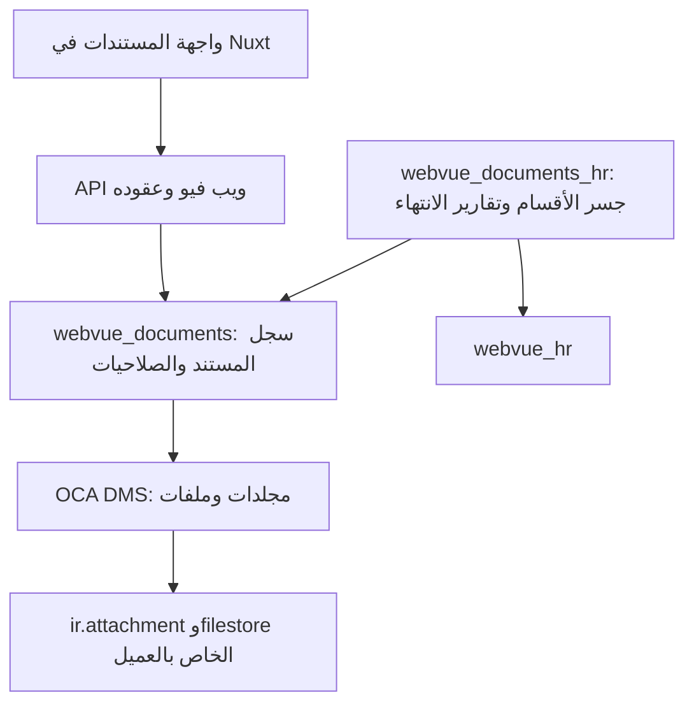

# فحص OCA DMS وملاءمته لإحلال مستندات ويب فيو

التاريخ: 19 أكتوبر 2026، بتوقيت الرياض. النطاق: فحص وتوصية فقط؛ لا تنفيذ إحلال، ولا تعديل لكود المنتج أو قواعد بيانات التطوير والعملاء.

## القرار المقترح

**مناسب بشروط كمحرك للملفات والمجلدات، ويستحق الاعتماد بعد إغلاق فجوات الربط. ليس إحلالًا مباشرًا لشاشة المستندات الحالية بمجرد التثبيت.**

الفائدة الحقيقية: إعادة استخدام محرك المجلدات، الملفات، المرفقات المرتبطة بالسجلات، صلاحيات المجلدات، الأرشفة والقفل، مع الحفاظ على هوية ويب فيو وواجهة Nuxt وصلاحياتها. لا أوصي بوعد المستخدم بالإصدارات والاستعادة أو OCR أو الاعتماد بناءً على هذه الإضافة الأساسية؛ لم تُنفذ هذه القدرات في النسخة المفحوصة.

الفحص أثبت أن الإضافة تعمل على Odoo المحلي وأن اختبارات HR الحالية تنجح مع وجودها. لم يُنفذ adapter بين النظامين، ولذلك تظل سلامة الإحلال والترحيل واختبارات واجهة العميل بوابات تنفيذ لاحقة.

## النسخ وحدود العزل

| العنصر | النسخة التي فُحصت |
|---|---|
| WebVue | `dc39a8eb734da4557d341fbe24b2fc63d773fbb1` |
| تري الفحص | `/Users/tariq/code/webvue/.worktrees/docs-oca-dms` |
| فرع الفحص | `codex/docs-oca-dms` |
| مصدر OCA | [OCA/dms — commit ثابت](https://github.com/OCA/dms/tree/42aec9613f64402ec702e8e21cfb643626a41056) |
| إصدار الموديول | `19.0.1.1.3`، من فرع `19.0` |
| تصنيف النضج | Beta في README |
| اعتمادات الموديول | `mail`, `http_routing`, `onboarding`, `portal`, `base`, `web`؛ لا اعتماد Enterprise في manifest |
| مصدر الفحص المحلي | `/Users/tariq/Desktop/webvue/oca-dms-evidence/upstream`؛ منفصل عن مصدر المنتج وعن قائمة OCA المعتمدة |

التري من local main، وليس إثباتًا لتطابقه مع GitHub. لم يحدث fetch أو push أو merge أو commit لمستودع WebVue. ملف المواصفة غير المتتبع الموجود أصلًا على main لم يُنسخ أو يُعدّل. لم تُثبّت node_modules أو تُشغّل واجهة المنتج لهذه الدراسة.

## الأدلة التشغيلية

| الفحص | النتيجة | ما يثبته |
|---|---|---|
| تثبيت DMS واختباراته المختارة | **75 اختبارًا، صفر فشل وصفر أخطاء** | عمل النسخة المثبتة على Odoo المحلي، بما في ذلك اختبارات HTTP الخاصة بالبوابة وعزل رموز المشاركة |
| تجارب ملاءمة إضافية | **11/11** | التخزين والقراءة والكتابة والقفل والأرشفة وسلوك الشركات في الاختبارات المبينة أدناه |
| تثبيت HR الحالي مع وجود DMS وتشغيل `/webvue_hr` | **109 اختبارات، صفر فشل وصفر أخطاء** | توافق أولي مع HR الحالي؛ ليس اختبار adapter جديد أو ترحيل |

الأوامر الكاملة محفوظة في `runtime/test-command.json` و`runtime/coexist-command.json`. النتائج في `runtime/odoo.log` و`runtime/coexist.log` و`runtime/probes.json`. سكربتات إعادة الإنتاج: `run_upstream.py` و`probe_dms.py` و`run_coexist.py`.

استُخدمت فقط قاعدة `webvue_scratch_oca_dms_20261019_010` وملف config مستقل وdata_dir مستقل ومنفذ HTTP محلي 8294. تجارب الملاءمة نفذت rollback. اختبار browser tour وbenchmark مستبعدان صراحة؛ اختبارات HTTP غير المستبعدة شُغلت. إحصاء runner النهائي هو 75 و109؛ أرقام `odoo.tests.stats` الأعلى تضم مراحل/setup ولا أستخدمها كعدد حالات مستقلة.

لا إثبات في هذه الدراسة لجودة المتصفح أو RTL، أداء الأحمال، عزل عشرة tenants، التشغيل داخل صورة Linux المنشورة، الاستعادة بعد الترحيل أو تطبيق الإحلال على بيانات فعلية. لم تُقرأ قاعدة `odoo19`، ولم يُجر جرد حي لعدد المستندات.

## ما يملكه DMS فعليًا

| القدرة | النتيجة من المصدر | أثرها على ويب فيو |
|---|---|---|
| شجرة مجلدات | `dms.directory` مع parent/root/path | أساس جيد لمكتبات الأقسام والمجالات |
| ملف مستقل | `dms.file`، directory إلزامي، نوع وحجم وchecksum | استبدال إدارة الملفات اليدوية |
| تصنيفات ووسوم | `dms.category`, `dms.tag` | متاحة؛ تحتاج ضبط نطاق الشركات والصلاحيات |
| تخزين | Database / Filestore / Attachment | لا نختار Database افتراضيًا لملفات الأعمال الكبيرة |
| ربط بموديل وسجل | directory يحمل `res_model/res_id`؛ Attachment mode يربط `ir.attachment` | مهم لاستيعاب المرفقات الحالية دون نسخة ثانية من البايتات |
| صلاحيات المجلد | مجموعات مستخدمين/مجموعات Odoo مع وراثة | محرك مفيد، يحتاج تقاطعًا مع قدرات WebVue |
| أرشفة الملفات | `dms.file.active` | مثبتة بالتجربة؛ المجلد نفسه لا يحمل active في المصدر |
| قفل تحرير | `locked_by`, `lock()`, `unlock()` | يمنع كتابة مستخدم آخر عند القفل؛ لا يحقق CAS أو إصدارات تلقائية |
| معاينة | مكونات Odoo وثمبنيل وpython-magic موصى بها | لن تُعاد استخدامها تلقائيًا داخل Nuxt |
| مشاركة | portal ومفاتيح على الملف/المجلد، تشمل الشجرة التابعة | تحتاج سياسة WebVue؛ لا تُفتح تلقائيًا |
| HTML منسق + عدة مرفقات كسجل واحد | غير موجود بهذا الشكل | وظيفة حالية يجب حفظها في سجل أعمال المستند |
| تاريخ انتهاء | غير موجود في موديلات DMS الأساسية | يبقى من مسؤولية طبقة أعمال المستند والتقارير |
| إصدارات قابلة للاستعادة | غير موجودة في الموديول الأساسي المفحوص | عمل مستقل إذا اعتُمدت كمتطلب؛ القفل لا يعوضها |
| OCR/بحث كامل محتوى PDF وWord | لا محرك لذلك في النسخة الأساسية | لا يُسوّق على أنه مشمول؛ فهرسة attachment المحتملة ليست OCR متكاملًا |
| دورة اعتماد/توقيع/احتفاظ قانوني | غير موجودة كتدفق أعمال | إضافات أو تطوير منفصل عند طلبه |
| سجل تدقيق شامل | mail.thread وtracking لبعض الحقول | ليس سجلًا غير قابل للتعديل لكل قراءة وتغيير محتوى |

مصادر أساسية: `dms/models/dms_file.py:26,42,89,192,233,456,555,627`، `dms/models/storage.py:18`، `dms/models/directory.py:24`، `dms/models/access_groups.py:10`، `dms/controllers/portal.py:15`.

## فجوات يجب إغلاقها قبل الإحلال

### 1. عزل الشركة الحالية مختلف — أولوية عالية

قواعد OCA تسمح بـ`company_id=False` أو الشركات الموجودة في `company_ids`. تجربة المستخدم الذي شركاته A وB أثبتت قراءة ملف B مع كون A هي الشركة الحالية، إذا سمحت مجموعة المجلد. هذا سلوك OCA المقصود، لكنه أوسع من عقد ويب فيو الذي يقصر العملية على الشركة الحالية.

يجب إلزام storage بشركة، ومنع الربط والنقل عبر الشركات، وتقييد البحث والقراءة والكتابة والتنزيل على `env.company` في طبقة الربط. الإخفاء في Nuxt أو إضافة شرط في list API وحده لا يكفي؛ `/web/content` وORM ومسارات OCA الأصلية يجب أن تخضع للحدود أيضًا.

كما أن `dms.tag`, `dms.category`, `dms.access.group` لا تحمل company_id افتراضيًا، وبعض أسمائها فريدة على مستوى القاعدة. يلزم قرار ونموذج واضح لنطاق هذه البيانات؛ لا نفترض أن عزل الملفات يعزل metadata تلقائيًا. عزل database-per-tenant يبقى كما هو؛ هذه الملاحظة تخص الشركات داخل قاعدة tenant نفسها.

المصدر: `dms/security/security.xml:36` وما بعدها، `dms/models/storage.py:31`، `dms/models/abstract_dms_mixin.py:21`؛ تجربتا الشركات في `runtime/probes.json`.

### 2. صلاحيات DMS لا تعادل صلاحيات WebVue — أولوية عالية

DMS يعتمد ACLs ومجموعات `dms.group_dms_user/manager` و`dms.access.group`؛ لا يعرف `webvue.access.service` أو features أو وضع SaaS/non-SaaS. منح DMS manager لكل مدير مستندات سيعطي صلاحيات configuration أوسع من المطلوب. مجموعات المجلد لا تكفي لإبطال capability سُحبت من المستخدم لاحقًا.

المطلوب تقاطع ثلاث طبقات: capability حالي + feature وسياسة tenant + رؤية السجل/مجلد DMS. تبقى WebVue مصدر صلاحيات الأعمال، مع مزامنة مجموعات المحرك الضرورية فقط. كل إدخال resource/model/company/group يعاد التحقق منه على الخادم. تتضمن بوابة القبول مستخدمًا بصلاحية المستندات دون قراءة دليل الموظفين أو الأقسام، ومستخدمًا سُحبت صلاحياته مع بقاء جلسة قديمة.

المصدر: `dms/models/dms_security_mixin.py:102,183,238,289`، `dms/security/ir.model.access.csv`، `odoo-addons/webvue_hr/models/access_service.py:15`.

### 3. الفرق بين المستند والملف — أولوية عالية

حاليًا `webvue.hr.document` يملك عنوانًا وbody HTML وexpiry_date وقسمًا وعدة attachment_ids. تحويل كل سجل إلى dms.file واحد يفقد التجميع أو النص، وتحويله إلى عدة ملفات يفقد هوية المستند وتاريخ انتهائه وروابطه.

أوصي باستبدال موديل HR بسجل أعمال عام `webvue.document` داخل تطبيق المستندات، يملك **فقط** حقائق الأعمال: العنوان والنص المنسق والانتهاء والحالة، مع رابط واحد لمجلد DMS. تدير OCA الملفات والبايتات والنوع والحجم والوسوم والشجرة؛ لا تنسخ هذه الحقائق إلى جداول أخرى. لمجلد المستند اسم بنيوي ثابت داخلي، فلا نخزن عنوان المستند مرتين. هذه مسؤولية أعمال لازمة وليست نسخة ثانية من محرك DMS. لا يبقى `webvue.hr.document` كموديل موازٍ أو compatibility wrapper.

### 4. الإصدارات والتزامن غير محلولين تلقائيًا — أولوية عالية

تجربة كتابة مستخدمين على ملف غير مقفول قبلت الحفظ الثاني واستبدلت المحتوى. القفل الصريح منع غير مالكه كما ينبغي، لكنه اختياري ولا يحتوي مهلة أو lease في تعريفه. لا يوجد أرشيف revision في schema المفحوصة.

أوصي بعقد `expected_revision` أو ما يعادله، يتحقق خادميًا قبل كل حفظ محتوى/metadata ويرجع 409 عند التعارض، مستقلًا عن تجربة القفل. يلزم حسم حفظ الإصدارات واستعادتها قبل وعد المنتج بها. إن أُضيفت لاحقًا تكون مراجعة واحدة للمحتوى، لا نسخة متنافسة من مصدر الحقيقة. اعتماد الطلبات يمكن بحثه عبر bridge مع تطبيق العمليات لاحقًا، ولا يُضمَّن تلقائيًا في هذا الإحلال.

المصدر: `dms/models/dms_file.py:555,627`، `dms/security/security.xml` rule_file_locked؛ `unlocked_last_write_wins` و`explicit_lock_blocks_other_writer` في نتائج التجارب.

### 5. مسارات المشاركة والتنزيل تحتاج سياسة صريحة

الموديول يضيف `/my/dms/*` و`/web/binary/upload_dms_file` و`/config/dms.forbidden_extensions`؛ هذه لا تطابق API ويب فيو. بوابة OCA تستخدم روابط token عامة وتستعمل sudo بعد التحقق منها. source pin يحتوي اختبارات لإصلاح سابق في نطاق token، وقد نجحت هنا. هذا سبب لتثبيت commit وفحص الانحدار، وليس ادعاء وجود الخلل السابق الآن.

واجهة Nuxt تتحدث إلى `/api/v1/documents/*` بعقود صريحة وجلسة المتصفح. يحدد الربط منفذ تنزيل ACL-checked، ويمنع توليد روابط OCA العامة قبل اعتماد المشاركة. عدم ظهور زر مشاركة لا يعطّل مساراتها. يلزم فحص المسارات الأصلية وgeneric RPC وملحقات البوابة ضمن صور dedicated/shared؛ إعداد dedicated الحالي لا يوجّه `/my/dms` إلى Odoo أصلًا، لذا رابط OCA الجاهز لن يعمل عبره كما هو.

المصدر: `dms/controllers/main.py:15`، `dms/controllers/portal.py:16,92,263`، `dms/tests/test_access_token.py:1`، `deploy/Caddyfile:6`.

### 6. حد الرفع والتخزين يحتاجان توحيدًا

افتراضي DMS هو 25 MiB، وحظر الامتدادات فارغ. HR الحالي يحد الملف بـ10 MiB. نقل طلبات Nuxt المؤقت محدود بـ16 MiB للطلب و32 MiB للاستجابة و15 ثانية؛ 25 MiB بترميز Base64 أكبر من الحد. أوصي بالحفاظ على 10 MiB مبدئيًا عند الإحلال، مع validation قبل فك Base64 وسياسة امتدادات/MIME واضحة، بدل تغيير الحدود ضمنيًا. لا دليل هنا على فحص مضاد للبرمجيات الضارة.

مصدر البايتات واحد: **Attachment mode مرشح أول لمجلد سجل المستند**، لأن الملفات الحالية مخزنة فعلًا في ir.attachment. يمكن أن تشير dms.file إلى attachment موجود، بعد إعادة ربطه بموديل الأعمال الجديد. هذا ليس خياريًا دون اختبار: permissions الموروثة من السجل وعمليات unlink المتبادلة يجب تثبيتها بتجارب الترحيل. Filestore mode مناسب لمكتبات ملفات مستقلة، لكنه ليس مجرد مرادف لـAttachment mode، ولا يوجب نسخ بايتات المرفقات الحالية.

المصدر: `dms/models/storage.py:19,74`، `dms/models/dms_file.py:198,233,456,565,618`، `apps/web/server/utils/tenantTransport.ts:6`، `odoo-addons/webvue_hr/serializers/hr_document.py:17`.

### 7. آثار جانبية تتجاوز شاشة المستندات

DMS يمدد `base.unlink` و`ir.attachment.create/write/unlink` وmail.thread، ويستخدم private access hooks وSQL داخليًا. حذف سجل مرتبط قد يحذف ملفات ومجلدات DMS التابعة. لا تكفي اختبارات HR وحدها لإثبات سلامة PMO والاجتماعات والمحادثة والمالية. يجب عدم تفعيل auto-capture لكل موديلات المنتج لمجرد تثبيت الإضافة؛ البداية allowlist لموديل المستند فقط. تبقى مرفقات المهام والفواتير والمحاضر ضمن مالكيها حتى قرار مستقل.

المصدر: `dms/models/base.py:9`، `dms/models/ir_attachment.py:44,88,103`، `dms/models/mail_thread.py:11`، `dms/models/dms_security_mixin.py:245`.

### 8. الترخيص يحتاج تسجيل المصدر بدقة

manifest يعلن LGPL-3، لكن توجد ترويسات AGPL في ستة ملفات، منها `models/abstract_dms_mixin.py` وwizard المشاركة والنقل وJS search panel. لذلك أصحح اختزال التوصية السابقة إلى أن كل ملفات الإضافة LGPL. لا أحسم هنا التفسير القانوني لهذا التفاوت. قبول OCA/AGPL موثق أصلًا في `docs/oca-addons.md`، ويجب أن يسجل provenance هذا التفاوت قبل الاعتماد، مع إبقاء المصدر الخارجي مثبتًا وغير معدل. هذه ملاحظة provenance، وليست رأيًا قانونيًا جديدًا في ترخيص ويب فيو.

## شكل الربط المقترح — توصية غير منفذة

1. **`webvue_documents`، تطبيق rank 4:** يعتمد `webvue_api` و`dms`، يملك `webvue.document` والـAPI والقدرات و`documents.enabled` والواجهة المستقلة والعقود. لا يعتمد HR أو PMO أو المالية، ولا ينسخ مصدر OCA. طبقة الربط تفرض capability/current company/feature على المداخل اللازمة وتوثق أي استثناء framework يتطلبه المحرك.
2. **`webvue_documents_hr`، bridge rank 5 وauto_install:** يملك علاقة القسم، خرائط الأذونات القديمة وتقاطع HR وتقارير الانتهاء، وفحص منع حذف قسم له مستندات. لا يبقى في HR استعلام مباشر إلى موديل تطبيق المستندات؛ يستبدل بنقطة امتداد يملؤها الجسر. صفحة القسم تربط بالمكتبة المصفاة أو تستعمل نقطة عرض عامة؛ لا تستورد مكوّن تطبيق آخر مباشرة.
3. **OCA خارجي:** إضافة `OCA/dms` إلى `deploy/oca-addons.json` على commit مفحوص كامل، باستخدام آلية fetch الحالية وبناء صورة Odoo. لا نسخه تحت `odoo-addons/` ولا تعديله محليًا. دعم Linux والمكتبات الموصى بها يثبت داخل صورة البناء قبل الإطلاق.
4. **API مملوك لويب فيو:** قوائم المستندات والمجلدات `{items,total}`، تفاصيل المستند، الإنشاء والتعديل، رفع/إزالة/أرشفة الملف، وأرشفة/استعادة المستند، وتنزيل يتحقق من الهوية. JSON بـjson2 وauth=user وapi_handler وfeature gate، والبايتات HTTP مع التحقق نفسه. whitelist للكتابة، وحدود payload، وأخطاء HTTP فعلية.
5. **واجهة Nuxt:** مسار مقترح `/documents` مع قائمة وسجل وتعديل وcreate panel وفق DESIGN.md، وعربية/إنجليزية وثيمين. المحرر الحالي يعاد امتلاكه في تطبيق المستندات، ويظل النص المنسق محفوظًا. وظائف معاينة OCA/OWL لا تدخل Nuxt تلقائيًا. قرار المسارات القديمة/الروابط المباشرة يحتاج تثبيتًا قبل التنفيذ، ولا أوصي بإزالتها صامتًا أو إبقاء نسختين من المنطق.
6. **قدرات جديدة مقترحة:** مثل `documents.items.read/manage` و`documents.files.read/manage`؛ refine قبل التنفيذ حسب التفويض المطلوب. صلاحية إدارة لا تعني configuration أو مشاركة عامة أو حذف نهائي. المجموعات اللازمة لـDMS تطبيق للقرار، لا مصدر صلاحيات ثانٍ. يهاجر grant الموظف الحالي بوضوح حتى لا يُمنح الجميع مستندات سرية مستقبلية.

فصل محرك الملفات كخدمة rank 3 يصبح مبررًا إن احتاجته تطبيقات متعددة مباشرة؛ لا أضيف طبقة ثالثة افتراضيًا لهذه المهمة. جسور PMO/Finance مستقبلية منفصلة. الربط لا يعتمد control plane في التشغيل، ويعمل في saas وnon_saas.

## إحلال البيانات دون تراكم

هذه خطوات الترحيل المقترحة وليست سكربتًا نفذ على بيانات المستخدم:

1. جرد read-only عند التنفيذ: عدد المستندات حسب الشركة والقسم، HTML، expiry، metadata، الأذونات، المرفقات وبايتاتها وروابطها ومراجعها من خارج المستندات. لم تُستخرج هذه الأعداد من أي قاعدة فعلية في الدراسة.
2. تثبيت dataset اختباري يغطي مستندًا بلا body، ومستندًا بلا مرفقات، وعدة مرفقات، وأسماء ملفات متكررة ومرفقًا مشتركًا ورابطًا خارجيًا وتواريخ انتهاء. DMS يمنع تكرار اسم الملف في المجلد؛ لا تُغير أسماء المستخدمين أو تسقط ملفًا بصمت.
3. إعادة تسمية/نقل هوية موديل سجل الأعمال الحالي إلى `webvue.document` عبر migration مع تحديث metadata وxmlids والمراجع، والحفاظ على IDs إذا أمكن إثباته، بدل إنشاء نسختين من كل مستند. ينتقل امتلاك department_id إلى الجسر، وتبقى body وexpiry عند مالكهما الجديد.
4. إنشاء مجلد بنيوي لكل سجل ضمن storage خاص بشركته، وتكوين dms.file لكل attachment مع **إعادة استخدام ir.attachment نفسه** عندما تكون الملكية أحادية وآمنة. تتحقق migration من res_model/res_id/M2M ومراجع chatter قبل أي تغيير؛ حالة مشتركة/غامضة توقف الترحيل برسالة واضحة.
5. تحديث res_model/resource references وعناوين التنزيل قبل إزالة أثر الموديل القديم. لا يُستخدم unlink القديم كوسيلة للترحيل؛ hook حذف السجلات في DMS قد يحذف المحتوى المرتبط. preserve محتوى body بتعقيم مكافئ، وverify checksum لكل ملف وربط الشركة والقسم والانتهاء.
6. نقل أذونات `hr.documents.*` إلى أذونات التطبيق الجديد والجسر، مع توثيق mapping للموظف ومدير HR والأدوار المخصصة. تحديث قوائم القدرات والعقود والتنقل والتقارير وفق المالك الجديد؛ لا dependency من HR إلى تطبيق آخر.
7. إزالة الموديل/controllers/serializers/ACLs القديمة ومفاتيح اللغة والاختبارات التي انتهى استعمالها، وتحديث الاستيرادات والتقارير وusage checks. لا يبقى مسار كتابة قديم أو جدول احتياطي أو wrapper دائم أو field mirror.
8. version bumps وترحيل idempotent وفق `docs/migrations.md`. استعادة الفشل تكون من لقطة DB+filestore متسقة؛ لا downgrade أو حذف بيانات لاحقة تلقائيًا. لا توجد موافقة تنفيذ أو نشر في هذه الدراسة.

العقد الحالي في `packages/contracts/src/hr/index.ts:110`، وdump في `odoo-addons/webvue_hr/serializers/hr_document.py:24`. التغيير يجب أن يطابق العقد وserializer وclient والاختبارات في الدفعة نفسها.

## خريطة الملفات المتأثرة في تنفيذ لاحق

| الحزمة | الملكية/المواضع |
|---|---|
| محرك OCA | `deploy/oca-addons.json`، `docs/oca-addons.md`، صورة Odoo واختبارات البناء |
| تطبيق المستندات | `odoo-addons/webvue_documents/**`، `packages/contracts/src/documents/**`، `apps/web/app/modules/documents/**`، الصفحات والمكونات/composables/locale/stories التابعة |
| جسر HR | `odoo-addons/webvue_documents_hr/**` وعلاقة القسم وتقارير الانتهاء |
| إزالة HR القديمة | models/hr_document، controllers/hr_documents، serializers/hr_document، قواعد ACL وcapability/data، models/hr_department وhr_report وaccess_service وentitlement_service، وملفات __init__ وmanifest والمigrations |
| الواجهة الحالية | صفحات `/hr/documents` وصفحات مستند القسم، DocumentCreateForm/Editor/Reader/List، useHrDocuments، documentListCache، hrReturnTo، تنقل HR وDepartmentTree وquickViews/createActions |
| التسجيل المشترك | `tools/arch_layers.json`، catalog الإصدار المعتمد، export العقود، ملفات قبول التثبيت والإصدار عند الحاجة |
| التحقق | اختبارات المصدر الجديد والجسر، استبدال حالات HR المناسبة، E2E الإنشاء/التعديل/الرفع/الرجوع والتقارير والترحيل والاستعادة |

الجرد الآلي وجد **56 ملف مصدر واختبار** تشير إلى العقود/المسارات القديمة، محفوظة في `integration-inventory.json`. هذا عدد ملفات لها references، وليس تقديرًا نهائيًا لعدد الملفات التي يجب تعديلها؛ لا يتضمن كل ملفات locale والتسجيل المحتملة.

## بوابات القبول قبل أي دمج

- تثبيت جديد نظيف ثم ترقية snapshot اختباري؛ تساوي عدد مستندات الأعمال، أعداد المرفقات/روابطها وchecksums، HTML والانتهاء والقسم والشركة؛ إعادة تشغيل migration لا تضاعف البيانات.
- المستخدم القارئ لا يكتب، ومدير المستندات لا يقرأ HR أوسع تلقائيًا، وسحب الصلاحيات فوري، وsystem_admin لا يكتسب وصول محتوى الأعمال افتراضيًا.
- current company وcross-company وكل مسارات binary/generic RPC/portal/direct IDs؛ لا companyless storage ولا directory/file/model reference لعميل أو شركة أخرى.
- tenant database+filestore مستقلان؛ اختبارات saas/non_saas وتعطيل feature/read-only limits. احتساب استخدام التخزين يستوعب الملفات مرة واحدة.
- تعارض الحفظ 409، القفل/فكه، الأرشفة/الاستعادة، إزالة المرفق، وانتهاء الصلاحية؛ لا حفظ مرفق صامت يناقض زر إلغاء.
- ملفات 10 MiB وما فوق الحد وBase64 غير صالح وMIME/امتداد مخالف وأسماء مكررة؛ تنزيل الملفات محفوظ الحقوق ويمر بالممر الفعلي للـshared وdedicated.
- روابط مباشرة وتحديث ورجوع مع الفلاتر، العربية والإنجليزية والثيمين و390/768/1440، لوحة المفاتيح، حماية المسودة، ومكونات Storybook.
- اختبارات HR وPMO والاجتماعات والمحادثة والمالية المتأثرة بـDMS hooks، ثم الفحوص المجمعة المعتمدة مرة واحدة وصورة Linux واستعادة DB+filestore.
- لا موديل قديم موازٍ، لا مسارات كتابة متنافسة، لا تكرار بايتات أو schema remnants. مراجعة الكود والترحيل مستقلة قبل أي تفويض دمج.

## ما يلزم حسمه عند بدء التنفيذ

1. اعتماد ملكية تطبيق مستقل `/documents` وطريقة المحافظة على الروابط الحالية ونقل منح الأدوار.
2. هل الإصدارات والاستعادة والاعتماد والمشاركة مطلوبة مع الإحلال الأول؟ هذه قدرات إضافية وليست مضمونة من DMS الأساسي.
3. dataset التطوير المطلوب الحفاظ عليه، وسياسة الأرشفة وإزالة الملفات، ونطاق المستندات العامة مقابل السرية.

التوصية الآن: قبول DMS كمرشح مشروط، ثم spike ربط محدود في التري المستقل إذا طُلب التنفيذ، يبدأ بحقوق الوصول وAttachment mode والترحيل المصطنع قبل الواجهة. لا أوصي باستبدال الشاشة بتطبيق Odoo أو ببناء محرك ملفات جديد موازٍ.
