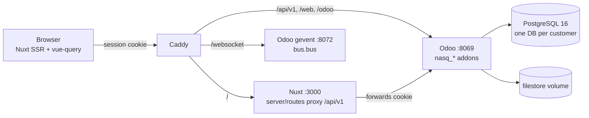
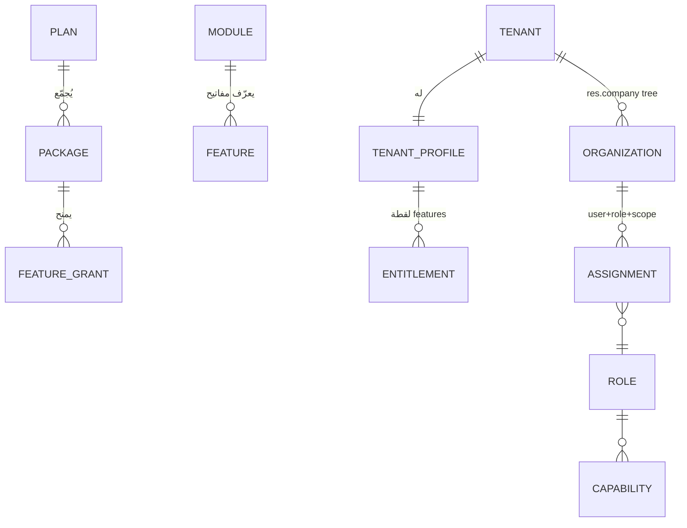
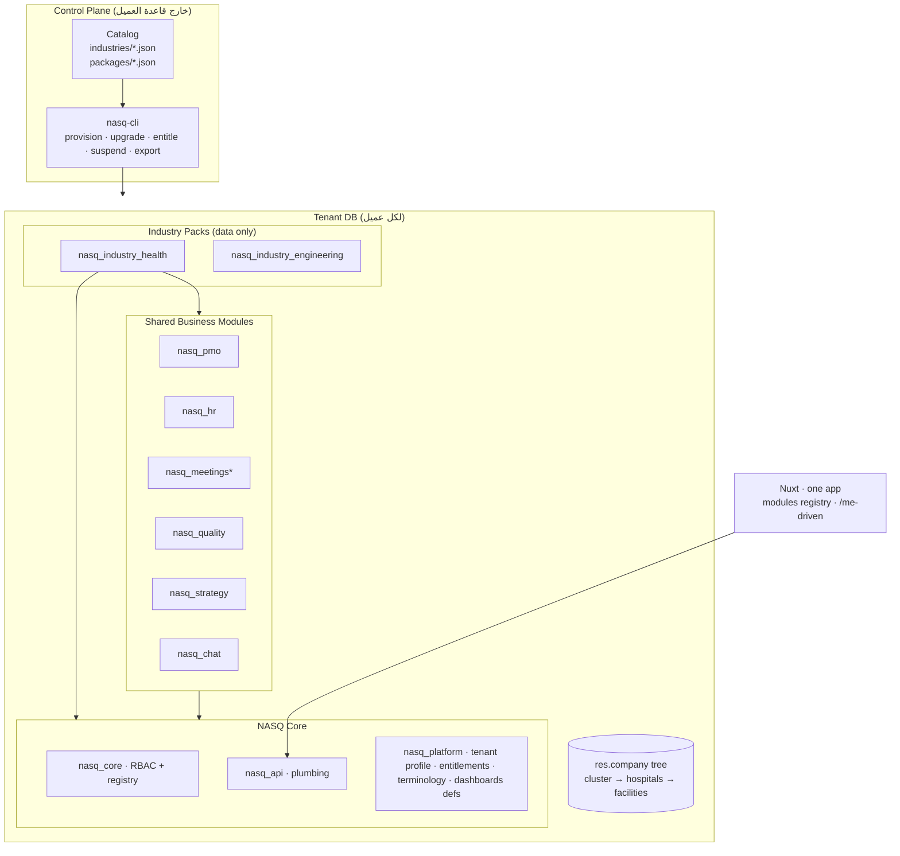
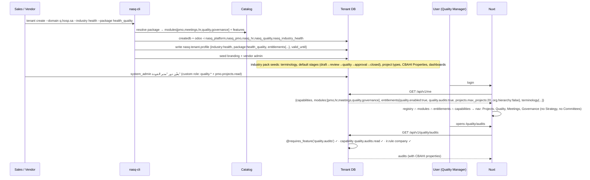

# NASQ — تحليل الوضع الحالي وخارطة التحول إلى Vertical SaaS Platform

**التاريخ:** 2026-09-15
**الحالة:** تحليل تاريخي للكود عند `dbf580c7`، وليس وصف الحالة الحية أو اتجاه الاستضافة النهائي. الهدف الأحدث SaaS ذاتي الخدمة بخدمات مشتركة وقاعدة وملفات مستقلة، مع حكومة غير SaaS؛ [عقد الاتجاه الحالي](nasq-shared-saas-and-sovereign-deployment.md). لا يتضمن هذا التحليل تغييرًا في الكود.
**المرجعية:** فحص فعلي للكود على `main` (`dbf580c7`) في `/Users/tariq/code/nasq` مع مصدر Odoo 19 في `/Users/tariq/code/odoo`.
**الأدوار:** Principal Software Architect + SaaS Product Architect + Technical Product Manager.

> منهج القراءة: كل حكم في هذا التقرير مربوط بملف وسطر. حيث لم أستطع الإثبات من الكود كتبت "غير مُثبت".

---

## 0. الخلاصة التنفيذية

1. **NASQ اليوم منتج Modular Monolith سليم البنية** على Odoo 19 CE + Nuxt 4، بنموذج "نشر مستقل لكل عميل". الأمن والصلاحيات وعزل الشركة (company) مبنية بعناية غير معتادة في مشاريع Odoo، ومغطاة باختبارات (657 اختبار Odoo، 145 ملف Vitest، 55 مواصفة Playwright).
2. **لا يوجد أي بنية SaaS**: لا Tenant، لا Plan، لا Entitlement، لا Feature Flag، لا Module Registry، لا Industry، لا Custom Fields، لا Workflow Engine، لا CI، لا مراقبة، لا نسخ احتياطي موثوق. هذا قرار موثّق في المواصفة الأصلية (`2026-09-03-nasq-platform-design.md`: "No multi-tenant SaaS") وليس إهمالًا.
3. **الخبر الجيد:** أغلب الفجوات يمكن سدّها بالإضافة لا بإعادة البناء، لأن Odoo نفسه يوفر معظم الأساسات المطلوبة وغير مستخدمة بعد: تعدد قواعد البيانات بالـ host (`dbfilter`)، تسلسل الشركات (`res.company.parent_id` / `parent_path`)، الحقول المخصصة (`fields.Properties`، موجودة أصلًا على `project.task`)، المراحل القابلة للتشكيل (`project.task.type`)، التتبع والتدقيق (`mail.tracking.value`)، والـ Cron والـ Bus.
4. **التوصية المعمارية المركزية:** *Tenant = قاعدة بيانات*، *Organization = `res.company` مع تسلسل*، *Module = Odoo addon* مع طبقة رقيقة `nasq_platform` تحمل (Tenant Profile + Entitlements + Capability Registry + Terminology)، و*Industry Pack = addon بيانات وتشكيل* (لا منطق أعمال)، و*Commercial Package = ملف كتالوج في Control Plane* يُترجم إلى وثيقة Entitlements داخل قاعدة العميل. الواجهة تبقى واحدة وتُشكَّل من `/api/v1/me`.
5. **أخطر ما يجب إصلاحه قبل أي "تجمع صحي":** أربعة مسارات تسريب محتملة بين الشركات داخل نفس قاعدة البيانات، غير مؤثرة اليوم (شركة واحدة لكل قاعدة) لكنها تصبح حقيقية فور وجود مستشفيات متعددة في قاعدة واحدة (القسم 17).
6. **خارطة الطريق:** 6 مراحل تدريجية، كل مرحلة تُسلّم قيمة مستقلة، والقطاع الصحي هو الاختبار الأول، والقطاع الثاني اختبار قابلية التوسع. التفاصيل في القسم 33.

---

## 1. Discovery — خريطة النظام الفعلية

### 1.1 الحجم

| البند | القيمة |
|---|---|
| Odoo addons (Python) | 30,443 سطر في 7 addons |
| Nuxt + contracts (TS/Vue) | 50,078 سطر |
| صفحات Nuxt | 104 |
| مسارات `/api/v1` | 172 (`@http.route`) |
| اختبارات Odoo | 657 `def test_` |
| ملفات Vitest | 145 |
| مواصفات Playwright | 55 (ضد Odoo حقيقي، تسلسليًا) |
| Commits | 485 منذ 2026-09-03 (12 يومًا) |
| CI | لا يوجد (`.github/workflows` غير موجود) |
| Migrations | لا يوجد مجلد `migrations/` في أي addon |
| Customer overlays | لا يوجد `customer_*` رغم أنه النمط الموثّق |

### 1.2 المستودع

```
nasq/
├── odoo-addons/
│   ├── nasq_core        الصلاحيات (28 capability)، الأدوار، التعيينات، التدقيق، حماية الهوية
│   ├── nasq_api         api_handler، auth/TOTP، /me، branding، admin users/roles
│   ├── nasq_pmo         المشاريع، المهام، الميثاق، الحوكمة، المالية، القوالب، الاجتماعات (امتداد)، الإشعارات
│   ├── nasq_hr          الموظفون، الأقسام، الوثائق (بدون sudo)
│   ├── nasq_chat        غلاف فوق discuss.channel (غير معزول بالشركة)
│   ├── cyan_meeting_minutes   محرك الاجتماعات (LGPL، vendor)
│   └── web_theme_shadcn       ثيم وحدة تحكم المورّد
├── apps/web             Nuxt 4 + Nuxt UI 4 + vue-query + i18n (ar افتراضي)
├── packages/contracts   Zod schemas (common/access/pmo/hr/meetings/chat)
├── deploy/              compose + Caddy + provision.sh + backup.py (غير موثوق) + branding.json
└── docs/                specs, plans, reports, design-system
```

---

## 2. AS-IS Architecture Report

### 2.1 Current Stack

| الطبقة | الحالي | الدليل |
|---|---|---|
| Frontend | Nuxt 4.5, Vue 3.5, Nuxt UI 4.11, Tailwind 4, @tanstack/vue-query 5, @tanstack/vue-table 8, Tiptap 3, Unovis, Zod 4, @nuxtjs/i18n 10 (ar افتراضي، RTL) | `apps/web/package.json` |
| Backend | Odoo 19.0 CE (Python)، addons LGPL-3، `type='json2'` + `auth='user'` + `@api_handler` | `nasq_api/controllers/common.py:42-62` |
| Database | PostgreSQL 16، قاعدة واحدة لكل عميل، `dbfilter = ^${DB_NAME}$`, `list_db = False` | `deploy/odoo.conf` |
| Cache | لا يوجد Redis. ormcache الخاص بـ Odoo فقط. Branding عبر `Cache-Control: max-age=300` | `nasq_api/controllers/branding.py` |
| Queue / Jobs | `ir.cron` فقط (3 crons: مواعيد المهام، تذكير الاجتماعات، تصعيد القرارات). لا queue_job | `nasq_pmo/data/*_cron.xml` |
| Storage | filestore محلي داخل volume `odoo_data`. لا S3 | `deploy/docker-compose.yml` |
| Auth | جلسة Odoo (cookie) + TOTP عبر `auth_totp`. لا bearer للمتصفح. لا SSO | `nasq_api/controllers/auth.py` |
| Realtime | Odoo `bus.bus` عبر `/websocket` + `useBus()` singleton مع backoff | `apps/web/app/composables/useBus.ts` |
| Deployment | 4 حاويات لكل عميل (Caddy, web, odoo `--workers 2`, db) عبر `provision.sh` | `deploy/` |
| Observability | healthchecks فقط. لا Sentry / metrics / log aggregation | `deploy/docker-compose.yml` |
| CI | لا يوجد | `.github/` |

### 2.2 كيف يعمل النظام اليوم



- **الطلب:** المتصفح → Caddy → Nuxt (SSR يمرّر الكوكي) أو Odoo مباشرة. كل مسار `/api/v1` يمر عبر `@api_handler` الذي يفتح `savepoint` ويحوّل الاستثناءات إلى `{code,message,field}` مع HTTP status حقيقي.
- **الهوية:** `/api/v1/me` يعيد `roles` و`capabilities` و`company` و`access_policy_version` (`nasq_api/serializers/user.py:20-38`). الواجهة تبني التنقل والحراسة كلها من هذه القائمة.
- **الصلاحيات:** `nasq.access.service._nasq_capability_keys` استعلام SQL لكل نداء (بدون cache) على `(user, company)`، مع مزامنة عكسية إلى `res.groups` كي تعمل ACL/record rules الأصلية (`nasq_core/models/res_users.py:160-189`).
- **الكتابة:** كل write يرجع الشكل الكامل، والعميل يستبدل الكاش. التحولات (transitions/approvals) تنتظر تأكيد الخادم.
- **العزل:** بالشركة (`env.company`) عند ثلاث طبقات: domain في الـ controller + `ir.rule` + إعادة فحص في الخدمة.

### 2.3 Current Domains

| Domain | الغرض | الكيانات الرئيسية | التبعيات | API | Frontend | الجداول |
|---|---|---|---|---|---|---|
| **Access (nasq_core)** | كتالوج 28 capability، أدوار مبنية/مخصصة، تعيينات بنطاق الشركة، تدقيق غير قابل للتعديل، حماية هوية المؤسسة | `nasq.access.permission/role/assignment/audit`, امتدادات `res.users/company/partner`, `ir.attachment` | base, project, hr, cyan_meeting_minutes | عبر nasq_api `/admin/*` | `/settings/users|roles|access-log` | `nasq_access_*` |
| **API plumbing (nasq_api)** | api_handler، auth/TOTP، `/me`، branding | لا نماذج جديدة | nasq_core, auth_totp | `/me`, `/branding`, `/admin/*`, `/auth/totp` | login, account, branding | – |
| **PMO (nasq_pmo)** | مشاريع بميثاق PMBOK، مهام مع موافقة إكمال، مراحل لكل مشروع، معالم، قوالب JSON، مالية (budget/expense)، حوكمة (RACI/stakeholders/register)، تحديثات، تقارير، إشعارات | `project.project/task/milestone/update/tags/task.type`, `nasq.project.finance.entry`, `nasq.project.stakeholder/raci/register`, `nasq.project.template`, `nasq.project.type/owning.unit`, `nasq.pmo.settings` | nasq_api, project, hr, mail, bus, cyan_meeting_minutes | 114 مسار في 25 ملف | `/projects/**`, `/tasks/**`, `/project-templates`, `/reports`, `/settings/projects` | `project_*`, `nasq_project_*` |
| **Meetings (cyan + nasq_pmo)** | محاضر، قرارات مع تصعيد، سلاسل متكررة، نسخ محاضر غير قابلة للتعديل، تحويل قرار إلى مهمة | `cyan.meeting.minute/resolution`, `nasq.meeting.series`, `nasq.meeting.minutes.version`, `nasq.meeting.event`, `calendar.event` | calendar, mail | `/meetings/**` | `/meetings/**` | `cyan_meeting_*`, `nasq_meeting_*` |
| **HR (nasq_hr)** | دليل موظفين، أقسام (شجرة عرض فقط)، وثائق أقسام، أرشفة تعطّل الدخول | `hr.employee/department/version`, `nasq.hr.document` | nasq_api, hr, mail | `/hr/*` (employee ids) | `/hr/**` | `hr_*`, `nasq_hr_document` |
| **Chat (nasq_chat)** | محادثة أعضاء فقط فوق `discuss.channel` | لا نموذج دائم جديد | nasq_api, mail | `/chat/*` | `/chat` | `discuss_channel*` (غير معزول بالشركة) |
| **Branding** | لون أساسي واحد يشتق ثيمًا كاملًا في وقت التشغيل | `res.company.primary_color/font/logo` | – | `/branding`, `/admin/branding` | `/settings/branding`, `brandTheme.ts` | `res_company` |

---

## 3. تقييم النظام الحالي (من 10)

الدرجات مقيسة على "منتج نشر مستقل لكل عميل" **و** على "Vertical SaaS" حين يختلفان.

| المحور | الدرجة | الدليل من الكود | الخطر | التوصية |
|---|---|---|---|---|
| Architecture | **7** | حدود addons واضحة، `nasq_api` لا يستورد pillar، hooks `_check_/_do_/_post_` للتجاوز، contracts مستقلة | 28 capability مثبتة بـ `assert len == 28` في core تجعل كل module جديد يعدّل core | Capability registry يساهم فيه كل addon (القسم 30) |
| Modularity | **6** | addons مستقلة فعلًا؛ لكن تسجيل module على الواجهة يلمس 7–9 ملفات مركزية (`shellModules.ts`, `activeRoute.ts`, `accessPolicy.ts`, `GlobalSearch.vue`, `nuxt.config.ts`…) | إضافة Quality/Strategy تكرر التعديل اليدوي | Module manifest registry على الواجهة + `modules[]` في `/me` |
| Multi-tenancy | **3** (كـ SaaS) / **8** (كعزل نشر) | العزل الفعلي = قاعدة+حاويات لكل عميل. داخل القاعدة العزل بالشركة مُثبت باختبار `test_current_company_limits_capabilities_and_access_records` | لا تسلسل مؤسسات، `/branding` يعيد أول شركة (`order='id', limit=1`)، chat غير معزول، مزامنة groups تتّحد عبر الشركات | Tenant=DB، Org=company tree، إغلاق مسارات التسريب الأربعة قبل التجمع |
| RBAC | **8** | Capability + dependency graph + custom roles بنطاق الشركة + optimistic locking بـ `pg_advisory_xact_lock` + last-admin guard | لا Scope غير `company` (النموذج يرفض غيره بـ `unsupported_scope`، أي مهيأ للتوسع) | إضافة scope kind `subtree` و(لاحقًا) `department` |
| Security | **8** | حماية هوية المؤسسة بـ precommit markers على company/partner/attachment، تدقيق غير قابل للتعديل يرفض مفاتيح الأسرار، `nasq_hr` بلا sudo، كل sudo في PMO موثّق | لا CI يمنع تراجعًا؛ تحصين `deploy/security/odoo_secure.py` غير مدمج في صورة Docker | CI إلزامي + نقل التحصين للصورة |
| Database design | **7** | company_id على كل جدول أعمال، فهارس على الحقول المخصصة، unique index للربط بين قرار ومهمة، JSON فقط لأشكال ثابتة مُتحقق منها | `nasq_pmo_rules.xml` يسمح `company_id = False`؛ لا migrations؛ `discuss_channel` بلا شركة | تشديد القاعدة، اعتماد `migrations/`، Properties للحقول المخصصة |
| Frontend architecture | **7** | حراسة واحدة (`hasCapability`) للمسار والتنقل والبحث، data layer موحد (`useApi` + Zod + keys)، ثيم runtime من لون واحد، Storybook إلزامي مع بوابة سياسة | 4 هياكل ثابتة متوازية للتنقل، لا مفهوم module/entitlement/terminology | Registry واحد يشتق منه الكل |
| Maintainability | **7** | قواعد صارمة في CLAUDE.md، serializers whitelist، اختبارات كثيفة | تحقق يدوي لكل endpoint، تعليق manifest قديم (`people.py` لا يستخدم `hr.employee.public`)، تكرار `_nasq_validate_scope` في 4 ملفات HR | مساعد تحقق مشترك (اختياري)، mixin للنطاق |
| Extensibility | **5** | hooks للتجاوز موجودة؛ لكن الحالات والحقول القابلة للكتابة ثوابت Python، والميثاق schema ثابت | كل حقل صناعي = تعديل core + serializer + contract | Properties + industry pack + whitelist مشتق من البيانات |
| Testing | **7** | 657 + 145 + 55؛ اختبارات عزل شركات صريحة؛ تكافؤ contracts يُثبت بجولة حية | لا CI؛ تكافؤ contracts يُكتشف فقط عند تشغيل Playwright يدويًا | GitHub Actions مع scratch DB |
| Observability | **2** | healthchecks فقط | لا يمكن تشغيل عشرة عملاء بلا رؤية | Sentry + logs مهيكلة + uptime؛ لاحقًا metrics |
| SaaS readiness | **2** | provision.sh لعميل واحد؛ backup مُعلَّم `UNVERIFIED`؛ لا plan/entitlement/tenant/billing | كل عميل جديد = تشغيل يدوي وستاك كامل | Control plane صغير + multi-db routing (القسم 34) |
| Verticalization readiness | **3** | لا industry/terminology/pack؛ لكن مراحل المشروع وإعدادات PMO وكتالوجات النوع/الوحدة بيانات لكل شركة، والثيم runtime | القطاع الصحي اليوم = نفس المنتج بأسماء عامة | Industry pack كـ addon بيانات + terminology overlay على i18n |

---

## 4. ما الذي يوفره Odoo 19 جاهزًا ولم يُستخدم بعد (القسم 22 من الطلب)

قبل اقتراح بناء أي مكون، هذا ما وجدته في مصدر Odoo نفسه وقابل للاستخدام دون اعتماديات جديدة:

| الحاجة | الحل الجاهز | الدليل | الحكم |
|---|---|---|---|
| تسلسل مؤسسات (تجمع → مستشفى → منشأة) | `res.company.parent_id`, `child_ids`, `parent_path`, `root_id`, حقول موروثة من الجذر | `odoo/addons/base/models/res_company.py:51-56, 318-321` | **استخدم** بدل org_unit جديد |
| رؤية عبر مؤسسات | `env.companies` / `allowed_company_ids` + `_check_company_domain` | `odoo/orm/models.py:4003` | **استخدم** للنطاق الفرعي |
| حقول مخصصة بلا أعمدة | `fields.Properties` + `fields.PropertiesDefinition`؛ موجود أصلًا: `project.project.task_properties_definition` و`project.task.task_properties` | `odoo/orm/fields_properties.py:32,844`; `addons/project/models/project_task.py:195` | **استخدم** ولا تبنِ محركًا |
| Workflow قابل للتشكيل | `project.task.type` مراحل لكل مشروع، تُدار في nasq بالفعل (`_nasq_add_stage`) + إعدادات مراحل افتراضية في `nasq.pmo.settings` | `nasq_pmo/models/project_project.py:805-841` | **وسّع** بحقلين بدل محرك |
| تدقيق تغييرات الأعمال | `tracking=True` → `mail.tracking.value` (مستخدم في timeline) | `nasq_pmo/controllers/timeline.py` | **استخدم** بدل جدول تدقيق عام |
| تعدد قواعد بيانات لعدة عملاء على بنية واحدة | `dbfilter` بـ `%h`/`%d` (host-based) — نموذج Odoo SaaS نفسه | `odoo.conf` + `odoo/http.py` db routing | **استخدم** للـ Shared SaaS |
| SSO لاحقًا | `auth_oauth`, `auth_ldap` (CE) | addons قياسية | **مؤجل** |
| Feature flags | لا حاجة لمكتبة؛ وثيقة entitlements JSON + `ir.config_parameter` | – | **ابنِ صغيرًا** (~200 سطر) |
| Billing | لا تبنِه في قاعدة العميل. Control plane خارجي (Stripe/Moyasar لاحقًا) | – | **مؤجل** |
| Search | Postgres `pg_trgm`/FTS عبر `_search` مخصص؛ لا Elasticsearch | – | **مؤجل** |
| Notifications | `mail.message` + `mail.notification` + `bus.bus` (موجود ومُحكم بمفتاح فريد) | `nasq_pmo/models/mail_notification_nasq.py:32-34` | **احتفظ** |
| Files | `ir.attachment` + `/web/content` مع ACL (موجود) | – | **احتفظ** |

**لا OCA** (AGPL، مستبعد بقرار مسبق). لا Enterprise.

---

## 5. Tenant Model (القسمان 7 و19 و20)

### 5.1 القرار

| المفهوم | التمثيل | السبب |
|---|---|---|
| **Tenant** (العميل المتعاقد) | **قاعدة بيانات Odoo واحدة** | عزل قوي حقيقي (Postgres level)، تفعيل modules = تثبيت addons لكل قاعدة، نسخ/تصدير/حذف/تعليق = عمليات على قاعدة واحدة. هذا هو ما يعمل به NASQ اليوم وما يعمل به Odoo SaaS. عزل الشركات داخل قاعدة واحدة في Odoo *ليس* حدًّا أمنيًا كافيًا بين عملاء لا يثقون ببعضهم (partners, attachments, discuss, sequences مشتركة). |
| **Organization** | `res.company` | كل الـ RBAC والـ record rules في nasq مبنية عليها أصلًا. |
| **Parent / Subsidiaries / Facilities** | `res.company.parent_id` (branches) داخل نفس Tenant | جاهز في Odoo 19، يورّث حقول الجذر (currency, country…). |
| **Membership** | `res.users.company_ids` + `nasq.access.assignment(user, role, company, scope)` | موجود. |
| **Active organization** | `env.company` (اختيار الشركة الحالية) | موجود ومُختبر. |
| **Cross-organization access** | assignment بـ `scope.kind = 'subtree'` → record rules تقارن `parent_path` | توسيع طبيعي للنموذج الحالي الذي يرفض اليوم أي kind غير `company`. |
| **Central administration** | تعيين دور على شركة الجذر بنطاق `subtree` | – |
| **Tenant configuration** | `nasq.tenant.profile` (singleton per DB): industry_key, package_key, entitlements JSON, terminology overrides, تاريخ الصلاحية | جديد، صغير. |
| **Tenant branding** | `res.company` (موجود؛ بالفروع يورث من الجذر افتراضيًا) | – |

### 5.2 التجمع الصحي = Configuration لا Fork

```
Tenant "cluster-riyadh" (DB واحدة)
└── res.company "تجمع الرياض الصحي" (root)          ← Central PMO / Strategy / Quality
    ├── res.company "مستشفى أ"  (parent = root)
    │   └── res.company "مركز رعاية أولية 1"
    ├── res.company "مستشفى ب"
    └── hr.department (داخل كل شركة كما هو اليوم)
```

- الباقة `health_cluster` ترفع `org.hierarchy = true` و`org.max_companies = N`.
- نشر مخصّص (Dedicated) للتجمع = نفس `docker-compose` بقاعدة واحدة. لا كود مختلف.
- **شرط مسبق إلزامي:** إغلاق مسارات التسريب الأربعة (القسم 17.4) لأن التجمع يعني عدة شركات في قاعدة واحدة لأول مرة.

### 5.3 نماذج النشر

| النموذج | متى | التغيير المطلوب |
|---|---|---|
| **Dedicated** (الحالي) | العملاء الكبار، متطلبات تعاقدية | لا شيء الآن |
| **Shared SaaS** | الهدف الأساسي المعتمد لاحقًا | **وصفة هذا الصف التاريخية غير صالحة للتنفيذ:** `dbfilter=^%h$` واستنتاج Nuxt للقاعدة من Host لا يكفيان. يلزم resolver موثوق وفشل مغلق في login/SSR/API/content/WS/jobs وعزل filestore/backup وفق [العقد الأحدث](nasq-shared-saas-and-sovereign-deployment.md). ترقيم «المرحلة 5» والتأجيل تاريخيان. |

---

## 6. Module System (القسم 8)

**الحكم: لا نحتاج Module Registry في قاعدة البيانات.** Odoo addon *هو* الـ module: له key/name/version/depends/installable/data، وتفعيله لعميل = تثبيته في قاعدته (`ir.module.module` هو الـ registry فعلًا).

ما ينقص فقط طبقة رقيقة من **metadata يعلنها كل addon** كي تعرف المنصة والواجهة:

```python
# في كل addon نسق: models/nasq_module.py
class NasqModuleQuality(models.AbstractModel):
    _inherit = 'nasq.module.registry'
    def _nasq_modules(self):
        return super()._nasq_modules() + [{
            'key': 'quality',
            'capabilities': {'quality.audits.read', 'quality.audits.manage', ...},
            'dependencies': {'quality.audits.manage': {'quality.audits.read'}},
            'feature_root': 'quality',          # يُطابق مفتاح entitlements
        }]
```

- `nasq_core.CAPABILITIES` تصبح مجموع ما يعلنه المسجلون (مع اختبار يضمن الثبات بدل `assert == 28` في الكود).
- `/api/v1/me` يعيد `modules: ['pmo','hr','meetings','quality']` (المثبت فعلًا) بجانب `capabilities`.
- الواجهة: `apps/web/app/modules/registry.ts` واحد يشتق منه `shellModules`, `activeRoute`, `accessPolicy.destinations`, أقسام البحث (توصية موثّقة في القسم 14).

---

## 7. Feature Entitlements (القسم 9)

**فصل صريح:** Module availability (addon مثبت) ≠ Feature availability (ما تسمح به الباقة) ≠ Permission (ما يملكه المستخدم).

### 7.1 التمثيل

وثيقة JSON واحدة لكل Tenant، تُكتب من Control Plane وتُخزن في `nasq.tenant.profile.entitlements` (مع `ir.config_parameter` كنسخة احتياطية للقراءة السريعة):

```json
{
  "plan": "health_quality",
  "industry": "health",
  "valid_until": "2027-09-15",
  "features": {
    "projects.enabled": true,
    "projects.max_projects": 20,
    "projects.portfolio": false,
    "quality.enabled": true,
    "quality.audits": true,
    "governance.enabled": true,
    "org.hierarchy": false,
    "org.max_companies": 1,
    "reports.advanced": false,
    "ai.project_analysis": false,
    "users.limit": 50,
    "storage.limit_mb": 10240
  }
}
```

### 7.2 الإنفاذ بلا انتشار شروط

- خدمة واحدة: `env['nasq.entitlement.service'].get(key, default)` و`.require(key)` (ترفع `NasqAccessRule('feature_not_included', status=403)` بشكل موحد).
- decorator على الـ controller: `@requires_feature('quality.audits')` يُطبَّق بجوار `@api_handler`.
- الحدود العددية تُفحص في نقطة اختناق واحدة لكل مورد (`_nasq_create_project` → `require_within_limit('projects.max_projects', count)`).
- **قاعدة:** لا `if plan == 'health_quality'` في أي مكان. الكود يسأل عن *feature* فقط؛ ترجمة الباقة إلى features تحدث خارج الكود (كتالوج).
- الواجهة تقرأ `entitlements` من `/me` وتُخفي/تعطّل (لا تحرس أمنيًا؛ الحراسة في الخادم).

### 7.3 نموذج البيانات المفاهيمي



PLAN/PACKAGE/FEATURE_GRANT تعيش في **Control Plane** (ملفات كتالوج JSON في البداية). داخل قاعدة العميل توجد فقط اللقطة (ENTITLEMENT) + MODULE (ir.module) + RBAC.

---

## 8. Configuration precedence (القسم 10)

| المستوى | أين | أمثلة | يملكه |
|---|---|---|---|
| 1. Global (code defaults) | Python/TS defaults | حالات المهمة، الحدود القصوى التقنية | المورّد |
| 2. Industry | addon `nasq_industry_<x>` (data XML/JSON + Properties definitions + terminology) | مصطلحات، مراحل افتراضية، أنواع مشاريع، لوحات افتراضية، حقول CBAHI | المورّد |
| 3. Package | وثيقة entitlements | features, limits | المورّد (Control Plane) |
| 4. Tenant | `res.company` + `nasq.pmo.settings` + `nasq.tenant.profile.overrides` + Properties definitions المعدّلة | شعار، هيكل، حقول إضافية، سير عمل مفعّل، إعدادات محلية | العميل (system_admin) |
| 5. User | `res.users` prefs (lang, tz, appearance) | تفضيلات، تخطيط لوحة | المستخدم |

**قواعد الأسبقية:**
- الأعلى رقمًا يغلب في *القيم القابلة للتخصيص*، لكن **Package يضع سقفًا** لا يتجاوزه Tenant (لا يمكن للعميل تفعيل feature غير ممنوحة).
- Industry يوفر *افتراضيات* فقط؛ لا يقفل شيئًا.
- لا يستطيع أي مستوى تجاوز Authorization (القسم 29).

---

## 9. Custom Fields (القسم 11)

**الحالي:** لا يوجد. `fields.Json` مستخدم 7 مرات لأشكال ثابتة مُتحقق منها فقط (objectives, deliverables, template definition, minutes form).

**التوصية:** `fields.Properties` الأصلي.

- موجود أصلًا على `project.task` بتعريف على `project.project` (`task_properties_definition`) لكنه غير معروض في serializers.
- إضافة: `project_properties_definition` على مستوى **الشركة** (أو `nasq.project.type`) لحقول المشروع، و`meeting_properties_definition` بالمثل.
- Industry pack يزرع التعريف الافتراضي (مثلًا: `cbahi_standard` selection، `quality_dimension`, `facility_code`). Tenant يعدّل التعريف من الإعدادات.
- **الحدود المعمارية:** البيانات الجوهرية (state, deadline, assignee, company, budget) تبقى أعمدة علائقية. Properties للـ "بيانات وصفية قطاعية" فقط، غير مستخدمة في record rules أبدًا.
- **التحقق:** Odoo Properties يدعم الأنواع (char, integer, float, date, datetime, selection, tags, many2one, boolean) لكنه لا يدعم `required`. نضيف مفتاح `nasq_required: true` في التعريف ونتحقق في `_nasq_validate_properties()` (~50 سطرًا) قبل الكتابة.
- Serializers: مفتاح `properties` مُعلَن (whitelist للتعريف نفسه، لا للقيم الحرة).

---

## 10. Workflow (القسم 12)

**الحالي:** حالات المهام والاجتماعات والقرارات ثوابت Python (`ALL_STATES` في `project_task.py:10-11`، `_cyan_check_transition` في `meeting.py:172-183`). لا محرك، لكن التحول مفكك إلى hooks قابلة للتجاوز.

**التحليل:** ما تصفه الأمثلة (Draft → Review → Quality → Approval → Closed) هو **pipeline** لا **lifecycle**. في Odoo هناك فصل جاهز:
- **State** (lifecycle ثابت، 6 قيم على السلك): in_progress / changes_requested / approved / waiting / done / cancelled. هذا لا يختلف بين القطاعات.
- **Stage** (`project.task.type`): قابل للتشكيل لكل مشروع، وبيانات، وموجود بالفعل مع إعدادات مراحل افتراضية لكل شركة.

**التوصية: State Machine خفيف على المراحل، لا Workflow Engine.**

توسيع `project.task.type` بأربعة حقول:

| الحقل | المعنى |
|---|---|
| `nasq_key` | مفتاح ثابت (`review`, `quality`) للقوالب والتقارير |
| `nasq_enter_capability` | capability مطلوبة لنقل مهمة إلى هذه المرحلة (فارغ = أي كاتب) |
| `nasq_is_gate` | المرحلة بوابة موافقة (تُشغّل آلية completion approval الحالية) |
| `nasq_next_stage_keys` | (اختياري) قائمة المراحل المسموح الانتقال إليها؛ فارغ = حر |

- Industry pack يزرع المراحل الافتراضية. Tenant يعدّلها. القالب (`nasq.project.template`) يشير إليها بالمفتاح (موجود).
- إن ثبتت الحاجة لاحقًا لآلة حالات على كيان آخر (Risk, Audit) نعمّم نفس الأربعة حقول عبر mixin `nasq.staged.mixin`. لا نبني DSL.
- **DEFER:** محرك workflow عام (شروط، إجراءات، مؤقتات). لا حاجة مثبتة.

---

## 11. Permissions (القسم 13)

### 11.1 التمييز المطلوب مقابل الحالي

| المفهوم | الحالي | التغيير |
|---|---|---|
| Role | `nasq.access.role` (built_in/custom، بنطاق الشركة) | KEEP |
| Permission (capability) | 28 مفتاح ثابت في core | MODIFY → registry يساهم فيه كل addon |
| Scope | `company` فقط (`unsupported_scope` لغيره) | MODIFY → `company` \| `subtree`؛ `department` مؤجل حتى تُثبت الحاجة |
| Organization | `res.company` | KEEP + تسلسل |
| Ownership | `project.user_id` يمنح 3 capabilities سياقية | KEEP |
| Delegation | غير موجود | DEFER (يُمثَّل كتعيين مؤقت بتاريخ انتهاء إن لزم) |
| Management hierarchy | `hr.department.parent_id` عرض فقط | DEFER؛ حين يُطلب "مدير القسم يرى أقسامه الفرعية" يُنفَّذ كـ scope `department` |
| Module access | ضمني عبر capabilities | إضافة `modules[]` (مثبت) |
| Feature entitlement | غير موجود | القسم 7 |

### 11.2 قاعدة القرار الفعّال

```
allowed(user, action, record) =
      module_installed(action.module)                 # ir.module
  AND entitlement.allows(action.feature)             # الباقة
  AND has_capability(user, action.capability, company_of(record))   # RBAC
  AND record_rule_visible(user, record)              # ir.rule (company/subtree/ownership)
```

الباقة تسمح بـ Risks لكن المستخدم بلا `quality.risks.read` → ممنوع. المستخدم لديه الصلاحية والباقة لا تشمل Risks → 403 `feature_not_included`. قراران مستقلان بمسارين مستقلين.

### 11.3 إصلاح مطلوب في النموذج الحالي

مزامنة capabilities إلى `res.groups` (`res_users.py:160-189`) تتّحد عبر **كل** شركات المستخدم، فيصبح المستخدم عضوًا في `group_cap_*` عالميًا، ويعتمد العزل بعدها على وجود domain شركة في **كل** record rule. مع التجمع (5 شركات لمستخدم واحد) يكبر نصف قطر الانفجار. الحل الأرخص: اختبار آلي يفحص أن كل نموذج له ACL على `group_cap_*` يملك rule بشركة، وتوثيق القاعدة. الحل الأكمل (لاحقًا): الاعتماد على `_search` overrides بنمط `nasq.governance.visibility` بدل الثقة في groups.

---

## 12. Frontend Architecture (القسمان 14 و15)

### 12.1 الحالي

- قوي: حراسة واحدة `hasCapability` تُستخدم في middleware والتنقل والبحث؛ `useApi` + Zod + query keys منضبطة؛ ثيم runtime كامل من لون واحد (`brandTheme.ts`)؛ Storybook إلزامي مع بوابة `tools/ui_policy.py`.
- ضعيف: أربعة هياكل ثابتة متوازية للتنقل (`shellModules.ts` items/shellModules/contextLinks، `activeRoute.ts`، `accessPolicy.ts` destinations، `GlobalSearch.vue`)، `ShellModule` union مغلق، i18n بملفات ثابتة في `nuxt.config.ts` بلا طبقة مصطلحات.

### 12.2 التوصية: واجهة واحدة تُشكَّل من `/me`

```ts
// apps/web/app/modules/registry.ts  (مصدر الحقيقة الوحيد)
export interface ModuleManifest {
  id: string                       // 'quality'
  icon: NavIcon
  railTo: string
  navItems: { to: string; labelKey: string; capability: string; feature?: string }[]
  contextLinks: ShellContextLink[]
  activePathPrefixes: string[]
  search?: { capability: string; endpoint: string; keyRoot: string }
}
```

- `useNav(me)` يرشّح: `me.modules.includes(id)` ∧ `entitled(feature)` ∧ `hasCapability`.
- `activeShellModule`, `destinations`, أقسام البحث تُشتق من الـ registry.
- **Terminology:** `/me` يعيد `terminology: { 'projects.title': 'المبادرات', ... }` من الـ industry pack + overrides العميل؛ الواجهة تدمجها بـ `mergeLocaleMessage` بعد التحميل. المفاتيح تبقى واحدة، القيم تتبدل. لا Nuxt layers، لا واجهة لكل قطاع.
- **UX القطاعي** يتحقق بـ: terminology + default modules + default dashboards (تعريف لوحة = JSON tiles تُزرع من الـ pack) + templates + Properties + مراحل. الشيفرة واحدة.
- Dashboards: تعريف لوحة كبيانات (`nasq.dashboard.definition` JSON) يزرعه الـ pack ويعدّله العميل؛ `DashboardChart.client.vue` موجود.

---

## 13. API Architecture (القسم 16)

| البند | الحالي | الحكم |
|---|---|---|
| Boundaries | `/api/v1/<pillar>/…`، addon لكل pillar، `nasq_api` مشترك | KEEP |
| Tenant resolution | ضمني (قاعدة واحدة عند كتابة التقرير) | **الوصفة التاريخية منسوخة:** لا يكفي `dbfilter` ولا يجوز أن يستنتج Nuxt قاعدة من Host غير موثوق؛ مرجع التنفيذ الحالي [عقد resolver والفشل المغلق](nasq-shared-saas-and-sovereign-deployment.md) |
| Authorization | capability + record rule + إعادة فحص في الخدمة | KEEP |
| Entitlement checks | غير موجود | ADD `@requires_feature` + `entitlement.service` |
| Validation | يدوي لكل endpoint (`_exact`, `parse_positive_int`) | KEEP الآن؛ DEFER مُساعد تحقق مشترك (لا Pydantic لتجنب اعتمادية) |
| Versioning | `/api/v1` ثابت؛ contracts بلا إصدار | KEEP؛ كسر التوافق = `/api/v2` لاحقًا |
| Internal services | AbstractModels (`nasq.access.service`, `nasq.pmo.settings`, `nasq.chat.service`) | KEEP النمط؛ أضف `nasq.entitlement.service`, `nasq.module.registry` |
| Events | `bus.bus` precommit + `mail.message` | KEEP |
| Background jobs | `ir.cron` | KEEP؛ DEFER queue حتى تظهر مهام طويلة (تصدير، AI) |
| Coupling risks | (1) `CAPABILITIES` مركزية؛ (2) `/branding` أول شركة؛ (3) `nasq_chat` يستدعي `nasq.access.service` دون إعلان تبعية؛ (4) تعليق manifest قديم في `nasq_pmo` | إصلاحات صغيرة في المرحلة 0/1 |

---

## 14. Database (القسم 17)

### 14.1 التصنيف

| الفئة | الجداول |
|---|---|
| **Core** | `res_company` (+ nasq fields), `res_users` (+ nasq_access_*), `res_partner`, `nasq_access_permission/role/assignment/audit`, `ir_attachment`, `mail_*`, `bus_bus`, `ir_cron`, `ir_config_parameter` |
| **Shared Business** | `project_project`, `project_task`, `project_task_type`, `project_milestone`, `project_update`, `project_tags`, `nasq_project_finance_entry`, `nasq_project_stakeholder/raci/register`, `nasq_project_template`, `nasq_project_type`, `nasq_project_owning_unit`, `cyan_meeting_minute/resolution`, `nasq_meeting_series/minutes_version/event`, `calendar_event`, `hr_employee/department/version`, `nasq_hr_document` |
| **Industry-specific** | لا يوجد بعد |
| **Infrastructure** | `discuss_channel*` (chat), `mail_notification` (+ `nasq_notification_key`), `mail_tracking_value` |
| **Legacy / questionable** | صفوف `project_project.company_id IS NULL` المسموح بها في `nasq_pmo_rules.xml`؛ مجموعات legacy (`group_customer_admin`, `group_employee`…) المدعومة عبر `legacy_current` |

### 14.2 الاستراتيجيات

- **tenant_id:** لا حاجة لعمود؛ Tenant = قاعدة. **organization_id:** `company_id` (موجود على كل جدول أعمال؛ الحوكمة عبر `project_id`).
- **FKs/Indexes:** جيدة؛ `meeting_id/resolution_id` أعداد صحيحة مقصودة مع unique index. لا فهرس مركب `(project_id, state)` — غير مطلوب عند الحجم الحالي.
- **Soft deletes:** `active` القياسي؛ `nasq.hr.document` و`nasq.access.audit` و`nasq.meeting.*version` تمنع الحذف.
- **Auditability:** access فقط في `nasq_access_audit`؛ الأعمال عبر `mail.tracking.value` (كافٍ).
- **JSON:** 7 مواضع بأشكال ثابتة. Properties ستضيف `properties` JSONB على task/project/meeting.
- **Polymorphic:** `mail_message.model/res_id` القياسي فقط.
- **Migrations:** لا يوجد `migrations/`؛ المشروع يعتمد إعادة إنشاء قواعد scratch. **يجب** اعتماد `migrations/19.0.1.x/` قبل أول ترقية لعميل حي.

### 14.3 Tenant Data Leakage — مسارات فعلية (تصبح حقيقية عند تعدد الشركات في قاعدة)

| # | المسار | الدليل | الأثر | الإصلاح |
|---|---|---|---|---|
| L1 | `discuss.channel` بلا `company_id` ولا rule | `nasq_chat/__manifest__.py:10`, `README.md:8-10` | عضو قناة من مستشفى أ يقرأ بعد انتقاله إلى ب | حقل `company_id` مخزَّن على القناة + rule + اختبار |
| L2 | `/api/v1/branding` يعيد `res.company` الأولى بـ `sudo()` بلا domain | `nasq_api/controllers/branding.py` | صفحة الدخول تعرض هوية الشركة الخطأ | اختيار الشركة بالـ host أو الجذر |
| L3 | مزامنة capabilities إلى groups تتّحد عبر الشركات | `nasq_core/models/res_users.py:160-189` | نموذج جديد بلا rule شركة يتسرب | اختبار تغطية rules + توثيق |
| L4 | `nasq_pmo_rules.xml` يسمح `company_id in [current, False]` | `nasq_pmo/security/nasq_pmo_rules.xml:3-7` | مشروع بلا شركة يظهر للجميع | تشديد إلى `= current` بعد backfill (مذكور في CLAUDE.md كمعلّق للاعتماد) |

بقية مسارات `sudo()` وُجدت موثقة ومحصورة (قراءة للعدّ، إشعارات بنطاق المستلم، migration مرة واحدة).

---

## 15. SaaS Foundations (القسم 18)

| القدرة | الحالة | القرار |
|---|---|---|
| Signup (self-service) | مفقود | **DEFER** — البيع B2B صحي عبر المبيعات؛ Provisioning من المورّد |
| Tenant provisioning | جزئي (`provision.sh` لعميل واحد) | **MODIFY** → أمر `nasq-cli tenant create --industry health --package health_quality` |
| Subscription / Trial | مفقود | **ADD صغيرًا**: `valid_until` + `status` في entitlements؛ Trial = باقة بتاريخ |
| Plans / Packages | مفقود | **ADD**: `deploy/catalog/packages/*.json` (مصدر الحقيقة) |
| Module activation | موجود ضمنيًا (`-i addons`) | **KEEP** كآلية؛ يُشغَّل من الكتالوج |
| Feature entitlements / Limits | مفقود | **ADD** (القسم 7) |
| Usage metering | مفقود | **ADD لاحقًا**: عدّادات بسيطة (users, projects, storage) في `/api/v1/admin/usage` |
| Billing | مفقود | **DEFER** (خارج قاعدة العميل) |
| Upgrade / Downgrade | مفقود | = تحديث وثيقة entitlements + تثبيت/تعطيل addon؛ Downgrade يمنع الإنشاء ولا يحذف |
| Cancellation / Suspension | مفقود | **ADD**: `status: suspended` يجعل `/login` يرفض عدا vendor |
| Data export | مفقود | **ADD**: `pg_dump` + filestore (موجود كـ candidate في `backup.py`) + تصدير CSV بالواجهة لاحقًا |
| Tenant deletion | مفقود | = drop DB + filestore بعد فترة احتفاظ |
| Backups / DR | candidate غير موثّق | **MODIFY** إلى مجدول + موثّق بالاستعادة |
| Observability | مفقود | **ADD** Sentry + logs |
| CI | مفقود | **ADD** أولًا |

---

## 16. Technical Debt Register (القسم 26)

| ID | المشكلة | الدليل | Severity | Prob. | Impact | الإجراء | Effort | Priority |
|---|---|---|---|---|---|---|---|---|
| TD-01 | لا CI؛ تكافؤ contracts يُكتشف يدويًا فقط | `.github/` بلا workflows؛ `e2e/contracts.spec.ts:44` | High | High | تراجع أمني/تعاقدي صامت | GitHub Actions: ruff, vue-tsc, vitest, Odoo tests على scratch DB، Playwright | M | P0 |
| TD-02 | لا migrations؛ كل تغيير schema يفترض قاعدة جديدة | لا `migrations/` في أي addon | High | High | استحالة ترقية عميل حي | اعتماد `migrations/` + اختبار `-u` على نسخة | S | P0 |
| TD-03 | chat غير معزول بالشركة | L1 | High (عند تعدد الشركات) | Med | تسريب محادثات | company_id + rule + test | S | P1 |
| TD-04 | `/branding` أول شركة | L2 | Med | High (عند تعدد) | هوية خاطئة | اختيار بالجذر/host | S | P1 |
| TD-05 | rule المشروع يسمح `company_id = False` | L4 | Med | Med | ظهور مشاريع قديمة | backfill + تشديد | S | P1 |
| TD-06 | اتحاد groups عبر الشركات | L3 | Med | Low اليوم | تسريب عند نموذج جديد بلا rule | اختبار تغطية rules | S | P1 |
| TD-07 | `CAPABILITIES` مركزية بـ `assert == 28` | `access_service.py:37` | Med | High | كل module يعدّل core | registry | M | P1 |
| TD-08 | 4 هياكل تنقل ثابتة + `ShellModule` مغلق | `shellModules.ts`, `activeRoute.ts`, `accessPolicy.ts`, `GlobalSearch.vue` | Med | High | 7–9 ملفات لكل module | registry واحد | M | P1 |
| TD-09 | حالات/مراحل/whitelists ثوابت Python | `project_task.py:10-11, TASK_WRITABLE_FIELDS` | Med | High | لا تشكيل قطاعي | حقول المراحل + Properties | M | P2 |
| TD-10 | backup غير موثّق (`UNVERIFIED`) | `deploy/backup.py`, `OPERATIONS.md:156-166` | High | Med | فقدان بيانات | جدولة + استعادة مُختبرة | M | P1 |
| TD-11 | لا observability | compose healthchecks فقط | Med | High | تشغيل أعمى | Sentry + structured logs | S | P1 |
| TD-12 | تحصين `odoo_secure.py` غير مدمج بالصورة | `deploy/security/README.md:3` | Med | Med | ثغرة PyPDF2 | Dockerfile مخصص | S | P1 |
| TD-13 | تحقق يدوي لكل endpoint | `access_admin.py` DSL محلي | Low | Med | انحراف | مساعد مشترك تدريجيًا | M | P3 |
| TD-14 | `useApi` schema اختياري | `useApi.ts:16-45` | Low | Low | نداء بلا تحقق | lint rule / default schema required | S | P3 |
| TD-15 | تعليق manifest قديم (`hr.employee.public`) + `nasq_chat` لا يعلن تبعية `nasq_core` | `nasq_pmo/__manifest__.py`, `nasq_chat/__manifest__.py` | Low | – | تضليل | تصحيح | XS | P2 |
| TD-16 | تكرار `_nasq_validate_scope` في 4 ملفات HR | `nasq_hr/models/*` | Low | Low | انحراف | mixin | S | P3 |
| TD-17 | legacy groups fallback (`legacy_current`) | `access_service.py:109-131` | Low | Low | تعقيد | إزالة بعد ترحيل كل المستخدمين | S | P3 |

---

## 17. Gap Analysis (القسم 27)

| الحاجة (TARGET) | الحالة | ملاحظة |
|---|---|---|
| Auth, Users, RBAC, Audit (access), Files, Comments, Notifications, Realtime, Branding | **Already Supported** | جودة عالية |
| Organization (single) | **Already Supported** | `res.company` |
| Organization hierarchy / cross-org | **Partially Supported** | Odoo يوفر؛ nasq لا يستخدمه؛ scope kind جاهز للتوسيع |
| Projects, Tasks, Subtasks, Milestones, Templates, Governance (RACI/register), Finance, Meetings, Decisions, HR directory, Chat | **Already Supported** | كـ shared modules بجودة جيدة |
| Dependencies, Attachments, Archive | **Already Supported** | |
| Reports / Dashboards | **Partially Supported** | حي بلا تعريف قابل للتشكيل |
| Settings | **Partially Supported** | PMO/branding/users؛ لا tenant profile |
| Module registry | **Needs Refactor** | capabilities مركزية؛ الواجهة يدوية |
| Feature flags / Entitlements / Plans / Packages | **Missing** | صغير |
| Tenant profile / Industry | **Missing** | |
| Custom fields | **Missing** (Odoo يوفر) | |
| Configurable workflow | **Partially Supported** | المراحل بيانات؛ تنقصها البوابات |
| Terminology overlay | **Missing** | |
| Search | **Partially** | بحث مسمّى لكل pillar |
| Risks / Issues | **Partially** | `nasq.project.register` على مستوى المشروع؛ لا سجل مخاطر مؤسسي |
| KPIs / OKRs / Strategy / Initiatives / Programs / Portfolios | **Missing** | shared modules جديدة |
| Quality / Audits / CBAHI | **Missing** | industry-driven shared module |
| Committees | **Partially** | سلاسل الاجتماعات + الحوكمة قريبة |
| Approvals (عام) | **Partially** | موافقة إكمال المهام فقط |
| Contracts, Clients, BOQ, Sites, Timesheets, Billing, Inventory, CRM, Scheduling | **Should Not Build Yet** | قطاعات لاحقة |
| Workflow Engine | **Should Not Build Yet** | |
| AI foundations | **Should Not Build Yet** | يُمثَّل كـ feature keys فقط |
| Multi-tenant shared runtime | **Missing** | multi-db routing |
| Control plane / provisioning API | **Missing** | CLI أولًا |
| Billing / Signup | **Should Not Build Yet** | |
| CI / Observability / Backups | **Missing** | شرط مسبق تشغيلي |

---

## 18. Target Architecture (القسم 28)

### 18.1 الطبقات



`nasq_meetings*` = الفصل المنطقي لاجتماعات nasq عن `nasq_pmo` (اليوم داخلها) — EXTRACT مؤجل حتى يستقر واجهة الـ registry.

### 18.2 المكونات الجديدة (كلها صغيرة)

| المكون | النوع | الحجم التقديري |
|---|---|---|
| `nasq_platform` addon: `nasq.tenant.profile`, `nasq.entitlement.service`, `nasq.module.registry`, terminology, dashboard definitions, `/api/v1/tenant` | Core | ~800 سطر + اختبارات |
| توسيع `/api/v1/me` بـ `modules`, `entitlements`, `terminology` | Core | ~100 |
| `@requires_feature` | Core | ~40 |
| scope `subtree` في assignments + rules بـ `parent_path` | Core | ~300 |
| حقول المراحل الأربعة + تحقق التحول | Shared | ~250 |
| Properties على project/task/meeting + serializers | Shared | ~300 |
| `nasq_industry_health`: بيانات فقط | Industry | XML/JSON |
| `apps/web/app/modules/registry.ts` + اشتقاق التنقل | Frontend | ~400 (استبدال) |
| terminology merge + entitlement guards على الواجهة | Frontend | ~150 |
| `deploy/catalog/` + `nasq-cli` (Python) | Control plane | ~600 |

---

## 19. Dependency Rules (القسم 29)

```
Odoo CE ◄── nasq_core ◄── nasq_api ◄── nasq_platform
                                       ▲
              Shared modules (pmo, hr, meetings, quality, strategy, chat) ──┘
                                       ▲
              Industry packs (health, engineering, …) ─────────────────────┘
```

1. **Core لا يعتمد على Shared ولا على Industry.** (اليوم `nasq_core` يعتمد على `project`, `hr`, `cyan_meeting_minutes` لأسباب groups — مقبول مؤقتًا، ويُزال تدريجيًا مع الـ registry.)
2. **Shared module يعتمد على Core فقط**، ولا يستورد shared module آخر (الربط عبر أعداد صحيحة/مفاتيح كما في `meeting_id`).
3. **Industry pack يعتمد على Core + Shared**، ويحتوي **بيانات وتشكيلًا فقط** (XML/JSON، Properties definitions، مراحل، مصطلحات، لوحات، قوالب). إذا احتاج القطاع *منطقًا* فهو إما shared module جديد أو `customer_*` overlay.
4. **Package لا يحتوي منطق أعمال**؛ هو ملف كتالوج → entitlements.
5. **Tenant configuration لا تتجاوز Authorization**؛ تُقرأ بعد الفحص لا قبله.
6. **Entitlements لا تمنح Permissions**؛ تحجب فقط.
7. **الواجهة تعتمد على `/me` وregistry**؛ لا تعرف اسم قطاع.
8. **Control Plane لا يقرأ بيانات أعمال العميل**؛ يكتب entitlements ويشغّل عمليات قاعدة.

---

## 20. Module Contract (القسم 30)

Odoo manifest + إعلان nasq:

```python
# __manifest__.py (قياسي)
{'name': 'nasq Quality', 'depends': ['nasq_platform'], 'version': '19.0.1.0.0', ...}

# models/nasq_module.py
def _nasq_modules(self):
    return super()._nasq_modules() + [{
        'key': 'quality',
        'name': {'ar': 'الجودة', 'en': 'Quality'},
        'feature_root': 'quality',
        'capabilities': {...},
        'dependencies': {...},
        'custom_role_allowed': {...},
        'builtin_role_grants': {'employee': {'quality.audits.read'}},
        'terminology_keys': ['quality.*'],
        'properties_hosts': ['nasq.quality.audit'],   # نماذج تقبل Properties
    }]
```

الواجهة: عنصر واحد في `modules/registry.ts` بالشكل المذكور في 12.2. الـ contracts: مجلد `packages/contracts/src/quality`. الـ i18n: `quality.json` (يُكتشف تلقائيًا من المجلد بدل القائمة اليدوية في `nuxt.config.ts`).

---

## 21. KEEP / MODIFY / EXTRACT / REPLACE / REMOVE / DEFER (القسم 21)

| العنصر | القرار | السبب |
|---|---|---|
| Odoo 19 CE + Nuxt 4 + same-origin topology + session cookie | **KEEP** | صحيح وآمن ومُختبر |
| `nasq.access.service` (roles, assignments, audit, locking, identity guards) | **KEEP** + MODIFY (registry, scope) | نادر الجودة؛ لا تُعد بناؤه |
| `api_handler`, serializers whitelist, contracts Zod | **KEEP** | |
| `nasq_pmo` domain (projects, tasks, milestones, templates, governance, finance) | **KEEP** كـ shared module | domain-neutral |
| Meetings داخل `nasq_pmo` | **EXTRACT** (لاحقًا) إلى `nasq_meetings` | حدود module؛ غير عاجل |
| `cyan_meeting_minutes` | **KEEP** (vendor محفوظ) | |
| `nasq_hr` | **KEEP** | |
| `nasq_chat` | **MODIFY** (company scoping) | L1 |
| `/api/v1/branding` | **MODIFY** | L2 |
| `nasq_pmo_rules.xml` company False | **MODIFY** | L4 |
| `CAPABILITIES` ثابتة | **REPLACE** بـ registry (نفس المفاتيح) | |
| التنقل الثابت في الواجهة | **REPLACE** بـ registry | |
| قائمة i18n اليدوية في `nuxt.config.ts` | **REPLACE** بالاكتشاف | |
| حالات المهام (6 قيم) | **KEEP** | lifecycle ثابت |
| المراحل | **MODIFY** (+4 حقول) | workflow خفيف |
| `fields.Json` للأشكال الثابتة | **KEEP** | |
| legacy groups fallback | **REMOVE** بعد الترحيل | TD-17 |
| `deploy/provision.sh` | **MODIFY** → CLI | |
| `deploy/backup.py` | **MODIFY** | |
| Workflow engine, Billing, Signup, AI, Microservices, Redis, Elasticsearch, queue_job | **DEFER** | لا حاجة مثبتة |
| Nuxt layer لكل قطاع / fork `nasq-cluster` | **REJECT** | Configuration تكفي |

---

## 22. مثال مطلوب: NASQ Health Quality من التوقيع إلى دخول Quality (القسم 31)



الترقية إلى Health Advanced = `nasq-cli tenant entitle --package health_advanced` (تحديث الوثيقة + `-i nasq_strategy`). الترقية إلى Health Cluster = نفس الشيء + `org.hierarchy = true` وإنشاء فروع `res.company`.

---

## 23. Roadmap تدريجي قابل للتنفيذ (القسم 7 من المهمة)

الأولوية الهندسية: Correctness → Security → Tenant isolation → Maintainability → Simplicity → Extensibility → Performance. كل مرحلة قابلة للشحن وحدها. التقديرات لفريق 1–2 مطور.

### المرحلة 0 — أساس تشغيلي (2–3 أسابيع) `P0`
- CI (GitHub Actions): ruff, vue-tsc, vitest, contracts, Odoo tests على scratch DB، Playwright على مصفوفة addons.
- اعتماد `migrations/` واختبار `-u` على نسخة من قاعدة قائمة.
- تصحيح TD-15، دمج تحصين Odoo في Dockerfile (TD-12)، Sentry + logs (TD-11).
- **مخرج:** لا تغيير وظيفي؛ حماية من التراجع.

### المرحلة 1 — سدّ التسريبات وتثبيت النطاق (2 أسابيع) `P1`
- L1 (chat company), L2 (branding), L4 (rule False بعد backfill), L3 (اختبار تغطية rules).
- **مخرج:** قاعدة واحدة تستطيع حمل أكثر من شركة بأمان. شرط مسبق للتجمع.

### المرحلة 2 — Platform seams (3–4 أسابيع) `P1`
- `nasq_platform`: tenant profile, entitlement service, `@requires_feature`, module registry, terminology, `/me` الموسع، `/api/v1/tenant`.
- تحويل `CAPABILITIES` إلى registry (المفاتيح الـ28 كما هي).
- الواجهة: `modules/registry.ts` واشتقاق التنقل/الحراسة/البحث؛ دمج terminology؛ إخفاء بالـ entitlements.
- `deploy/catalog/` + `nasq-cli` أولي يستبدل `provision.sh`.
- **مخرج:** إضافة module جديد = addon + عنصر registry + contracts + i18n. لا تعديل core.

### المرحلة 3 — Health Pack v1 + أول shared module جديد (4–6 أسابيع) `P1`
- توسيع المراحل (4 حقول) + Properties على task/project/meeting.
- `nasq_quality` (shared): سجل مخاطر مؤسسي (ترقية `nasq.project.register` أو ربطه)، تدقيقات (audits) ونتائج (findings) وإجراءات تصحيحية (CAPA)، مصمم بلا مفردات صحية في الكود.
- `nasq_industry_health`: مصطلحات، مراحل، أنواع مشاريع، Properties (CBAHI)، لوحات افتراضية، قوالب.
- باقات: `health_basic`, `health_quality` في الكتالوج.
- **مخرج:** NASQ Health Quality قابل للبيع. القطاع الأول مُثبت.

### المرحلة 4 — التجمع الصحي (4–6 أسابيع) `P2`
- scope `subtree` في assignments، rules بـ `parent_path`، اختيار الشركات (`env.companies`) في الواجهة، Central PMO views (تجميع عبر الفروع)، `org.max_companies`.
- باقة `health_cluster`.
- **مخرج:** تجمع = Tenant واحد بشجرة شركات. لا fork.

### المرحلة 5 — Shared SaaS runtime (تسلسل وتقدير تاريخيان، لا خطة التنفيذ الحالية)
- **لا تنفذ الوصفة القديمة**: استنتاج DB من Host في Nuxt وOdoo multi-db بالـHost وحدهما لا يثبتان العزل. الهدف الحالي يبدأ بعقد resolver موثوق واختبارات عبور وفشل مغلق، ثم تسجيل/هوية/دفع sandbox وتجهيز وعمليات نسخ/استعادة/ترقية وفق [AC-01–AC-09](nasq-shared-saas-and-sovereign-deployment.md). لا تقدير أسابيع معتمد لهذا المسار.
- **مخرج مستهدف لا منجز:** عملاء SaaS على طبقة تطبيق مشتركة، لكل عميل قاعدة وfilestore وbackup مستقل؛ dedicated مسار منفصل.

### المرحلة 6 — القطاع الثاني كاختبار (3–4 أسابيع) `P3`
- `nasq_industry_engineering` أو `consulting` ببيانات فقط + أول shared module يحتاجه (مثلًا `nasq_contracts` أو `nasq_strategy` إذا تأخر).
- **معيار النجاح:** إضافة القطاع بدون تعديل أي ملف في Core، وعدد الملفات المركزية الملموسة في الواجهة = 0 (فقط registry entry).

### مؤجل صراحةً
Billing, self-signup, workflow engine, AI, portal users, SSO, queue, search engine, microservices.

---

## 24. المخاطر المتبقية والافتراضات

- **افتراض:** إرادة (العميل الأول) قطاع صحي؛ إن كان غير ذلك فالمرحلة 3 لا تتغير تقنيًا.
- **افتراض غير مُثبت:** لا يوجد عميل حي بقاعدة تحتاج ترقية اليوم (لا migrations). إن وُجد، فالمرحلة 0 عاجلة.
- **خطر:** الاعتماد على `res.company` كمؤسسة يورّث كل قيود Odoo متعددة الشركات (currency, partners مشتركة). مقبول للقطاع الصحي؛ يُراجع عند Beauty/Consulting.
- **خطر:** Properties ليس لديها `required` أصلي؛ نعوّضه بمُتحقق صغير. إن احتاج قطاع علاقات معقدة بين الحقول المخصصة، فذلك مؤشر على shared module جديد لا حقل مخصص.
- **قرار يحتاج اعتمادك:** (1) Tenant = DB لا company؛ (2) عدم بناء workflow engine؛ (3) ترتيب المراحل (التسريبات قبل المنصة قبل الصحة).

---

## 25. ما لم أنفذه

لا كود، لا commits، لا تعديل على أي ملف قائم. هذا الملف الوحيد المضاف وهو غير مُلتزم (uncommitted).
