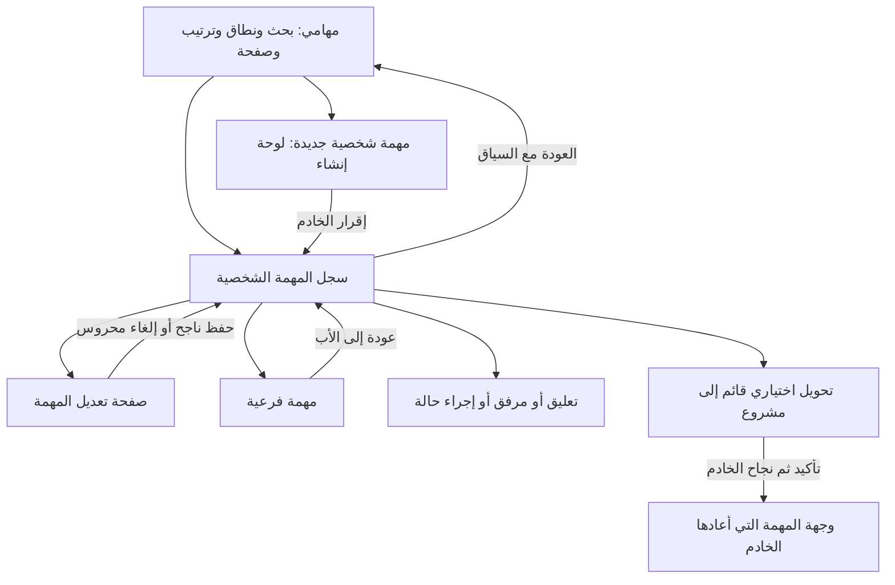

# مهامي — مراجعة الرحلة والتصور المقترح

**الحالة:** اعتمد المالك التصور والخطة وفوّض التنفيذ في المحادثة بقوله «كومت أولًا منظم لكل أعمالك ثم نفذ». تُحفظ الأعمال الحالية أولًا بكومتات منظمة، ثم يُنفّذ نطاق «مهامي» والمهام الشخصية في نسخة مستقلة. اسم التطبيق المعتمد «مهامي». لا دمج أو push أو نشر.

**المصدر المراجع:** النسخة المعزولة `/Users/tariq/.codex/worktrees/docs-ux-foundations/webvue`، الفرع `codex/docs-ux-foundations` عند `c9a91d7c` مع تحسينات الأساس غير المثبتة بكومت. DESIGN.md هو سياسة الواجهة؛ هذه الوثيقة مقترح تطبيقي لا تغيّر تلك السياسة.

## 1. النتيجة المطلوبة والنطاق

يجد المستخدم عمله داخل «مهامي»، ويميّز مصدر المهمة وحالتها، وينشئ مهمة شخصية ويفتحها ويعدّلها ويتابعها دون فقد نص أو سياق. يرى نتيجة مؤكدة للحفظ، ويفهم الخطوة التالية في الخطأ والفراغ.

يشمل النطاق `/my-tasks` و`/my-tasks/new` وسجل المهمة الشخصية، والمهام الفرعية والتعليقات والمرفقات والتحويل القائم إلى مشروع. تظهر مهام المشاريع الحالية في القائمة كما يقرر الخادم، وتفتح وجهاتها الحالية؛ لا مراجعة أو إعادة تصميم لتفاصيل مهام المشاريع أو لوحتها أو سير اعتمادها.

الاسم المعتمد **مهامي / My tasks**. الاسم موجود بالفعل في عنوان القائمة والتنقل في النسخة المراجعة؛ المطلوب تثبيته في جميع نصوص التطبيق وقصصه وإزالة الوصف القديم «مهامي الشخصية» من تعليق manifest. «مهمة شخصية جديدة» تبقى تسمية فعل الإنشاء لتمييز نوع المورد داخل القائمة الجامعة. لا تغيير للمعرّفات `tasks` و`webvue_tasks` أو مفاتيح القدرات.

## 2. المراجعة المثبتة

التجارب محلية ببيانات اصطناعية. استُخدمت جلسة متصفح منفصلة عن معاينة المالك، وحُجبت كتابات `/api/v1/**` في تجربة فقد المسودة. لا حفظ أو تحويل أو حذف بيانات حقيقية، ولا تشغيل Odoo أو اختبارات قاعدة بيانات.

| الأولوية | الملاحظة وأثرها | الدليل الحالي | التصور المقابل |
|---|---|---|---|
| P1 | إلغاء التعديل يمسح القيم فورًا، دون سؤال عن مسودة معدّلة | المتصفح: تغيير عنوان المهمة ثم إلغاء يزيل حقول التعديل، والحارس غير ظاهر؛ `pages/my-tasks/[id].vue:71` و`:218` | تعديل بصفحة مستقلة، حارس مغادرة واحد، وإلغاء يعيد السجل دون فقد صامت |
| P1 | كتابة تعليق ثم الرجوع للقائمة تفقد النص | المتصفح: يصل إلى `/my-tasks` بلا حارس، والعودة تترك الحقل فارغًا؛ `components/personal-tasks/MyTaskComments.vue:15`؛ حارس الصفحة مرتبط بالتعديل فقط | إدخال مسودة التعليق في حماية المغادرة؛ يبقى النص عند اختيار البقاء أو فشل الإرسال |
| P1 | فشل تحديث مهمة محمّلة يُخفى رغم فشل الطلب | المتصفح: طلبات تحديث 500، بلا حالة خطأ ظاهرة مع بقاء إجراء التعديل؛ `pages/my-tasks/[id].vue:168` يصفر الخطأ عند وجود task | تمرير الخطأ للقالب: 500 مع البيانات المحملة وإعادة المحاولة، و403/404 يحجبان جسم السجل وإجراءاته |
| P2 | المطلوب يظهر بعد محاولة الإنشاء، لكن التركيز يبقى على زر الإنشاء | المتصفح: رسالة «عنوان المهمة مطلوب» ظاهرة وactiveElement هو BUTTON؛ `MyTaskForm.vue:63` | نقل التركيز إلى الحقل الأول الخاطئ وربطه برسالته، في الإنشاء والتعديل |
| P2 | «المنجزة» تشمل الملغاة أيضًا، فيوحي الاسم بنجاح لم يحدث | المتصفح: `?tab=done` يعرض «ملغاة»؛ `utils/myTaskList.ts:42` يطلب closed؛ خدمة المهام تضم done وcancelled في CLOSED_STATES | تسمية النطاق «المغلقة»، وبقاء شارة منجزة/ملغاة لكل مهمة |
| P2 | بيانات الإنشاء وآخر التحديث تحتل ملخص القرار على الجوال قبل الوصف | لقطة السجل عند 390px: ستة صفوف خصائص قبل الوصف؛ `pages/my-tasks/[id].vue` خانة summary | ملخص الموعد والأولوية والمكلفين أولًا، وبيانات التوثيق في قسم مساند أدنى |
| P2 | عدة إجراءات مهمة تتنافس في رأس السجل، والتعديل لا يغطيه عنوان النموذج الحالي «الوصف» | لقطة التعديل والسجل، وأزرار الحالة باقية أثناء التعديل | رأس واضح: الحالة، إنجاز/إعادة فتح، تعديل، والمزيد؛ صفحة تعديل بعنوان مستقل |
| P2 | فشل جلب مشاريع التحويل لا يملك عرضًا خاصًا، وقد يُفهم كعدم وجود مشاريع | مراجعة مصدر: `ConvertToProject.vue:15` يستهلك data فقط | حالة تحميل وخطأ وإعادة محاولة وفراغ منفصلة، بعد فتح إجراء التحويل فقط |
| P3 | القائمة تستخدم «تحميل المزيد» لجدول، بينما قالب ويب فيو المعتمد له ترقيم | `pages/my-tasks/index.vue:191` مقابل SharedPagination وDESIGN.md | ترقيم ثابت بالـURL، مع إبقاء فلاتر القائمة وأصل العودة |

**ما يعمل ويُحافظ عليه:** العنوان والروابط واضحة، الصف يميّز الشخصي من المشروع، مصدر العودة يحمل البحث الحي، زر الإنشاء يصف نوع المهمة، التذييل المشترك ثابت، ولدى الطلبات الأساسية حراس تكرار وتحديث من استجابة الخادم. العمق الحالي للمهام الفرعية مستوى واحد. الصورة الجديدة عند 390px لم تظهر تمريرًا أفقيًا: عرض المستند والعرض المرئي 390px؛ لا يُنسب خلل عرض لصورة سابقة أُخذت أثناء تغيير حجم النافذة.

**حدود الدليل:** فشل 500 وفقد المسودتين وتركيز الإنشاء ودلالة النطاق جُرّبت مباشرة. حجب 403/404، والتزامن، وفشل مشاريع التحويل، وكل حالات المرفقات تحتاج تحققًا موجّهًا عند التنفيذ؛ لم تُقدّم هنا كرحلات ناجحة. لا قياس زمني أو ادعاء تحسن قبل/بعد.

## 3. البدائل والاختيار المقترح

1. **الموصى به: تطوير الرحلات الحالية على قوالب الأساس.** قائمة وسجل وإنشاء وتعديل واضح، مع إصلاح حماية النصوص والحالات. يزيل التباسًا مثبتًا ويحافظ على API والصلاحيات الحالية.
2. **إبقاء التعديل داخل السجل مع حارس محلي.** أقل نقلًا للملفات، لكنه يبقي خمسة حقول تحت عنوان «الوصف» ويمزج تغيير الحالة بتحرير البيانات؛ لا أوصي به لرحلة موحدة مع الأساس.
3. **إضافة لوحة أو مجموعات اليوم/المتأخر أو تقويم.** قد تفيد لاحقًا، لكنها تغيّر نطاق المنتج والبحث والترقيم وتزيد الأسطح قبل حل فقد المسودات. ليست ضمن هذه الخطة.

## 4. تصور الرحلة

### D1 — العثور على المهمة

- عنوان الصفحة «مهامي»، ووصف قصير: «مهامك الشخصية ومهام المشاريع المرتبطة بك». ظهوره لا يمنح صلاحية لمهام مشاريع غير متاحة.
- نطاقان: **المفتوحة / المغلقة**. توضيح المغلقة: «المهام المنجزة والملغاة». لا تقسيم ثالث يُنفّذ بفلترة صفحة واحدة بعد الجلب.
- البحث ثم «الكل / المسندة إليّ / التي أنشأتها» ثم الترتيب؛ عداد واضح. لا فلاتر أو عدادات تحتاج API جديدًا.
- على سطح المكتب: عنوان ومصدر، حالة، موعد، مكلفون. على الجوال: نفس المعلومات بصفوف البطاقات القائمة. إظهار كلمة «متأخرة» بجانب الموعد، فلا يكون اللون وحده الدليل.
- SharedPagination بدل تحميل المزيد. حجم الصفحة 50 كما هو، `offset` في URL، وتغيير البحث أو النطاق أو الترتيب يصفر offset فقط. تعديل عرض آخر أو العودة إلى السجل يحفظ بقية المفاتيح وhash.
- فراغ أول استخدام: دعوة إنشاء إن سمحت القدرة. فراغ بحث: مسح البحث/الفلاتر. فراغ «المسندة إليّ» أو «التي أنشأتها»: نص يشرح النطاق وزر العودة إلى الكل، دون وعد بوجود بيانات.

### D2 — الإنشاء والتعديل

- الإنشاء يبقى لوحة `SharedCreatePanel` ذات المسار `/my-tasks/new`؛ بياناته: العنوان أولًا، الوصف، ثم الموعد والأولوية والمكلفون. لا خطوات إضافية لنموذج قصير.
- التعديل صفحة `/my-tasks/{id}/edit` بعنوان «تعديل المهمة» ونفس حقول النموذج. لا نموذج آخر داخل قسم الوصف، ولا نسخة مستقلة من الحقول.
- المطلوب والحد الأقصى يراجعان بالتحقق القائم. توحيد field aliases، ونقل التركيز لأول خطأ بعد المحاولة. لا تعطيل صامت بسبب حقل فارغ، ولا toast للتحقق.
- خط أساس المسودة ثابت من آخر قراءة مؤكدة عند بدء التحرير؛ تحديث خلفي لا يعيد تهيئة قيم مكتوبة. التعارض لا ينشئ حفظًا تلقائيًا أو يمسح القيم. لا ادعاء كشف تعارض متزامن بلا دعم من الخادم؛ إن رد 409 يعرض كما هو.
- تذييل الإنشاء ثابت، وتذييل التعديل في الصفحة. زر «إنشاء المهمة» أو «حفظ التغييرات»، وإلغاء محروس. طلب واحد للنقر المكرر/Enter، والقيم تبقى بعد 422/403/409/500 والانقطاع.
- إقرار الخادم يحدّث baseline قبل `replace` إلى السجل. فشل غير مؤكد لا يُسمّى نجاحًا ولا يعاد ككتابة تلقائية. لا يُغيّر سلوك الإسناد الافتراضي أو الموارد أو نوع المعرفات ضمن تحسين UX.

### D3 — قراءة المهمة ومتابعتها

- رأس السجل: رجوع يسمّي وجهته، عنوان المهمة، حالتها، إجراء إنجاز/إعادة فتح بحسب `allowed_actions`، وتعديل. الإلغاء والتحويل في إجراءات ثانوية واضحة؛ التأكيد الهدّام inline.
- ملخص القرار: الموعد والأولوية والمكلفون. بعده الوصف، المهام الفرعية، المرفقات، التعليقات. المنشئ وتاريخا الإنشاء/التحديث في قسم «معلومات المهمة» بعد المحتوى الأساسي. لا حذف لأي معلومة أو تخزين لملخص موازٍ.
- المهام الفرعية: إنجاز عدد/إجمالي مشتق من القائمة الحالية، عنوان الحقل واضح، وخطأ الإضافة يحفظ النص. فتح الفرعية ثم الرجوع يعيد الأب وأصل قائمته دون دورة أو تعمّق أصل متكرر.
- لا إضافة اعتماد أو أولوية ثالثة أو حالة جديدة أو لوحة مهام شخصية.

### D4 — التعليقات والمرفقات والتحويل

- حارس مغادرة واحد للسجل يجمع مسودة التعليق ومسودة اسم الفرعية والعمليات الجارية، ويحرس تغير معرّف المهمة داخل نفس مكوّن المسار أيضًا. لا حارس ثانٍ داخل كل قسم يكدّس نوافذ التأكيد. البقاء يحفظ القيم ويرد التركيز؛ إرسال التعليق بنجاح فقط يمسح نصه.
- المرفقات تستخدم القائمة المشتركة والتحقق الحالي والحذف inline. فشل الرفع يوضح السبب ويتيح اختيار الملف مجددًا؛ المغادرة أثناء الرفع لا تُعلن أنه ألغي خادميًا أو اكتمل.
- التحويل الحالي عملية اختيارية من إجراءات السجل، لا قسم دائم يستحوذ على رحلة كل مهمة. فتحه يفعّل جلب المشاريع، ويعرض تحميلًا أو خطأ مع إعادة محاولة أو فراغًا حقيقيًا.
- قبل POST التحويل: تُحسم المسودات غير المرسلة؛ لا ينفّذ التحويل ثم يتعثر عند حارس المغادرة. تأكيد inline واحد يوضح عدم الرجوع، ويذكر تجاهل المسودات عند وجودها؛ «متابعة الكتابة» يبقي النصوص دون طلب. أثناء رفع أو كتابة جارية يتعطل التحويل مع سبب واضح. بعد التأكيد الصريح فقط تُفرّغ المسودات ويُرسل الطلب مرة واحدة، ثم الوجهة من `href` الخادم. لا تعديل لموديول المشاريع أو قواعد التحويل.

### D5 — الحالة والصلاحيات والرجوع

- 500 بعد تحميل سابق: يبقى المحتوى مع خطأ وإعادة محاولة. 403/404: حالة القالب بلا جسم المهمة وإجراءاتها، مع رجوع مسموح؛ لا toast نجاح ولا بديل بيانات محمي.
- بيانات read-only تعرض بلا عناصر تحرير أو رفع أو تعليق غير مخولة. الاعتماد على القدرات و`allowed_actions`، والخادم مرجع كل عملية.
- السجل يحمل `returnTo`، والتعديل `listOrigin`، وعلاقة الفرعية بأبيها كما حُسمت في الأساس. روابط مباشرة وتحديث وBack/Escape تُختبر منفصلة.
- URL المقترح للنطاق المغلق `tab=closed`، وطلب الخادم يبقى `closed=1`. تُستبدل قيمة `done` القديمة في الحالة والاختبارات والنصوص والروابط المملوكة، دون alias أو مسار توافق. حالات البيانات `done/cancelled` لا تتغير.

## 5. معايير القبول

| المعيار | النتيجة المطلوبة |
|---|---|
| A1 | اسم التطبيق مهامي في التنقل والقائمة والرجوع والقصص، دون تغيير المعرفات أو الصلاحيات |
| A2 | المفتوحة والمغلقة تصفان نتائجهما، والملغاة مميزة؛ pagination والبحث الحي وأصل العودة محفوظة |
| A3 | إنشاء → خطأ → تصحيح → إقرار → سجل؛ عنوان خطأ مركّز، وتكرار واحد فقط |
| A4 | سجل → تعديل → إلغاء/Back/تنقل: تبقى المسودة عند البقاء، والحفظ يعيد السجل مع أصل القائمة |
| A5 | تغيير الحالة حسب `allowed_actions`، ومعلومة النجاح بعد الخادم، وإلغاء المهمة مؤكد inline |
| A6 | تعليق أو اسم فرعية غير مرسل لا يضيع عند مغادرة غير مقصودة؛ لا نوافذ تأكيد متراكبة |
| A7 | فشل التعليق/رفع الملف/إضافة فرعية يبقي المدخل المناسب؛ الحذف والتحويل لا يتكرران |
| A8 | مصدر تحويل فاشل يختلف عن مصدر فارغ، والتحويل لا يبدأ قبل حسم المسودة |
| A9 | تحديث 500 يحتفظ بالبيانات مع الخطأ؛ 403/404 يحجبانها مع الإجراءات |
| A10 | عربية/إنجليزية، فاتح/داكن، ثلاثة أحجام خط، 390/768/1440، لوحة مفاتيح ولمس، دون overflow |
| A11 | لا تغييرات لسلوك مهام المشاريع أو backend/schema/قدرات/جسر التحويل؛ لا مسارات تنفيذ موازية |

## 6. الترتيب والحدود

الأولوية: حماية المسودات والتحقق وحالات التحديث، ثم القائمة ودلالاتها، ثم توزيع السجل والتفاعلات المكملة، ثم القبول المشترك. خطة التنفيذ المرفقة توضح الملفات والاختبارات والاعتماد بين المراحل.

تُبنى نسخة التنفيذ مستقبلًا على تحسينات الأساس المراجعة، دون دمج ضمني أو حذف العمل غير المثبت بكومت. لا تُغيّر النسخة التي يراجعها المالك أثناء ذلك. لا كومت أو دمج أو push أو نشر ضمن هذا الطلب. اعتمد المالك التصور والخطة؛ يبدأ التنفيذ بعد حفظ العمل السابق بكومتات منظمة، مع بقاء حدود النطاق أعلاه.

## 7. أدلة المراجعة المحلية

- نتائج التجارب: `/tmp/webvue-my-tasks-review/observations.json`.
- صور: `/tmp/webvue-my-tasks-review/01-list-desktop.png`، `02-edit-desktop.png`، `03-record-phone.png`، `04-create-validation-phone.png`، `05-refresh-failure-phone.png`، `06-cancelled-in-done-phone.png` في المجلد نفسه.
- صور desktop/phone دليل حالات محددة، وليست مصفوفة قبول شاملة. لا تُستخدم اللقطة القديمة أثناء resize لادعاء overflow؛ قياس الصفحة المستقر هو المعتمد.
- قياس هذه المهمة جزئي: بدأ بعد استكشاف أولي، والسياق السابق شمل تشغيل المعاينة؛ لا إسناد كامل للرموز أو ادعاء توفير. سياسة النماذج `sol61-all-v1`؛ مراجعة داخلية واحدة دون وكلاء إضافيين.
