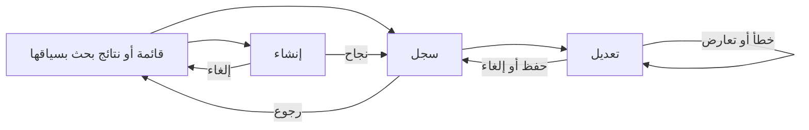

# تصور الأساس الموحّد لتجربة المستخدم في ويب فيو

التاريخ: 2026-10-15 — الحالة: **منفّذ محليًا في نسخة معزولة؛ فُوّض حفظ العمل المنجز بكومتات منظمة، دون دمج أو نشر**.

تحديث التفويض: طلب المالك في المحادثة «كومت أولًا منظم لكل أعمالك ثم نفذ». هذا يجيز حفظ أعمال الأساس ووثائق مهامي الحالية، ثم تنفيذ خطة مهامي؛ لا يجيز دمجًا أو push أو نشرًا. عبارات منع الكومت في سرد المراحل السابقة تصف تفويضها وقتها.

طلب المالك الأصلي: تجهيز تصور وخطة موحدة للتنقل، وتوزيع مكونات الصفحات، وتدفقات الإنشاء والتعديل والحفظ والرجوع، قبل مراجعة التطبيقات، دون تعديل الكود حاليًا.

اعتمد المالك الوثيقتين في المحادثة بتاريخ 2026-10-15 وفوّض تنفيذ التحسينات بالترتيب والتحقق من الرحلات بعد كل مرحلة، دون إعادة تصميم التطبيقات. هذه الوثيقة تصف السلوك المستهدف. تظل [DESIGN.md](../../../DESIGN.md) سياسة الواجهة النافذة؛ عند اعتماد المقترح تُنقل قراراته إلى مواضعها في ذلك الملف، ولا يصبح هذا المستند دستورًا موازيًا. [خطة العمل](../plans/2026-10-15-webvue-ux-foundations.md) مرتبطة بهذا التصور، ولا تمنح تفويض تنفيذ أو دمج أو نشر.

## 1. النتيجة المطلوبة وحدود العمل

يستطيع المستخدم في كل صفحة أن يعرف: أين أنا؟ ما المهم الآن؟ ما الإجراء التالي؟ هل حُفظ عملي؟ وإلى أين أعود؟

العمل يملك الغلاف والتنقل، وقوالب الصفحات، وعقود التوجيه والنماذج والحالات، وقصص استخدامها. إعادة ربط الصفحات بهذه العقود جزء من تطبيق الأساس؛ إعادة تصميم وظائف كل تطبيق مرحلة لاحقة.

لا يشمل المقترح تغيير صلاحيات أو نماذج أعمال أو مخططات بيانات، دمج موارد المهام المختلفة، إضافة قدرات جديدة للتطبيقات، إنشاء مركز عمل ببيانات مجمعة جديدة، أو إعادة تصميم إدارة البائع. أي تغييرات API تظهر ضرورتها تُفصل في طلب مستقل؛ هذه الخطة لا تفترضها.

النطاق التشغيلي واجهة العميل `apps/web`. أي نقل جارٍ للمكونات إلى `packages/ui` أو فصل إدارة البائع يعتمد على دمج عمل مالكه أولًا؛ لا ننسخ المكونات ولا نعمل بالتزامن على مالكها القديم والجديد.

## 2. أساس الأدلة

خط الأساس المقروء: `main` عند `c9a91d7c`، مع جرد 147 ملف صفحة في المراجعة السابقة. المعاينة المحلية شملت أكثر من 40 وجهة وحالة، بالعربية، بعروض 390 و768 و1440px، وبحساب إداري. هذه ليست نتيجة اختبار لكل صلاحية أو حالة؛ العمليات لم تتاح حيًا لذلك الحساب.

| الملاحظة | الدليل من المصدر/المعاينة | الاستجابة التصميمية |
|---|---|---|
| الرئيسية الحالية تخص المشاريع | [manifest المشاريع](../../../apps/web/app/modules/pmo/manifest.ts)، [صفحة الجذر](../../../apps/web/app/pages/index.vue) | مدخل عام مستقل، مع بقاء لوحة المشاريع في تطبيقها |
| «مهامي الشخصية» و«مهامي» لا يشرحان اختلاف المصدر | [manifest المهام](../../../apps/web/app/modules/tasks/manifest.ts)، [قائمة مهامي](../../../apps/web/app/pages/my-tasks/index.vue) | تسميات تعكس النطاق، دون دمج الموارد |
| أصل القائمة يسقط عند فتح مهمة مشروع من قائمة مهامي | `rowTo` في قائمة مهامي؛ الانتقال من `/my-tasks?q=Realtime` إلى `/projects/1/tasks/60` أعطى رجوعًا إلى `/projects/1/tasks` | أصل رحلة محفوظ عبر التطبيقات |
| الخصائص تأتي بعد المحتوى على الجوال | [RecordPage](../../../apps/web/app/components/shared/layout/RecordPage.vue) ومعاينة تفاصيل المهمة | ملخص تشغيلي قبل المحتوى الطويل |
| أزرار النموذج الطويل تغادر مجال الرؤية | [ProjectCharterForm](../../../apps/web/app/components/pmo/projects/ProjectCharterForm.vue)، [CreatePanel](../../../apps/web/app/components/shared/layout/CreatePanel.vue)؛ زر التالي أسفل 990px في شاشة ارتفاعها 900px | تذييل موحّد خارج جسم النموذج القابل للتمرير |
| شرط الإرسال غير ظاهر | [إنشاء دور](../../../apps/web/app/pages/settings/roles/new.vue): الاسم العربي بلا required والزر معطل عند فراغه | مطلوب واضح، تحقق عند المحاولة، سبب مفهوم للتعطيل |
| القائمتان تضيّقان شاشة 768px | [shell.css](../../../apps/web/app/assets/css/shell.css): 64px + 232px | سلوك مخصص للشاشات المتوسطة |
| نتائج البحث تختلف بين النافذة والصفحة | [مزود البحث](../../../apps/web/app/modules/pmo/search.ts)، [surfaces](../../../apps/web/app/modules/surfaces.ts) | نطاق نتائج واحد للمزودات الحالية |
| مسح الفلاتر يوحي بالحذف | [FilterBar](../../../apps/web/app/components/shared/data/FilterBar.vue) | مسح محايد واضح الاسم |

تقييم سهولة الاستخدام أعلاه حكم تصميمي مستند إلى هذه الملاحظات؛ لم تُجرَ دراسة مستخدمين، ولا يوجد قياس يثبت مقدار توفير وقت أو انخفاض أخطاء.

## 3. البدائل والتوصية

| المسار | المكسب | الكلفة/القيد | القرار المقترح |
|---|---|---|---|
| تطوير الغلاف والقوالب الحالية بعقود موحّدة | يحسن رحلة المستخدم ويحافظ على المكتبة والعقود والمسارات | يحتاج حصرًا وتطبيقًا منضبطًا على المستهلكين | **الموصى به** |
| إعادة بناء الغلاف ونظام التنقل من الصفر | حرية أكبر في التكوين | مخاطرة أعلى على الروابط والصلاحيات، وتكرار لبنات قائمة | مستبعد من هذه المرحلة |
| إصلاح صفحات متفرقة بالتتابع | أثر سريع على مواضع محدودة | يستبقي اختلاف الرحلات ويؤجل الأساس | لا يحقق الطلب الموحّد |

## 4. قرارات التصميم المقترحة

### D1 — مدخل عام واضح للمنصة

- يصبح `/` صفحة «الرئيسية» داخل الغلاف، متاحة للمستخدم الداخلي المصادق عليه دون اشتراط صلاحية المشاريع. يبقى المستخدم غير الداخلي ضمن مسار حسابه/دعوته الحالي.
- تعرض الرئيسية عنوانًا واضحًا، وروابط مساحات العمل المسموحة، وإجراءات البدء المسموحة من تعريفات التطبيقات القائمة. الترتيب من بيانات التنقل الحالية؛ لا ترتيب خفي من الأدوار ولا طلبات بيانات خاصة بتطبيق من الغلاف.
- لا أرقام انتظار أو «يحتاج انتباهي» أو «آخر ما عملت عليه» قبل وجود مصدر متحقق لها. الصفحة الأولى مدخل عمل مفيد، وليست لوحة مؤشرات مجمعة جديدة.
- تسمّى `/projects/dashboard` «نظرة عامة على المشاريع» وتبقى تحت المشاريع. ينتهي استخدام لوحة المشاريع كرئيسية عامة.
- رابط تسجيل الدخول المحفوظ `next` يبقى أولى من الرئيسية إذا كان مسموحًا؛ لا تؤدي العودة من تسجيل الدخول إلى إضاعة الوجهة المقصودة.
- حساب لا يملك أي مساحة عمل يرى رسالة توضح أن حسابه جاهز دون مساحات متاحة، مع الوصول إلى حسابه؛ لا بطاقات وهمية أو أزرار غير مسموحة.

### D2 — مستويات التنقل والتسمية

- شريط التطبيقات يجيب «أي مساحة؟»، والقائمة السياقية «أي قائمة أو قسم؟»، وتبويبات السجل «أي جزء من هذا السجل؟». لا تنقل أقسام السجل إلى قائمة عامة ثانية.
- يملك الغلاف مسار الصفحة وحده، ويظل للصفحة عنوان ظاهر. داخل إطار المشروع يبقى اسم المشروع H1، وعنوان السجل الداخلي H2؛ لا تغيير لهذا العقد.
- التسمية المستهدفة لـ `/my-tasks`: «مهامي»، ووصف «المهام الشخصية ومهام المشاريع المتاحة لك». إجراء إنشائها «مهمة شخصية جديدة». تبقى قابلية رؤية كل صف من الخادم.
- التسمية المستهدفة لـ `/tasks`: «مهام المشاريع المسندة إليّ»، وإجراء إنشائها «مهمة مشروع جديدة». لا تغيير لمعرّفات الموارد أو عقودها أو منح قدرات جديدة.
- تجاور الأيقونة تسمية ظاهرة للإجراءات المهمة. الأيقونة المنفردة مناسبة للبحث والقوائم والطي، مع اسم وصول وتلميح.
- يظهر إجراء الإنشاء الواضح في رأس القائمة؛ اختصار الإنشاء السياقي ينفذ الإجراء نفسه. لا إنشاء عام يخمّن نوع السجل نيابة عن المستخدم.

### D3 — توزيع يستجيب للمساحة

| العرض | السلوك المستهدف |
|---|---|
| أقل من 768px | درج التنقل الواحد الحالي، وتدفق محتوى بعمود واحد |
| من 768 إلى 1023px | شريط التطبيقات 64px والقائمة السياقية مطوية افتراضيًا إلى 48px؛ يستطيع المستخدم فتحها |
| 1024px فأعلى | القائمة السياقية بعرضها المعتمد، وتفضيل المستخدم المحفوظ مقدّم على الافتراضي |

عند وجود اختيار صريح محفوظ `open/closed` يُحترم، ولا تعيد أحداث resize كتابته. دون تفضيل صريح، يُحسم الافتراضي من CSS لتجنب قفزة SSR؛ لا يُكتب كوكي لمجرد زيارة الصفحة. اللوحات المتخصصة كالمحادثات تحتفظ بعقدها، وتُختبر في حالة العرض والطّي ولا تُضغط عشوائيًا.

لا تمرير أفقي للمستند. يُسمح به داخل جدول/خط زمني/شريط تبويبات محدد. التبويب النشط يبقى ظاهرًا ويمكن الوصول إلى جميع التبويبات بلوحة المفاتيح؛ لا إخفاء صامت للأقسام.

مساحة الضغط المستهدفة على شاشات اللمس 44×44px على الأقل للإجراءات الأساسية والتنقل؛ يمكن الاحتفاظ بالشكل البصري المدمج داخلها. تبقى كثافة سطح المكتب المعتمدة. لا يدّعي هذا المقترح اجتياز تدقيق إتاحة كامل.

### D4 — خريطة ثابتة لمناطق الصفحة

| القالب | الترتيب من أعلى الصفحة | الإجراء/السلوك |
|---|---|---|
| قائمة | عنوان ووصف عند الحاجة → إنشاء واضح → بحث/فلاتر → نطاق/عرض وعدّاد → نتائج → ترقيم | فتح سجل مع أصل القائمة؛ لا وضع حقول العمل في الهيدر العام |
| سجل | رجوع مسمّى → عنوان وحالة وإجراء → ملخص تشغيلي → تبويبات عند الحاجة → محتوى → نشاط | معلومة القرار قبل تاريخ الإنشاء والتحديث |
| إنشاء | عنوان سياق → حقول أساسية → حقول إضافية/خطوة حالية → تذييل ثابت | إلغاء/حفظ مسودة إن كانت مدعومة فعليًا/إجراء أساسي واحد |
| تعديل | رجوع إلى السجل → عنوان «تعديل…» → الحقول → تذييل واضح | حفظ صريح ثم العودة إلى السجل بسياقه |
| إعدادات | عنوان يحدد نطاق التأثير → أقسام بعناوين → طريقة حفظ واضحة | يوضح القسم إن كان الحفظ تلقائيًا أو صريحًا |
| لوحة متابعة | عنوان ونطاق → ما يستدعي فعلًا → مؤشرات موجزة → تفاصيل عند الطلب | لا مؤشرات زخرفية أو بلا مصدر |

رسم ترتيب السجل، لا شكل بصري نهائي:

```text
رجوع إلى [الوجهة الفعلية]
[اسم السجل]    [الحالة]                 [الإجراء التالي] [المزيد]
[المسؤول]    [الموعد]    [السياق المرتبط]
──────────────────────────────────────────────────────────────
[تبويبات محتوى السجل، إن وجدت]
[المحتوى الأساسي]                 [خصائص مساندة على الواسع]
[التعليقات والنشاط والمرفقات بحسب القسم]
```

على الجوال تبقى معلومات القرار في الملخص أعلى الصفحة؛ نزول الخصائص المساندة لا يخفي المسؤول والموعد. يحتوي الملخص عرضًا لنفس البيانات، ولا ينشئ مخزنًا ثانيًا أو نموذج حقول مكررًا. لا يُعاد عرض نفس المعلومة في موضعين من الصفحة نفسها دون فائدة.

### D5 — إنشاء مرتبط بالمسار وتعديل مفهوم

- تبقى `/new` داخل `SharedCreatePanel` من نهاية القراءة؛ الجوال بعرض الشاشة. عرض اللوحة المستهدف على الواسع 640px فعلية، مع حد لا يتجاوز الشاشة، ومتسق مع أحجام الخط الثلاثة.
- جسم اللوحة هو منطقة التمرير؛ التذييل خارجها في slot المكوّن، مع مراعاة المنطقة الآمنة. يرتبط زر الإرسال بالنموذج عبر `form` إذا رُسم خارجه؛ Enter لا يرسل نموذجًا آخر.
- تبقى التعديلات المركبة صفحة كاملة. التحرير الصغير داخل السجل مسموح إذا كان له بدء واضح وحفظ/إلغاء وخطأ قريب، ولا يفتح نموذجًا ثانيًا أو يخفي مسودة أخرى.
- الإظهار التدريجي يخفف الاختيارات غير المطلوبة: حقول أساسية ظاهرة، وتفاصيل اختيارية بأقسام مسماة. لا تُخفى متطلبات مطلوبة للإتمام.
- النماذج الطويلة المتدرجة تعرض «الخطوة س من ص: الاسم»، وتحفظ الاختيارات عند التنقل بين الخطوات. «التالي» يعني الانتقال للخطوة، و«إنشاء…» أو «حفظ التغييرات» هو الإتمام.
- لا تُعد المسودة محفوظة إلا بإقرار الخادم. لا إضافة تخزين دائم محلي أو حفظ تلقائي لنماذج الإنشاء ضمن هذه المرحلة.

### D6 — عقد الرحلة والرجوع



| الحالة | النتيجة المتفق عليها |
|---|---|
| فتح سجل من قائمة/بحث، ولو في تطبيق آخر | يحمل عنوان الأصل مع البحث والفلاتر والعرض والترقيم وhash |
| فتح تعديل من سجل | يعود للسجل، مع احتفاظ السجل بأصل القائمة |
| سجل تابع لسجل آخر، مثل مستند داخل قسم | يعود إلى الأب الذي فُتح منه؛ يحتفظ الأب بدوره بطريقه إلى قائمته، ولا تُسطّح هذه العلاقة إلى قائمة عامة |
| نجاح الإنشاء | يفتح السجل الناتج ويحمل أصل القائمة؛ لا يعود لقائمة عارية ولا يعيد إرسال الإنشاء |
| نجاح التعديل | يعود للسجل المحدّث ويحمل أصل القائمة؛ لا يستعيد مسودة انتهت عبر Back |
| إغلاق إنشاء أو الضغط على إلغاء/Escape | يعود للأصل؛ المسودة تمر عبر الحارس نفسه |
| فتح رابط مباشر بلا أصل | رجوع معلوم لقائمة السجل المالكة؛ تعديل مباشر يعود أولًا لسجله |
| العودة إلى قائمة | تحفظ URL وتستعيد موضعها عبر آلية scrollMemory القائمة؛ لا تستبدلها آلية ثانية |
| التنقل للقائمة من الشريط | زيارة جديدة من بدايتها، وليست استعادة تلقائية لبحث قديم |
| أصل غير صالح أو فقد المستخدم صلاحية وجهته | رجوع مسموح معلوم؛ لا حلقة تحويل أو تسريب عنوان بيانات محمية |

العقد التقني يبني على `safeReturnTo` و`recordListOrigin` و`scrollMemory` القائمة. يحمل السجل `returnTo`، ويحمل التعديل `listOrigin` لأصل السجل. لا معاملات جديدة موازية، ولا تكرار لنفس الأصل داخل سلسلة `returnTo`. السياق الذي يمثل حقيقتين مختلفتين، مثل قائمة المشاريع الأصلية والقائمة الداخلية الحالية، لا يُحذف بحجة التوحيد. يحتفظ `projectNavigation` و`hrReturnTo` بمنطق الأب والسياق الأعلى إلى أن يثبت البديل حفظهما باختبار؛ الدمج في المساعد المشترك يزيل التكرار فقط ولا يبقي wrapper توافق بعد تحويل آخر مستهلك.

تُقبل وجهات محلية مسجلة ومسموحة فقط، وتُحفظ قيم query دون فك/ترميز متكرر. يسمح السياق بأصل قائمة وبأب مباشر مع أصل قائمته عند الحاجة؛ لا تُقبل سلسلة ذاتية متكررة أو دورة. تصفية الروابط في الواجهة لا تحل محل صلاحيات المورد في API. لا يعتمد الرجوع على `history.length`، ولا تُستدعى `back()` دون معرفة الأصل؛ تظل أزرار المتصفح عاملة وتُختبر منفصلة عن الرجوع المسمّى.

### D7 — عقد الحفظ والخطأ والمسودة

| الحالة | ما يراه المستخدم وما يحدث |
|---|---|
| بدء نموذج | الحقول المطلوبة موسومة؛ لا أخطاء مبكرة بلا محاولة |
| محاولة غير صالحة | رسالة عند الحقل، وملخص للأخطاء المتعددة، وتركيز أول حقل خاطئ، دون toast تحقق |
| حفظ جارٍ | إجراء يحمل حالة تحميل؛ تمنع الإرسالات المكررة؛ يبقى المحتوى والسياق |
| نجاح مؤكد | تحديث من جواب الخادم ثم الوجهة المحددة؛ رسالة موجزة تسمي النتيجة |
| فشل واضح | تبقى القيم، يظهر الخطأ قرب العمل، ويمكن إصلاحه أو إعادة المحاولة |
| تعارض 409 | تبقى المسودة، ويظهر أن السجل تغيّر؛ تحديث البيانات لا يسحقها دون تأكيد |
| انقطاع والنتيجة غير معلومة | «لم نتأكد من اكتمال الحفظ»؛ لا إعادة إنشاء تلقائية قد تنتج سجلًا مكررًا |
| حفظ تلقائي في إعداد قائم | حالة قريبة «جارٍ الحفظ/تم الحفظ/تعذّر الحفظ»؛ لا زر حفظ وهمي |
| مغادرة قبل الحفظ | الحارس الحالي: «البقاء» أو «تجاهل التغييرات والمغادرة»؛ يعيد التركيز لموضعه عند البقاء |

«إنشاء…» لإضافة سجل، «حفظ التغييرات» لتعديل، «التالي» للتقدم، وأفعال الأعمال تسمي نتيجتها مثل «إرسال للموافقة». التعطيل للحالة المعلقة أو غياب القدرة/شرط مسبق، مع سبب ظاهر حين لا يكون السبب مفهومًا. لا تتبدل الأزرار إلى نجاح قبل تأكيد الخادم.

### D8 — قوائم وفلاتر وحالات تساعد على الاستمرار

- بحث ظاهر، ثم «الفلاتر» مع عدّاد النشط؛ النطاق ومبدّل العرض في الطرف الآخر. تظهر الفلاتر النشطة كشرائح يمكن مسح كل منها.
- «مسح الفلاتر» إجراء محايد مع رمز إعادة ضبط؛ الأحمر وسلة المهملات للحذف. لا يغير المسح البيانات أو تحديد الصفوف أو التفضيل البصري.
- تغيير البحث/فلتر يبدأ الصفحة الأولى؛ تغيير العرض يحتفظ بالفلاتر. رابط القائمة مصدر الحالة، مع معالجة الكتابة قبل اكتمال debounce عند المغادرة.
- فراغ أول استخدام: ماذا يفيد هذا المكان؟ وإجراء إنشاء إن كان مسموحًا. فراغ بحث: البحث/الفلاتر التي سبّبته مع مسح. فراغ بسبب صلاحية لا يُسمى «لا بيانات».
- التحميل الأول skeleton؛ فشل تحديث لاحق لا يمحو نتائج محملة؛ تعاد المحاولة في نفس المنطقة. 403 بلا زر إعادة محاولة مضلل، و404 برابط رجوع معلوم.
- يبقى اختيار الصفوف والإجراءات الجماعية واضحًا عند تغيير الصفحة، ولا يُنفذ حذف أو أرشفة دون التأكيد المعتمد.

### D9 — بحث عام موحّد ضمن القدرات الحالية

- النافذة وصفحة `/search` تستخدمان نفس المزودات الحالية ونفس قواعد القدرة والنطاق؛ لا يعد البحث بأنه يبحث كل محتوى ويب فيو.
- قبل الكتابة تظهر وجهات وإجراءات البدء المسموحة، دون سكب كل المشاريع. بعد الكتابة: نتائج مجمعة حسب النوع مع سياق السجل عندما يتيحه المزود.
- تعرض أول خمس نتائج لكل مزود، ثم «عرض المزيد» إلى نتائج ذلك المزود في الصفحة. مزود محدود بلا ترقيم يعرض أن النتائج محدودة ولا يدّعي اكتمالها.
- query في صفحة النتائج يحفظ النص والمزود المختار؛ الرجوع للسجل ثم البحث يحافظ عليهما. لا مزودات جديدة لمحتوى التطبيقات ضمن الأساس.

## 5. مصدر التنفيذ والملكية

| المسؤولية | المالك الحالي الذي يُطوّر في مكانه |
|---|---|
| الغلاف والتسمية والتكيّف | `components/shell/**`، `composables/nav/**`، `useShellModel`، `shell.css`، وتعريفات التطبيقات |
| الصفحة الرئيسية | `pages/index.vue`، `utils/accessPolicy.ts`، ومكوّنات Nuxt UI والقوالب الحالية |
| القوائم والسجل والإنشاء | `components/shared/layout/**` و`shared/data/**` و`shared/feedback/**` |
| أصل الرحلة | `utils/safeReturnTo.ts`، `recordListOrigin.ts`، `scrollMemory.ts`، `router.options.ts` |
| حالة الحفظ/التحقق | النماذج القائمة وحارس `shared/form/UnsavedChanges.vue`؛ أخطاء `ApiError` الحالية |
| قصص الرحلات والقوالب | `stories/shared/**` و`stories/shell/**`؛ بيانات قصص اصطناعية منفصلة عن بيانات العملاء |
| السياسة النافذة لاحقًا | `DESIGN.md` ثم فهرس المكونات والكتالوج المولّد؛ لا ملفات تعليمات متنافسة |

لا مكتبة واجهة جديدة، ولا نسخ v2، ولا feature flags للاحتفاظ بالسلوك القديم. أي واجهة جديدة مشتركة تُضاف فقط إن كانت مسؤولية مفقودة فعلًا؛ تُوثق بقصتها وتحل محل التكرار في نفس الدفعة.

## 6. معايير القبول

| الرمز | دليل القبول المطلوب قبل الانتقال إلى مراجعة التطبيقات |
|---|---|
| A1 | الرئيسية تعمل لمستخدم بلا PMO، ولا تعرض رابطًا أو إجراء غير مسموح؛ next المسموح محفوظ |
| A2 | لكل مستوى تنقل وظيفة وتسمية واضحة، وتحدد التسميات مصدر مهام المستخدم |
| A3 | المسار المنشور يفتح مباشرة ويعمل بعد التحديث، مع H1 وحيد وعنوان سجل صحيح داخل الإطار |
| A4 | قائمة مفلترة → سجل → تعديل → حفظ/إلغاء → سجل → رجوع تعيد الأصل نفسه، عبر تطبيقين أيضًا |
| A5 | إغلاق إنشاء/Escape/رجوع المتصفح لا يتجاوز المسودة؛ نجاح الحفظ لا يعيد إرسالها أو يحييها |
| A6 | أخطاء الحقول واضحة، ويحفظ الفشل والتعارض القيم، ويمنع الحفظ المكرر؛ النتيجة غير المعلومة لا تعاد تلقائيًا |
| A7 | ملخص السجل التشغيلي ظاهر قبل النشاط على الجوال؛ إجراءات النموذج الطويل مرئية مع التمرير |
| A8 | 390/768/1440px بلا تسريب تمرير أفقي، وتفضيل طي القائمة لا يتبدل من resize |
| A9 | نتائج البحث ونطاقه متسقان في النافذة والصفحة، وتعود نتيجة البحث إلى نفس الاستعلام |
| A10 | لكل فراغ/خطأ/تحميل إجراء مناسب، والفلاتر لا توحي بحذف سجلات |
| A11 | العربية RTL والإنجليزية LTR، الفاتح/الداكن، وأحجام الخط الثلاثة مقروءة؛ Tab/Enter/Escape والتركيز وتقليل الحركة تعمل |
| A12 | جرد جميع ملفات الصفحات يصنف كل مستهلك: مطابق للعقد أو استثناء متخصص مبرر ومختبر؛ لا استثناءات عامة أو صفحات متروكة بلا قرار |

الجمع البصري الأساسي 36 حالة لكل قصة قالب مركزية: لغتان × مظهران × ثلاثة أحجام خط × ثلاثة عروض. اختبارات السلوك تُوزّع بحسب المخاطر بدل تكرار كل رحلة 36 مرة. الصلاحيات والقراءة فقط وسوء الاتصال والتعارض حالات سلوكية منفصلة.

## 7. بوابة مراجعة المالك

المقترح المعروض للاعتماد يشمل خصوصًا: تحويل `/` إلى مدخل عام محدود بالروابط والإجراءات الحالية، تسميات المهام، الطي الافتراضي على الشاشات المتوسطة، الملخص التشغيلي، والتذييل الثابت. هذه تغييرات مقترحة على قرارات نافذة وليست تصحيحات مفترضة الموافقة.

بعد مراجعة الوثيقتين يمكن تعديل القرارات ثم طلب تنفيذ مرحلة محددة. قبول التصور لا يُفهم كإذن commit أو دمج أو push أو نشر. قياس السلاسة يبدأ بالملاحظة: إتمام المهمة، الرجوع الخاطئ، إعادة إدخال فلاتر، والأخطاء التي تحتاج تفسيرًا؛ لا نسبة تحسن معلنة قبل مقارنة قابلة للتكرار.
