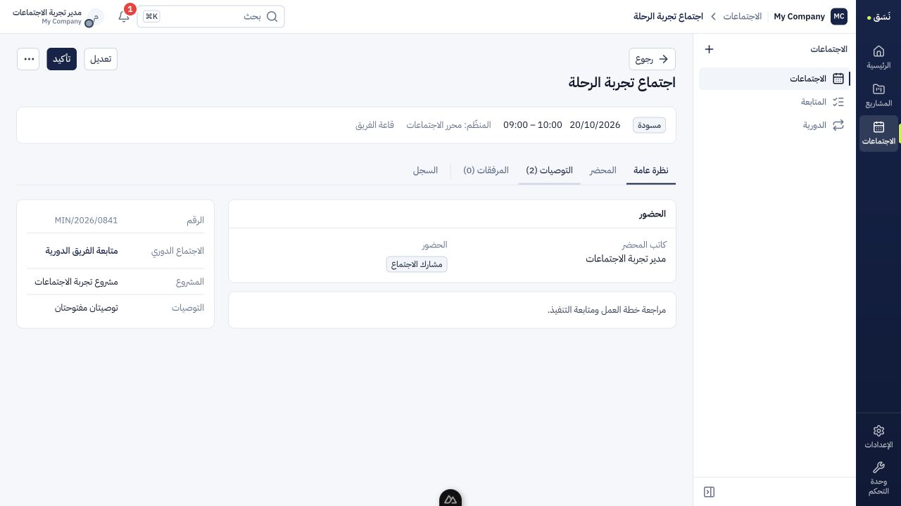
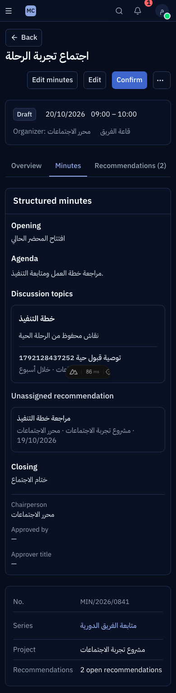
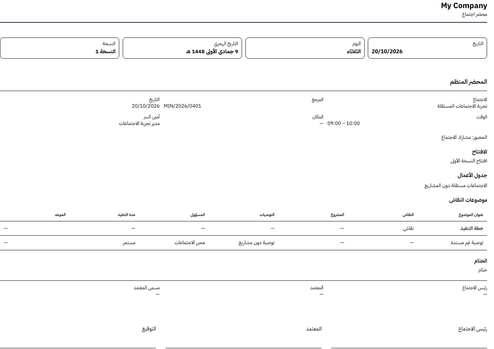

# تحقق تحسين تجربة الاجتماعات — 2026-10-16

نُفّذ التصور المعتمد في `/Users/tariq/.codex/worktrees/meetings-ux/nasq`، على الفرع `codex/meetings-ux` من `03f0da9b357af15e882a51ebf27cd3ff2df49a19`. العمل غير مُلتزم به في Git؛ لا commit أو merge أو push أو نشر. بقي checkout الرئيسي على نفس SHA، مع ملفاته غير المرتبطة كما هي.

المعاينة النهائية: [الاجتماعات](http://127.0.0.1:4414/meetings). Nuxt وOdoo من هذه النسخة، على loopback فقط. القاعدة `nasq_scratch_meetings_pmo_ux_20261016` ببيانات قبول مصطنعة، وOdoo على 8188. قاعدة تحقق مستقلة دون تثبيت المشاريع: `nasq_scratch_meetings_ux_20261016` على 8187. لم تُستخدم `odoo19`، ولم تُغيّر معاينة المشاريع على 4410/8185.

## ما تغير

- التنقل: الاجتماعات / المتابعة / الدورية. القائمة والتقويم عرضان يحتفظان بالفلاتر والتاريخ؛ إنشاء اجتماع من اليوم المختار. مصدر الرجوع محفوظ عبر اللقاء وتعديله ومحضره والتوصيات، مع رفض المصادر الخارجية أو غير المسموحة.
- السجل: خمسة تبويبات — نظرة عامة، المحضر، التوصيات، المرفقات، السجل. الروابط القديمة لجدول الأعمال والنسخ تفتح المحتوى المقابل؛ التوصيات لا تظهر خارج تبويبها وتحتفظ بالبحث عند العودة.
- المحضر: تحرير منظم، وجدول الأعمال يُحرر في صفحة تعديل الاجتماع. النص السابق بقي ملاحظات إضافية. الشاشة تعرض الموضوعات كبطاقات، والطباعة تستخدم الجدول من المصدر نفسه. لا تحويل بيانات أو تغيير لنموذج الاعتماد.
- حفظ المحضر قبل إنشاء التوصية، ثم العودة للموضوع مع تنبيه أن الربط يحتاج حفظ المحضر. نجاح إنشاء التوصية يُسجّل في عنوان لوحة الإنشاء قبل المغادرة؛ التحديث بعد تعثر المغادرة يستعيد النتيجة المسموح بقراءتها، ويعرض إجراء رجوع بدل نموذج قابل لإرسال التوصية مرة أخرى. لا يعاد POST تلقائيًا عند نتيجة شبكة غير مؤكدة.
- تحديث رقم النسخة المفتوحة من نتيجة PATCH الناجحة فقط؛ refetch لا يتجاوز حماية التعارض. أخطاء الحفظ والانتقال في سياقها، ونواقص إنهاء الاجتماع لها روابط إصلاح واضحة.
- المتابعة العامة: قراءة فقط، بحث، مسؤول، حالات التنفيذ بما فيها «كل الحالات»، صفحات من 25، وروابط الاجتماع والمهمة المسموحين. حالة المهمة المقروءة تدخل مجال الفلترة قبل العدد وتقسيم الصفحات. المهمة المخفية أو المؤرشفة لا تكشف حالتها ولا تفتح تنفيذًا بديلًا للتوصية المحولة. فتح المهمة في تبويب جديد موصوف، والتحويل لا يغادر الاجتماع.
- المرفقات تستخدم المكوّن المشترك: التحقق من النوع والحجم، رسالة فشل بجانب الملفات، وبقاء الصف والتأكيد عند فشل الحذف. نُقل التحقق القائم إلى مساعد المرفقات المشترك بدل نسخه.
- ربط المشروع يفحص الصلاحية قبل قراءة حقوله. محرر الاجتماع دون صلاحية المشاريع يستطيع تعديل المحضر دون كشف المشروع أو محو ارتباط موضوعه المخفي.

## الملفات المالكة

الصفحات والمكونات تحت `apps/web/app/pages/meetings/` و`apps/web/app/components/meetings/`، ومسارات وحالة الاجتماع في `utils/meetingRoutes.ts` و`meetingTabs.ts` و`meetingEditorContext.ts`، وhooks الاجتماعات وmanifest واللغتين. الخادم في `odoo-addons/nasq_meetings/` وربطه في `nasq_meetings_pmo/`؛ عقد المتابعة في `packages/contracts/src/meetings/index.ts`، مع اختبارات وStorybook وكتالوج المكونات. التغييرات المشتركة المحصورة: تعطيل إشعار تحديث النص عند تغيير editable فقط، الإبقاء على تأكيد حذف المرفق عند الخطأ، ونقل تحقق الملف إلى `attachmentFile.ts` مع تحديث الاستيرادات. لا تعديل لملفات المشاريع أو المهام الوظيفية خارج استيراد المساعد القائم.

## الأدلة

المخرجات الكاملة في `.superpowers/sdd/2026-10-16-meetings-ux/` داخل النسخة المعزولة؛ `progress.md` يضم مراحل RED/GREEN والقرارات، و`runtime.json` هو وصف المعاينة. هذه موارد محلية وليست دليل نشر.

| الفحص | النتيجة والدليل |
|---|---|
| `npm test` | 761 اختبار أدوات، 203 عقود، 2345 واجهة، ناجحة؛ `final-npm-test.log`. يشمل سياسة الواجهة والكتالوج وفحوص القوالب والأسرار. |
| `npm -w apps/web run lint` | ناجح، `final-typecheck.log`. |
| `ruff check odoo-addons/nasq_meetings odoo-addons/nasq_meetings_pmo` | ناجح، `final-ruff.log`. |
| `python3 -B tools/arch_policy.py --base main` و`git diff --check` | ناجحان؛ لم تُضعف سياسة أو baseline المعمارية. |
| Odoo دون مشاريع | 115 اختبارًا ناجحًا؛ `odoo-acceptance.log`. |
| Odoo مع المشاريع والربط، بعد إصلاحات القبول | 149 اختبارًا ناجحًا، `odoo-final-reviewed.log`؛ وبعد تنظيف المتغيرات غير المستعملة نجح اختبارا الربط المتأثران مجددًا (`odoo-clean-final.log`). استُبعد من هذه الإعادة اختبار الحجم الناجح سابقًا حتى لا يتكرر بلا تغيير في مساره. |
| الأداء | صفحة 25 من 250 ثم 5000 توصية: 61 ثم 37 استعلامًا؛ `odoo-pmo.log`، اختبار الحجم ناجح ضمن 2/2. اختلاف تهيئة مخازن الصلاحيات لا يثبت زمن استجابة أو وفورات؛ يثبت أن الاستعلامات لا تنمو مع العدد الكلي. |
| متصفح مصطنع | 10 رحلات ناجحة، `mock-final.log`: عزل التبويب، أصول الرجوع، التقويم، التحقق، الحفظ/التوصية/التحديث، 409، بطاقات/طباعة، المتابعة، وفشل المرفقات. |
| متصفح على Odoo مع المشاريع | 3 رحلات كتابة/حالة/صلاحيات +2 مرفقات/عرض ضيق +1 فقد جلسة/نتيجة إنشاء غير مؤكدة، ناجحة؛ `live-browser.log` و`live-extra.log` و`live-network.log`. |
| متصفح على Odoo دون تثبيت المشاريع | 3 رحلات ناجحة لمحرر ومدير ومشارك ومستخدم بلا قدرة اجتماعات؛ `standalone-browser.log`. |
| الملفات المحملة | trace على إضافة الاجتماعات والربط: جميع الملفات محملة، ومنها الاختبارات الجديدة. |
| مراجعة مستقلة | GPT-6.1 Sol بجهد high، جلسة `01a14328-6f61-7f72-99ac-c2f8dad4e590`. ملاحظتا تعافي مهمتان أُصلحتا باختبارات فشلت ثم نجحت، ولم توجد ملاحظة Critical مستقلة. |

فحص المقاسات والثيمات: **12/12** تركيبة ناجحة، **180** فتح صفحة: 15 صفحة/عرضًا عند390 و768 و1440، بالعربية والإنجليزية، فاتح/داكن، والخط الكبير. فُحص عدم تجاوز العرض ووجود عنوان واحد واللغة وحجم الخط؛ `responsive-matrix.log`. الجولة الأولى اصطدمت ببدء الخادم وبافتراض اختبار خاطئ أن رمز العربية ar بدل ar-SA؛ سُخّن مسار الدخول وثُبّت التوقع إلى اللغة المضبوطة، ثم نجحت الجولة كاملة دون تعديل المنتج بسبب ذلك.

سجل Odoo يتضمن رفضًا مقصودًا لقيد المهمة الفريدة داخل `test_repeat_conversion_does_not_create_second_task`؛ ليس فشلًا في الجولة (ملخصها 0 failures / 0 errors). تحذيرات QWeb عن `t-raw` في التقرير القائم لم تتغير، ولم تُعدّل مصادر Cyan.

## قرارات التنفيذ والمراجعة

1. تنفيذ متسلسل بمنسق واحد ثم مراجعة مستقلة واحدة لأن صفحة الاجتماع ومسارات العودة واللغات مشتركة بين المراحل. لا كتاب متزامنين للملفات.
2. موجزات المراحل العربية مستخرجة يدويًا في سجل التنفيذ لأن أداة الموجزات تتوقع عنوان Task بالإنجليزية؛ لا تغيير لعقود القبول بسبب الأداة. الاحتفاظ بموارد التحقق والنسخة للتجربة، بدون حذف أو commit يتجاوز طلب المستخدم.
3. محرر النص المشترك لا يرسل تحديث محتوى عند تبديل قابلية التحرير فقط؛ اختبار 409 الحي أثبت أن هذا التحديث كان يمحو رسالة الخطأ. الكتابة الفعلية ما زالت محفوظة.
4. اختبار مسؤول خارج المشاركين رفضته قاعدة البيانات المنطقية القائمة؛ لم نتجاوزها لتكوين حالة غير مسموحة، وأبقينا اختبارات المشارك/غير المشارك والشركات مستقلة.
5. إصلاح اختبار بوابة الميزات الموجود: كان يعطل المشاريع ثم يحسبها كميزة نشطة متبقية. أُعيد إنتاج فشله على `main` نفسه، وصُححت مجموعة الاختبار فقط؛ لا تغيير لبوابة المنتج.
6. المراجعة كشفت فقد هوية POST الناجح عند refresh بعد تعثر التنقل، ورقم نسخة قديم بعد PATCH ناجح. كلاهما RED→GREEN في `meetingEditors.test.ts`، ثم نجاح مجموعة 69 اختبارًا مرتبطة ورحلة الخادم الحية. إيصال الإنشاء يقبل معرّفًا موجودًا في اجتماع المستخدم المحمل فقط؛ لا URL عودة حر.
7. خيار جميع الحالات مطلب صريح في التصور، لذلك عومل نقصه كسلوك مطلوب. يحتفظ عنوان الواجهة بـ`state=all` لتمييزه من الدخول الافتراضي النشط؛ طلب API يحذف state عند هذا الاختيار.
8. قراءة المشروع المخفي وإبقاؤه أثناء حفظ محتوى مرئي مثبتتان باختبار HTTP: 403 قبل ترتيب الصلاحيات، ثم محو الارتباط قبل إصلاح الاحتفاظ. أُعيد استخدام حالة الرفع الموثقة لحقل المحضر، دون استدعاء sudo إضافي أو توسيع رؤية المشاريع.
9. قياس استهلاك المهمة غير مكتمل: خطا الأساس للمنسق والمراجع متأخران. لا نسبة وفورات ولا مجموع استهلاك كامل يمكن نسبته لهذه المهمة. سياسة التوجيه `sol61-all-v1`.

## حدود القبول

التحقق محلي ببيانات تجريبية. المراجعة اليدوية للمستخدم لم تتم بعد؛ لا CI أو staging أو production أو موافقة إطلاق. لم تتغير حالات الاجتماع أو محرك الموافقات أو المشاريع والمهام خارج الربط المسموح. فتح المهمة الجديدة يفتح صفحة المهمة القائمة؛ لا إعادة تصميم لها. لم يُطبع ورق فعلي؛ جرى التحقق من مصدر النسخة، وسلوك وسائط الطباعة، والظهور وعدم عرض أدوات الرجوع والطباعة على الورق.

## لقطات

آخر دفعة عامة ناجحة: 08:43 بتوقيت الرياض، 2026-10-16. المعاينة أُعيد تشغيل خادمها على المصدر النهائي، مع قراءات200 وقناة websocket101؛ اكتمال التحقق المحلي لا يساوي موافقة المستخدم على الدمج.
